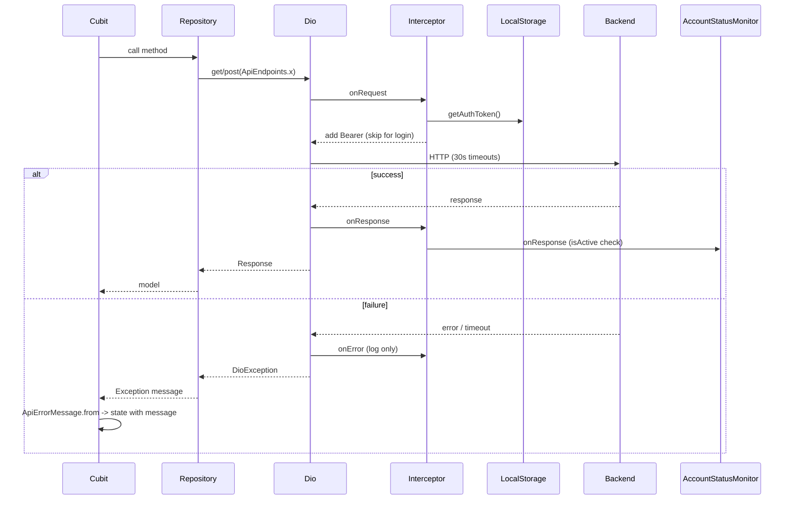

# API Client Core

There is no dedicated `core/network` client class: the only file is `lib/core/network/service_locator.dart`, which builds one `Dio` in `setupDi()` and registers it as a lazy singleton. Repositories receive it via constructor (`XRepository(dio: getIt<Dio>())`). `Dio(` is not constructed anywhere else in `lib/`.

## Configuration
- `BaseOptions.baseUrl = kBaseUrl` (see CONFIGURATION.md).
- `connectTimeout`, `receiveTimeout`, `sendTimeout`: 30 s each.
- Default headers: `Content-Type: application/json`, `Accept: application/json`. Multipart uploads are handled in feature repositories.

## Interceptor (one `InterceptorsWrapper`)
- `onRequest`: if the request path contains `ApiEndpoints.login` -> remove `Authorization`; otherwise read `getIt<LocalStorage>().getAuthToken()` on every request and set `Authorization: Bearer <token>` (remove header when no token). Debug-only logging (`kDebugMode`) prints method, URI, headers and body with the `Authorization` header and any `password` field masked (Map and FormData). Note: the debug `onResponse`/`onError` logs still print full response and error bodies, including tokens and financial data (debug builds only).
- `onResponse`: debug log, then `AccountStatusMonitor.onResponse(response)` (updates account-block state from login / investor-details responses; never throws), then continue.
- `onError`: debug log, then `SessionExpiryHandler.handleDioError` (`lib/core/network/session_expiry_handler.dart`): on a 401 for an authenticated request (not login) whose `Authorization` header equals the current stored token, it calls `LoginCubit.logout()` and pushes `LoginScreen` via `notificationNavigatorKey`, clearing the stack. Concurrent 401s collapse into one logout; stale-token 401s are ignored. Then `handler.next(error)`. No retry, no token refresh (D6).

## Error handling conventions
- Repositories catch `DioException` themselves and throw `Exception(message)` or typed results (e.g. `AuthRepository` uses `response.data['message']`). Some repos switch on `statusCode` (401/403/etc.) for friendly messages.
- `lib/core/utils/api_error_message.dart` -> `ApiErrorMessage.from(error, fallback:)`:
  - `DioException` of connection error / connection, receive, send timeout, or unknown with `SocketException` or network-like text -> `ApiErrorMessage.noInternet` ("No internet connection. Try after some time.").
  - Otherwise uses `response.data['message']` or `['Message']` if present, else the fallback ("Something went wrong. Please try again.").
  - Non-Dio errors: strips `Exception: ` prefix; network-looking text maps to noInternet.
  - `ApiErrorMessage.isNetworkError(DioException)` is public.
- Backend response envelope observed in `LoginResponseModel`: `{status, message, data, code}`.
- Media URLs: `resolveMediaUrl(path)` prefixes `kBaseUrl` for relative paths.

## Request execution flow

## `ApiEndpoints` constants (`lib/core/constants/api_endpoints.dart`, paths only)
Auth / users
- `login` /api/User/Login
- `createAdmin` /api/User/CreateAdmin
- `getAdmins` /api/User/GetAdmins

Investors
- `investorsList` /api/Investor/GetInvestors
- `registerInvestor` /api/Investor/RegisterInvestor
- `updateInvestor` /api/Investor/UpdateInvestor
- `investorTypes` /api/Investor/GetInvestorTypes
- `investorDetails` /api/Investor/InvestorDetails/ (append id)
- `investorTypeCount` /api/Investor/InvestorTypeCount
- `topInvestors` /api/Investor/GetTopInvestors
- `addTopInvestor` /api/Investor/AddTopInvestor
- `removeTopInvestor` /api/Investor/RemoveTopInvestor
- `topInvestorButton` /api/Settings/UpdateTopInvestorsInvestorVisibility
- `investorRatingDetails` /api/Investor/InvestorRatingDetails
- `saveInvestorRating` /api/Investor/SaveInvestorStarRating
- `blockUser` /api/Investor/UpdateInvestorStatus
- `getBlockRequests` /api/Investor/GetBlockRequests
- `reviewBlockRequest` /api/Investor/ReviewBlockRequest
- `refundInvestor` /api/Investor/RefundInvestor
- `saveMOU` /api/Investor/SaveInvestorMOU
- `saveLLP` /api/Investor/SaveInvestorLLP
- `getInvestorsMOU` /api/Investor/GetInvestorMOU/{investorId}
- `getInvestorsLLP` /api/Investor/GetInvestorLLP/{investorId}
- `updateDueDates` /api/Investor/UpdateInvestorInstallmentDueDate

Payments / funding
- `addInvestorPayment` /api/Investor/AddInvestorPayment
- `transactionHistory` /api/Investor/AllInvestorTransactionHistory
- `investorTransactionHistory` /api/Investor/InvestorTransactionHistory/
- `fundingPaymentOverview` /api/Investor/FundingPaymentOverview
- `paymentStatusReport` /api/Investor/PaymentStatusReport
- `getPdfExcel` /api/Investor/InvestorPaymentDetails
- `getPaymentRequests` /api/Investor/GetPaymentRequests
- `acceptOrRejectPaymentRequest` /api/Investor/ReviewPaymentRequest
- `monthlyPaymentList` /api/Investor/PaymentVerificationList
- `paymentVerificationHistory` /api/Investor/PaymentVerificationHistory
- `acceptOrRejectPaymentStatus` /api/Investor/ReviewPaymentVerification
- `getDashboard` /api/Dashboard/GetFundingDashboard

Complaints
- `registerComplaint` /api/Investor/RegisterComplaint
- `getMyComplaints` /api/Investor/GetMyComplaints
- `userComplaints` /api/Investor/GetComplaints
- `viewComplaint` /api/Investor/ViewComplaint
- `solveComplaint` /api/Investor/SolveComplaint

Projects / work progress
- `createProject` /api/Project/CreateProject
- `getProject` /api/Project/GetProjects
- `addStage` /api/Project/AddProjectStage
- `stageList` /api/Project/ProjectStageList
- `addOrUpdatePhase` /api/Project/AddOrUpdateProjectProgress
- `workProgressDetails` and `workPhaseList` (duplicate) /api/Project/WorkProgressDetails
- `workProgressGraph` /api/Project/WorkProgressGraph
- `getWorkUpdates` /api/Project/GetWorkUpdates
- `workUpdate` /api/Project/AddWorkUpdate
- `deleteWorkUpdate` /api/Project/DeleteWorkUpdate/
- `addWorkStatus` /api/Project/AddWorkStatus
- `getWorkStatus` /api/Project/GetWorkStatus
- `deleteWorkStatus` /api/Project/DeleteWorkStatus/
- `getBanners` and `getBanner` (duplicate) /api/Project/GetBanners
- `addBanner` /api/Project/AddBanner
- `deleteBanner` /api/Project/DeleteBanner

Notifications
- `registerDevice` /api/Notification/RegisterDevice
- `getMyNotifications` /api/Notification/GetMyNotifications
- `getUnreadCount` /api/Notification/GetUnreadCount
- `markAsRead` /api/Notification/MarkAsRead/
- `markAllAsRead` /api/Notification/MarkAllAsRead

Staff
- `staffList` /api/Staff/GetStaffList
- `createStaff` /api/Staff/CreateStaff
- `getInvestorByStaff` /api/Staff/GetInvestorsByStaff/{staffId}
- `getStaffReport` /api/Staff/GetStaffReport
- `getStaffReportByID` /api/Staff/GetStaffReportDetails/{staffId}

Constants containing `{staffId}` / `{investorId}` placeholders are presumably replaced by callers with string replacement; not verified here. Per-endpoint request/response models: see feature docs.
