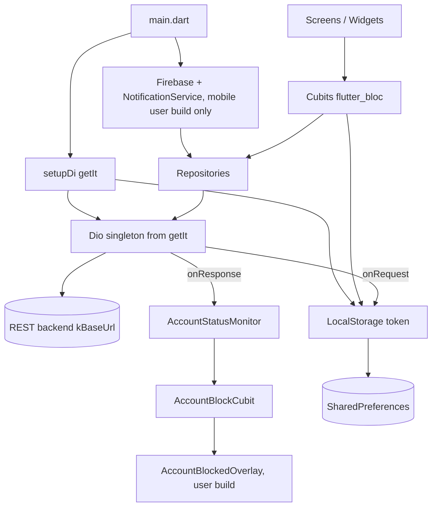
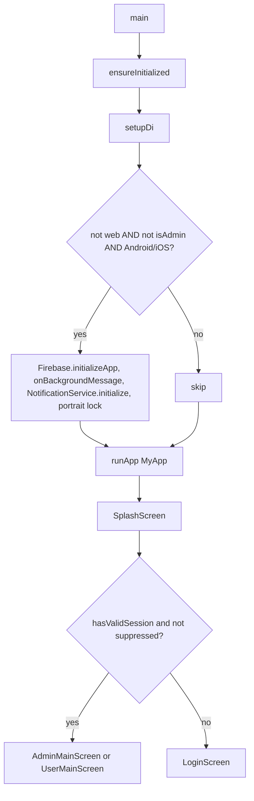

# Architecture

## Pattern
Feature-first folders with a layered **Cubit (flutter_bloc) -> Repository -> Dio** structure, wired with **get_it**. Per feature the usual layout is `cubit/` (Cubit + State), `repository/`, `model/`, `screens|widgets/`. There are no named routes: navigation is imperative `Navigator` + `MaterialPageRoute` (see NAVIGATION.md).

## Directory structure (`lib/`)
```
main.dart                 entry, isAdmin flag, MyApp, FCM background handler
firebase_options.dart     generated FlutterFire options
admin/                    admin product
  dashboard/ investors/ funding&payments/ work_progress/ reports/ (incl. staff_report/)
  monthly_payment_list/ pending_requests/ settings/ user_management/ (manage_users, due_payments)
  navigation/             AdminMainScreen, AdminSideDrawer, AdminNavPermissions
user/                     investor product
  home/ investments/ status/ updates/ profile/
  navigation/             UserMainScreen, UserBottomNav, TabReselectNotifier
auth/                     SplashScreen, LoginScreen, AdminWebLoginScreen, LoginCubit, AuthRepository, models
core/
  account/                AccountBlockCubit, AccountStatusMonitor, AuthNavigationGuard, overlay, route observer
  constants/              api_endpoints.dart, app_colors.dart, image_constants.dart, lottie_constants.dart
  network/service_locator.dart   get_it setup + Dio + kBaseUrl
  notifications/notification_service.dart
  storage/local_storage.dart
  utils/                  shared widgets/helpers (toasts, dialogs, api_error_message, media_url, currency_formatter ...)
```

## Layers
1. **UI**: screens/widgets, `sizer` units, `BlocBuilder`/`BlocConsumer`.
2. **Logic**: Cubits (list in STATE_MANAGEMENT.md).
3. **Data**: `*Repository` classes taking a shared `Dio`; models parse JSON in `fromJson`.
4. **Core services**: `LocalStorage`, `NotificationService`, `AccountStatusMonitor`.

## Dependency injection (`lib/core/network/service_locator.dart`)
- `final GetIt getIt = GetIt.instance;` `setupDi()` is awaited in `main()`.
- Singletons: `LocalStorage` (async `LocalStorage.init()`), `AccountBlockCubit`.
- Lazy singletons: `String` named `'baseUrl'`, one shared `Dio`, repositories (`AuthRepository`, `InvestorsRepository`, `InvestorPaymentRepository`, `ProfileRepository`, `HomeRepository`, `InvestmentsRepository`, `UpdatesRepository`, `AddPhaseRepository`, `DashboardRepository`, `StatusRepository`, `NotificationsRepository`), and `NotificationService` (**registered only on Android/iOS**).
- Factories: `LoginCubit`, `DashboardCubit`, `InvestorsCubit`, `FundingPaymentsCubit`, `HomeCubit`, `ProfileCubit`, `InvestmentsCubit`, `UpdatesCubit`, `StatusCubit`, `NotificationsCubit`.
- Other cubits (e.g. `PaymentListCubit`, `PendingRequestsCubit`, report/settings/work-progress cubits) are **not** registered in get_it. `Dio(` is constructed only in `service_locator.dart`, so their repositories presumably receive `getIt<Dio>()` from screens. Unclear - needs human clarification.
- `FundingPaymentsCubit` factory builds `ProjectRepository(dio: getIt<Dio>())` inline.
- `main.dart` exposes via `RepositoryProvider.value`: `AuthRepository`, `InvestorsRepository`, `InvestorPaymentRepository`, `HomeRepository`, `ProfileRepository`, `AddPhaseRepository`, `DashboardRepository`; and via `BlocProvider`: `LoginCubit`, `DashboardCubit`, and (user build only) `AccountBlockCubit`.

## App initialisation flow (`main()`)
1. `WidgetsFlutterBinding.ensureInitialized()`
2. `await setupDi()` (SharedPreferences, Dio, repositories, cubits)
3. If not web, `isAdmin == false`, and platform is Android/iOS: `Firebase.initializeApp(DefaultFirebaseOptions.currentPlatform)`, register `firebaseMessagingBackgroundHandler` (top-level `@pragma('vm:entry-point')`), `getIt<NotificationService>().initialize()`, lock orientation to `portraitUp`.
4. `runApp(MyApp)`: `MultiRepositoryProvider` -> `MultiBlocProvider` -> `Sizer` -> `ToastificationWrapper` -> `MaterialApp` (Material 3, seed `AppColors.accent`, font `Montserrat`).
5. `home: SplashScreen(homeAfterLogin: AdminMainScreen | UserMainScreen)`.
6. Splash animation (GIF `ImageConstants.splashGif` + text) finishes, waits 1 s, then `pushReplacement` to the shell (valid session) or `LoginScreen`.

Old commented-out versions of `main()` and DI registrations remain in source (dead code).

## Lifecycle notes
- No `WidgetsBindingObserver` / `didChangeAppLifecycleState` usage found.
- The user shell runs a 5 s `Timer.periodic` (`UserMainScreen`) calling `AccountStatusMonitor.refresh()`.
- The admin shell keeps all drawer screens alive in an `IndexedStack` and passes `isActive` so screens can refetch when selected.

## Mermaid: overall architecture


## Mermaid: init flow

