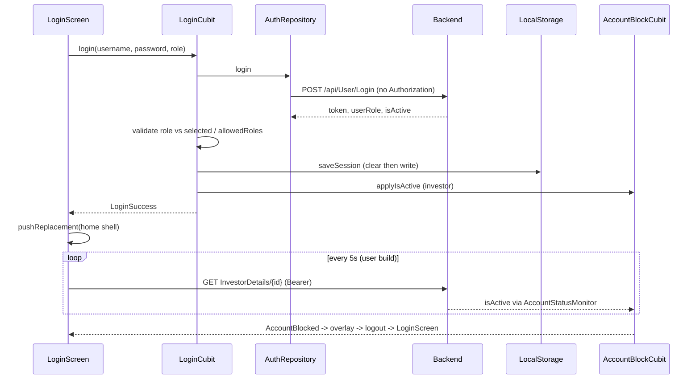

# Authentication

Files: `lib/auth/**`, `lib/core/storage/local_storage.dart`, `lib/core/account/**`, `lib/admin/navigation/admin_nav_permissions.dart`, Dio interceptor in `lib/core/network/service_locator.dart`.

## Login
- Endpoint: `ApiEndpoints.login` = `/api/User/Login`, POST JSON from `LoginRequestModel(username, password, userRole)` through `AuthRepository.login`.
- Response: `LoginResponseModel{status, message, data, code}`; `LoginDataModel{userId, username, fullName, email, phoneNumber, investorCode, profileImage, userRole, token, isActive}`.
- `AuthRepository` converts `DioException` into `Exception(message)`.
- `LoginCubit.login(username, password, userRole, requiredRole, allowedRoles)`:
  1. clears `AuthNavigationGuard.suppressAuthenticatedNavigation` and `holdBlockedOverlay`;
  2. emits `LoginLoading`; calls repository;
  3. fails if `status == false` or no data;
  4. if a role was selected, its normalised value must equal the returned `userRole` (else "not registered as the selected role");
  5. if `allowedRoles` given (admin web), returned role must be in it; else if `requiredRole` given (mobile: `Investor`) it must match case-insensitively;
  6. `LocalStorage.saveSession(...)` (clears previous session first);
  7. for investors: `AccountBlockCubit.applyIsActive(data.isActive)` and `NotificationService.registerDeviceToken()` (service is `null` on non-mobile platforms);
  8. emits `LoginSuccess`.
- UI: mobile `LoginScreen` (investor), `AdminWebLoginScreen` (width >= 900, role dropdown Admin / Super Admin / Financial Manager / Marketing Manager mapped by `AdminNavPermissions.apiRoleForWebLoginLabel` to API values `Admin`, `SuperAdmin`, `FinancialManager`, `MarketingManager`).

## Token storage and use
- Bearer token stored under key `auth_token`: `flutter_secure_storage` on mobile/desktop, SharedPreferences on web (plus a `refresh_token` key that login never writes; no refresh flow). See LOCAL_STORAGE.md and SECURITY.md.
- Dio request interceptor reads `LocalStorage.getAuthToken()` on every request and sets `Authorization: Bearer <token>`, except for the login path where the header is removed.

## Session persistence
`LocalStorage.hasValidSession()` = non-empty token AND `is_logged_in == true`. `SplashScreen` uses it on every launch to skip login.

## Logout
`LoginCubit.logout()`: set `suppressAuthenticatedNavigation = true` before the first await, `LocalStorage.clearSession()`, `AccountBlockCubit.reset()`, emit `LoginInitial`. Callers navigate to login themselves:
- Admin: `AdminMainScreen._onLogout` (confirm dialog -> logout -> `pushAndRemoveUntil` to `LoginScreen`).
- User: `UserProfileScreen` (calls `LoginCubit.logout()`; navigation handled there - see feature docs).
- Forced: `AccountBlockedOverlay` (see below).
No server-side logout/invalidate call was found.

## Roles and permissions (`AdminNavPermissions`)
Roles: `Admin`, `SuperAdmin`, `FinancialManager`, `MarketingManager`; investors use role string `Investor` (compared lowercase). `normalizeRole` lowercases and strips whitespace.
| Role | Allowed drawer items | Default item |
|---|---|---|
| MarketingManager | pendingRequests only | pendingRequests |
| FinancialManager | monthlyList only | monthlyList |
| Admin / SuperAdmin / other | all except pendingRequests (includes monthlyList) | dashboard |
Comment in source: "Local until backend permissions arrive" - permissions are client-side only; backend enforcement is not implemented yet; server-side role checks are planned by the backend team (security finding H2, decision D2 in DECISIONS.md). Logout is always available.

## Unauthorized (401/403) handling
A global 401 handler (`SessionExpiryHandler`, called from the Dio `onError`) logs the user out and returns to `LoginScreen` when an authenticated request carrying the current token gets 401 (see API_CLIENT_CORE.md). There is no token refresh. Per-repository 401/403 message mapping (e.g. `monthly_payment_list_repository.dart`, `due_payments_repository.dart`) still exists.

## Account block monitoring (investor, user build)
- `isActive == false` marks the investor blocked. Sources: login response, any Dio response for `ApiEndpoints.login` or `ApiEndpoints.investorDetails` (`AccountStatusMonitor.onResponse`, only when payload has `isActive`/`IsActive` and is an investor account), and polling.
- Polling: `UserMainScreen` timer every 5 s and on tab change calls `AccountStatusMonitor.refresh()` -> `ProfileRepository.getInvestorDetails(userId)` (skipped if not investor, no session, already blocked, or logout in progress).
- `AccountBlockCubit.applyIsActive` ignores updates once the session is cleared.
- `AccountBlockedOverlay` (`lib/core/account/account_blocked_overlay.dart`) covers the app; its logout sets `holdBlockedOverlay = true`, calls `LoginCubit.logout()`, navigates through `notificationNavigatorKey` to login, and clears the hold when the observer reports an auth route.
- Admin build does not use any of this.

## Mermaid

