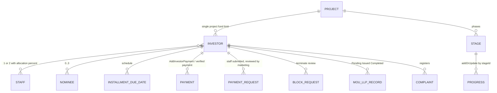

# Data Models

Important Dart models grouped by module. Endpoints that use each model: [API_INTEGRATION.md](API_INTEGRATION.md). Per-module field detail: `docs/modules/*.md`. State classes (cubit states) are in [STATE_MANAGEMENT.md](STATE_MANAGEMENT.md).

## 1. Serialization approach (verified)

- **Hand-written only.** `pubspec.yaml` has no `json_serializable`, `freezed`, `json_annotation`, `equatable` or `build_runner`, and `lib/` contains no `*.g.dart` / `*.freezed.dart`. Models are plain classes with `final` fields.
- **Response models:** `factory X.fromJson(Map<String, dynamic>)` (143 factory constructors across 114 files). Typical envelope:
  ```dart
  LoginResponseModel(status: json['status'] ?? false, message: json['message'] ?? '',
      data: json['data'] != null ? LoginDataModel.fromJson(json['data']) : null, code: json['code'] ?? 0)
  ```
  Defaults (`?? 0`, `?? ''`, `?? false`) are used instead of throwing on missing keys.
- **Request models:** `toJson()` for JSON bodies (e.g. `LoginRequestModel`, `AddOrUpdatePhaseRequestModel`, `AddInvestorPaymentRequestModel`, `UpdateDueDatesRequestModel`, `RegisterDeviceRequestModel`) or `toFormData()` returning Dio `FormData` for multipart (`RegisterInvestorRequestModel`, `UpdateInvestorRequestModel`, `ProjectRequestModel`, `SaveInvestorMOURequestModel`). Some repositories build `FormData.fromMap` inline (work update, work status, banner).
- **JSON key conventions:** camelCase is the base (`userId`, `fullName`, `totalPaidAmount`, `isActive`). Many admin/user models are **tolerant of PascalCase** alternates (e.g. `NotificationId`/`notificationId`, `Title`/`title`) and multiple fallback keys (e.g. `PdfExcelInvestorModel` tries several amount keys; `MonthlyPaymentTransactionModel.paymentStatus` falls back to `VerificationStatus`). Multipart field names are mixed case (`Title`, `Description`, `File`, `Image`, `Document`, `ProjectId`, `Name`, `StaffId`, `StaffId2`).
- **Dates:** parsed leniently to `DateTime?`; outgoing dates are UTC ISO-8601 (`toUtc().toIso8601String()`) for phase/due-date/export requests and `yyyy-MM-dd` strings for query parameters.
- **Media paths:** server paths (`profileImage`, `bannerImage`, ...) are resolved to full URLs with `resolveMediaUrl` (`lib/core/utils/media_url.dart`, also a copy in `service_locator.dart`); models expose `*Url` getters.
- **Envelope variants:** `status` + `code` (most), `success` (create staff). Some lists are in `data`, others nested (`data.investors|items|list`).
- **Numbers:** `(json['x'] ?? 0).toDouble()` pattern for amounts.
- **Enums** (UI/domain, not generated): `PendingRequestStatus`, `PendingRequestsListFilter`, `UserPaymentStatus`, `ManageUsersStatusFilter`, `DuePaymentsStatusFilter`, `DocumentProcessStatus`, `WorkProgressStageStatus`, `StaffReportPeriod`, `AdminDrawerItem`, `PaymentStatus`/`PaymentReviewIntent` (monthly list), `VerificationHistoryStatus`.

Request vs response legend below: **Req** = built by the app and sent; **Resp** = parsed from server; **UI** = view model derived client-side.

## 2. Auth (`lib/auth/model`)

| Model | Kind | Key fields |
|---|---|---|
| `LoginRequestModel` | Req (`toJson`) | `username`, `password`, `userRole?` (omitted when null) |
| `LoginResponseModel` | Resp | `status`, `message`, `data: LoginDataModel?`, `code` |
| `LoginDataModel` | Resp | `userId`, `username`, `fullName`, `email`, `phoneNumber?`, `investorCode?`, `profileImage?`, `userRole`, `token`, `refreshToken?`, `isActive`. `phoneNumber` is parsed but not saved to storage (Unclear - needs human clarification). |

## 3. Admin

### Dashboard (`A/dashboard/model`)
`DashboardModel` (Resp: `projectFund`, `totalInvestmentAmount`, `totalReceivedAmount`, `totalPendingAmount`, `totalInvestors`, `fundingProgress`); `TopInvestorsModel`; `TransactionHistoryModel` (`all_transaction_history_model.dart`); `WorkUpdateModel` (`recent_updates_model.dart`). Work phases use `WorkPhaseListModel` from work_progress. `fundingProgress` scale (fraction vs percent) is Unclear - needs human clarification.

### Funding & Payments (`A/funding&payments/model`)
| Model | Kind | Key fields |
|---|---|---|
| `AddInvestorPaymentRequestModel` | Req | `userId`, `paidAmount`, `narration`, `paymentMethod`, `isFullSettlement`, `discountAmount`, `remarks`, `medicalAllowance` (String amount), `extraAmount`, `days` |
| `AddInvestorPaymentResponseModel` / `InvestorPaymentDataModel` | Resp | `status`, `message`, `code`; data: `userId`, `investorCode`, `fullName`, `totalInvestmentAmount`, `totalPaidAmount`, `remainingAmount`, `paidAmount`, `entryNo` |
| `FundingInvestorsResponseModel` / `FundingInvestorModel` | Resp | identity, `investorCode`, `investorType`, `isActive`, `totalInvestmentAmount`, `totalPaidAmount`, `totalPendingAmount`, `latestPaymentAmount`, `status` |
| `InvestorDetailsResponseModel` / `InvestorDetailsModel` | Resp | identity, KYC, bank, investment plan (`investmentAmount`, `investmentSplitMonths/Gap/Type`, `investmentAdvanceAmount`), totals, `nominees[]`, due dates |
| `UpdateDueDatesRequestModel` / `...ResponseModel` | Req / Resp | `investorId`, `installmentNumber`, `dueDate` |
| `InvestorTransactionHistoryResponseModel` / `InvestorTransactionHistoryModel` | Resp | all-investor payment history (see module doc Unclear about duplication with the user-side model) |

### Investors (`A/investors/model`)
`InvestorModel` (+ `InvestorResponseModel`, totals `InvestorTotalsModel`), `InvestorTypeModel`, `StaffModel`/`InvestorStaffModel`, `InvestorStaffAllocation`, `InvestorStaffAssignmentPayload` (`toFormFields`: `StaffId`, `StaffId2`, `StaffAllocationPercentage`, `Staff2AllocationPercentage`), nominee types `InvestorNomineeEntry` (form), `InvestorNomineeRecord` (server), `InvestorNomineeSubmitData` (request). `RegisterInvestorRequestModel` (Req, multipart; fields include username, password, fullName, email, phoneNumber, alternativeNumber, investorType, staffId/staffId2 and percentages, organization, address, investmentAmount/Date/SplitMonths/SplitType/SplitGap/AdvanceAmount, paymentMethod, aadhaar/PAN/bank fields, dateOfBirth, nominees[]); `UpdateInvestorRequestModel` (Req); `RegisterInvestorResponseModel`/`UpdateInvestorResponseModel` (Resp).
Relationships: Investor 1..2 staff (with % allocation), 0..3 nominees; investment plan is a flat set of fields; the installment schedule shown in the form is computed client-side (UI).

### Pending Requests (`A/pending_requests/model`)
`PaymentRequestResponseModel` -> `PaymentRequestDataModel` -> `PaymentRequestModel` (Resp; includes `isFullSettlement`, `discountAmount`, `medicalAllowance`, `remarks`, `entryNo`); `PendingRequestModel` (UI, with `PendingRequestStatus`, `PendingRequestNominee`, `PendingRequestsOverviewStats`); `AcceptOrRejectPaymentRequestModel` (Req: `requestId`, `status`, `remarks`) and its response/data models.

### Monthly Payment List (`A/monthly_payment_list/model`)
`MonthlyPaymentListResponseModel` -> `MonthlyPaymentListDataModel` (`totalPayments`, `totalAmount`, `transactions[]`) -> `MonthlyPaymentTransactionModel` (transactionId, investorId, userId, investorName, investorCode, mobileNumber, staffName, paymentMethod, paidAmount, paymentDate, entryNo, receiptNumber, paymentStatus, verificationRemarks, verifiedByName, verifiedDate). `PaymentVerificationHistoryResponseModel` / `PaymentVerificationHistoryTransactionModel`. `ReviewPaymentVerificationRequestModel` (Req: `transactionId`, `status`, `remarks`) and response. All fromJson-only for responses.

### Reports (`A/reports/model`, `A/reports/staff_report/model`)
`FundingPaymentOverviewModel` (chart series), `InvestorTypeCountModel`, `StaffReportResponseModel`/`StaffReportModel`, `StaffReportDetailsResponseModel`/`StaffReportDetailsModel`, `StaffInvestorAmountModel`, `StaffReportRowModel` (UI). Meaning of `staffAllocatedAmount`, `refundAmount`, `netAmount` is Unclear - needs human clarification.

### Settings (`A/settings/screens/*/model`)
- Project: `ProjectRequestModel` (Req, multipart: `projectId`, `name`, `description`, `totalFund`, `image`, `signatureImage`), `ProjectResponseModel`, `ProjectListResponseModel`, `ProjectModel` (`projectId`, `name`, `description`, `totalFund`, `status`(int), `image`, `projectSignaturePath`, audit fields). Source file is named `projcet_model.dart`.
- Staff: `CreateStaffRequestModel` (`fullName`, `designation`, `email`, `phoneNumber`, `role`), `CreateStaffResponseModel` (uses `success`), `GetStaffResponseModel`, `GetInvestorsByStaffResponseModel`.
- Admin: `CreateAdminModel` (Req: username, password, fullName, email, phoneNumber, alternativeNumber, userRole), `AdminsResponseModel`.
- Complaints: `ComplaintUiModel` (UI), `ViewComplaintModel`, `SolveComplaintModel`, `UserComplaintModel`.
- Rating: `InvestorRatingDetailsResponse`, `InvestorRatingUpdateResponseModel`, `AddTopInvestorResponseModel`, `RemoveTopInvestorResponseModel` (`removedInvestorIds`, `notFoundInvestorIds`), `TopInvestorsResponse`, `TopInvestorButtonResponseModel`.
- `AdminStaffPermissionModel` + `dummyAdminStaff` (local seed data, no API).

### User Management (`A/user_management/...`)
`ManagedUserModel` (UI; `outstandingBalance`, `UserPaymentStatus`, `isBlocked = !isActive`), `ManageUsersResponse`/`ManageUsersInvestor`, `BlockUserRequestModel`/`BlockUserResponseModel`, `InvestorBlockRequestsResponse`/`InvestorBlockRequestModel` (`requestId`, `userId`, `status`, `remarks`, `requestedDate`, reviewer fields), `ReviewBlockRequestModel`, `RefundInvestorRequestModel`, `SaveInvestorMOURequestModel` (Req multipart `investorId`, `status`, `Document`) and `SaveInvestorMOUResponseModel`/`SaveInvestorMOUDataModel` (also used for LLP), `PdfExcelResponseModel`/`PdfExcelInvestorModel` (tolerant multi-key), `PaymentStatusReportResponseModel`/`PaymentStatusReportModel`.

### Work Progress (`A/work_progress/...`)
`AddPhaseModel` (`stageId`, `stageName`), `AddOrUpdatePhaseRequestModel` (Req: `stageId`, `startDate`, `dueDate?`, `constructionTeam`, `progress`, `status`, `description`), `AddOrUpdatePhaseResponseModel`, `WorkPhaseListModel` (stage timeline), `add_update_models.dart`; media: `AddWorkUpdateModel`, `GetWorkUpdatesModel`, `DeleteWorkUpdateModel`, `AddWorkStatusResponseModel`/`GetWorkStatusResponseModel`/`DeleteWorkStatusModel`, banners `AddBannerModel` (`bannerId`, `bannerImage`), `BannerModel`, `DeleteBannerModel`.

## 4. User (investor) (`lib/user/*/model`)

| Module | Models |
|---|---|
| Home | `HomeProfileModel` (UI from `InvestorDetailsModel`), `BannersResponseModel`/`BannerItemModel`, `TopInvestorsResponseModel`/`TopInvestorModel`, `WorkProgressDetailsResponseModel`/`WorkProgressItemModel`, `NotificationsResponseModel`/`AppNotificationModel` (`notificationId`, `title`, `message`, `type`, `relatedId`, `isRead`, `createdDate`, `readDate`; PascalCase tolerant), `RegisterDeviceRequestModel` (Req `deviceToken`, `platform`), `UnreadCountResponseModel`, `MarkAsReadResponseModel` |
| Investments | `InvestorTransactionHistoryResponseModel` -> `InvestorTransactionHistoryDataModel` -> `InvestorTransactionItemModel`; `ProjectStageModel`; `WorkProgressGraphResponseModel`/`WorkProgressGraphPointModel` |
| Profile | `InvestorDetailsResponseModel`/`InvestorDetailsModel` (identity, KYC, bank, plan, totals, `staffAllocations: List<StaffAllocationModel>`, `nominees: List<InvestorNomineeModel>`, `dueDates: List<InvestmentDueDateModel>`, `medicalAllowance` String, `isActive`, `userRole`), `InvestorMouResponseModel`/`InvestorLlpResponseModel`, `RegisterComplaintResponseModel` (request body is `{ "complaint": text }`), `MyComplaintsResponseModel`/`MyComplaintModel` |
| Status | `WorkStatusResponseModel`, `WorkStatusModel` (`status` bool and `googleDriveFileId` purpose Unclear) |
| Updates | `WorkUpdatesResponseModel`, `WorkUpdateModel` (`status` meaning Unclear) |

Admin and user sides each define their own work update/status models; the investor transaction history model is defined in `user/investments/model` and reused by admin Manage Users.

## 5. Cross-module relationships



Relationships come from request fields and module docs (for example the MOU/LLP status ranks, `userId` vs `investorId` fields). Exact backend cardinalities are not verifiable from the client: Unclear - needs human clarification. Note that `investorId` and `userId` are both used for the same person in different endpoints (`SaveInvestorStarRating` sends `investorId = userId`).
