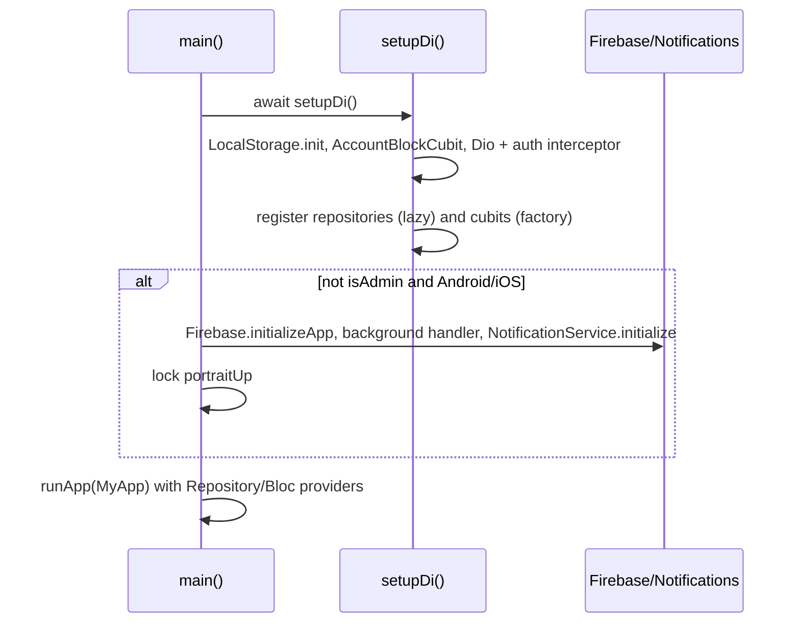
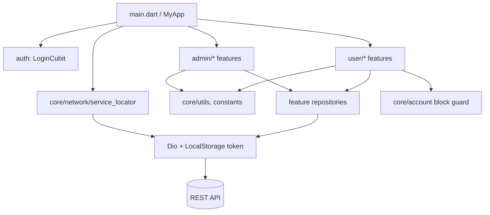

# Diagrams Index

| Diagram | Location |
|---|---|
| Architecture (layers, 2 diagrams) | [ARCHITECTURE.md](ARCHITECTURE.md) |
| App initialization | below |
| Authentication sequence | [AUTHENTICATION.md](AUTHENTICATION.md), [modules/AUTH_AND_ACCOUNT.md](modules/AUTH_AND_ACCOUNT.md) |
| State flow | [STATE_MANAGEMENT.md](STATE_MANAGEMENT.md) |
| API request sequence | [API_CLIENT_CORE.md](API_CLIENT_CORE.md) |
| Navigation map | [NAVIGATION.md](NAVIGATION.md), [ADMIN_NAVIGATION](modules/ADMIN_NAVIGATION.md), [USER_NAVIGATION](modules/USER_NAVIGATION.md) |
| Module dependency | below |
| Business workflows | per module in `docs/modules/*.md` (all 17 module docs contain at least one diagram) |

## App initialization

## Module dependency

