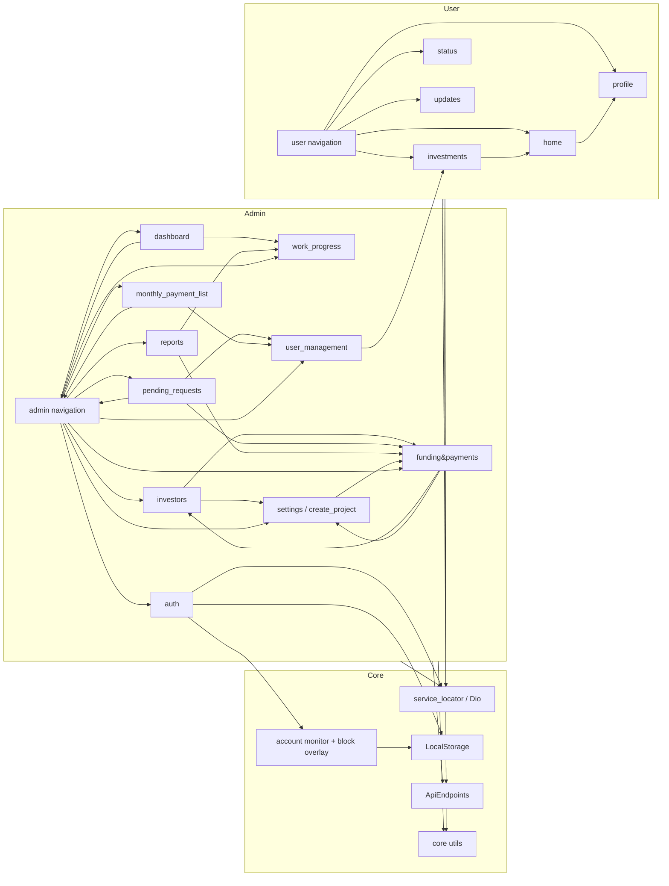
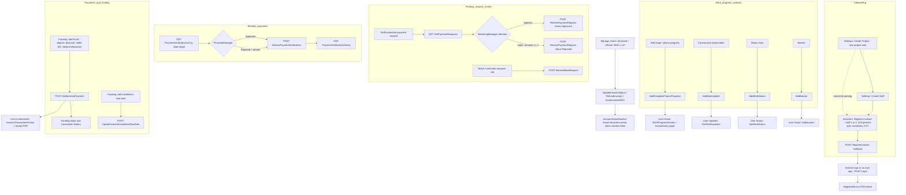

# Feature Modules

Complete feature inventory of the Maribel Wellness Centre Flutter app. Source of truth is `lib/**`; per-module detail lives in `docs/modules/*.md`. Related: [ARCHITECTURE.md](ARCHITECTURE.md), [STATE_MANAGEMENT.md](STATE_MANAGEMENT.md), [NAVIGATION.md](NAVIGATION.md), [API_INTEGRATION.md](API_INTEGRATION.md), [DATA_MODELS.md](DATA_MODELS.md), [CODEBASE_MAP.md](CODEBASE_MAP.md).

## 1. How the app is split

- One codebase, two interfaces selected at compile time by `const bool isAdmin` in `lib/main.dart` (`true` = admin web/desktop shell, `false` = investor/user mobile app). Role at login is additionally checked by `LoginCubit`; see [AUTHENTICATION.md](AUTHENTICATION.md).
- Every feature follows `cubit/ + repository/ + model/ + screens|widgets` (see [ARCHITECTURE.md](ARCHITECTURE.md)). Repositories take the shared `Dio` from `get_it`; there is no router, navigation is `IndexedStack` + in-place sub-screens ([NAVIGATION.md](NAVIGATION.md)).
- Admin role access (`AdminNavPermissions`, client-side only): `Admin`/`SuperAdmin` see all drawer items except Pending Requests; `MarketingManager` sees only Pending Requests; `FinancialManager` sees only Monthly List.

## 2. Admin modules (`lib/admin/*`)

### 2.1 Dashboard (`lib/admin/dashboard`)
- **Responsibility:** landing tab: funding summary for a date range, funding ring, work progress per phase, top-rated investors, recent payments, recent work updates, quick actions.
- **Screens/widgets:** `AdminDashboardScreen`; `dashboard_overview`, `dashboard_details_section`, `dashboard_activity_section`, `dashboard_shimmer`.
- **Business logic:** default range month start..today, invalid range rejected; only the summary reacts to the range; offline message applied to all sections. Hidden from Marketing/Financial roles.
- **Cubit/Repository:** `DashboardCubit` / `DashboardRepository` (4 calls) + `AddPhaseRepository.workPhaseList`.
- **API:** `GetFundingDashboard`, `GetTopInvestors`, `AllInvestorTransactionHistory`, `GetWorkUpdates`, `WorkProgressDetails`.
- **Depends on:** work_progress, navigation, core. **Doc:** [modules/ADMIN_DASHBOARD.md](modules/ADMIN_DASHBOARD.md).

### 2.2 Funding & Payments (`lib/admin/funding&payments`)
- **Responsibility:** funding totals + per-investor table; record a payment (deposit, discount, full settlement, medical allowance); investor detail with installment schedule; edit due dates; fund-limit warning.
- **Screens:** `funding_payments_screen`, `add_fund/add_new_fund` (+ form card, side panel), `transaction_details/transaction_detail_screen` (+ profile and payment history sections), `FundingLimitWarningDialog`.
- **Business logic:** outstanding = pending or (investment - paid); paid + discount must not exceed outstanding; "Settle Full" requires paid + discount == outstanding.
- **Cubit/Repository:** `FundingPaymentsCubit` / `InvestorPaymentRepository` (also uses `InvestorsRepository`, `ProjectRepository`).
- **API:** `AddInvestorPayment`, `GetInvestors`, `AllInvestorTransactionHistory`, `InvestorDetails/{userId}`, `UpdateInvestorInstallmentDueDate`, `GetProjects`.
- **Depends on:** investors (`InvestorsRepository`, `InvestorModel`), settings/create_project (`ProjectRepository`). **Doc:** [modules/ADMIN_FUNDING_PAYMENTS.md](modules/ADMIN_FUNDING_PAYMENTS.md).

### 2.3 Investors (`lib/admin/investors`)
- **Responsibility:** list investors; register/edit investor (credentials, investment + installment plan, up to 2 staff with % split, KYC, bank, up to 3 nominees, photos).
- **Screens:** `investors_screen` (+ overview, table sections), `add_new_investor` (+ form cards, additional info, side panel).
- **Business logic:** staff allocation sums to 100 (default 70/30 when second staff added); installment preview computed client-side; Admin/SuperAdmin only.
- **Cubit/Repository:** `InvestorsCubit` / `InvestorsRepository`.
- **API:** `GetInvestors`, `GetStaffList`, `GetInvestorTypes`, `RegisterInvestor` (multipart), `UpdateInvestor` (multipart).
- **Depends on:** settings/create_project, funding&payments (warning dialog). **Doc:** [modules/ADMIN_INVESTORS.md](modules/ADMIN_INVESTORS.md).

### 2.4 Monthly Payment List (`lib/admin/monthly_payment_list`)
- **Responsibility:** payments received in a date range; approve/reject each pending payment (rejection remark >= 3 chars), batch "Approve All" (sequential), verification history.
- **Screens:** `monthly_payments_list_screen`, `payment_verification_history_screen`, widgets (overview, table, reject dialog).
- **Cubit/Repository:** `PaymentListCubit` / `MonthlyPaymentListRepository`. Role gate `canAccessMonthlyList`.
- **API:** `PaymentVerificationList`, `PaymentVerificationHistory`, `ReviewPaymentVerification`.
- **Depends on:** navigation, user_management shared table widget. **Doc:** [modules/ADMIN_MONTHLY_PAYMENT_LIST.md](modules/ADMIN_MONTHLY_PAYMENT_LIST.md).

### 2.5 Navigation (`lib/admin/navigation`)
- **Responsibility:** admin shell (drawer + `IndexedStack`), role-based drawer filtering.
- **Files:** `admin_main_screen.dart`, `admin_side_drawer.dart`, `admin_nav_permissions.dart`; layout helpers in `lib/core/utils/admin_main_screen_layout.dart`.
- **Business logic:** `AdminNavPermissions.allowedDrawerItems/defaultDrawerItem/canOpen`; logout -> `LoginCubit.logout()` -> login screen. Permissions are client-side ("until backend permissions arrive").
- **Depends on:** every admin screen, auth. **Doc:** [modules/ADMIN_NAVIGATION.md](modules/ADMIN_NAVIGATION.md).

### 2.6 Pending Requests (`lib/admin/pending_requests`)
- **Responsibility:** Marketing Manager queue of staff-submitted payment requests (approve; reject with remarks), request detail with KYC/bank/nominees, and a "Terminated Investor" tab for investor block requests.
- **Screens:** `pending_requests_screen` (+ overview, list, card, terminated section), `review_request_screen` (+ header, details, KYC preview dialog, reject dialog).
- **Business logic:** 1-minute silent refresh while active; only Pending rows show decisions; reject remark >= 3 chars.
- **Cubit/Repository:** `PendingRequestsCubit` / `PaymentRequestRepository`; block requests via `ManageUsersCubit` / `ManageUsersRepository`; detail via `InvestorPaymentRepository.getInvestorDetails`.
- **API:** `GetPaymentRequests`, `ReviewPaymentRequest`, `GetBlockRequests`, `ReviewBlockRequest`, `InvestorDetails/{userId}`.
- **Depends on:** funding&payments, user_management, navigation. **Doc:** [modules/ADMIN_PENDING_REQUESTS.md](modules/ADMIN_PENDING_REQUESTS.md).

### 2.7 Reports (`lib/admin/reports`, incl. `staff_report`)
- **Responsibility:** funding/payment overview chart by date range, work-progress report, investor-type counts, recent transactions; staff report (ThisMonth/LastMonth/Custom, search) and per-staff details.
- **Screens:** `reports_screen` (+ overview cards, details section with custom painter chart, recent transactions table), `staff_report_screen`, `staff_details_screen` (+ table/investor sections).
- **Cubit/Repository:** `ReportCubit` / `ReportRepository` (+ `AddPhaseRepository`, `InvestorPaymentRepository`); `StaffReportCubit` / `StaffReportRepository`.
- **API:** `FundingPaymentOverview` (POST), `InvestorTypeCount`, `GetStaffReport`, `GetStaffReportDetails/{staffId}`, `WorkProgressDetails`, `AllInvestorTransactionHistory`.
- **Doc:** [modules/ADMIN_REPORTS.md](modules/ADMIN_REPORTS.md).

### 2.8 Settings (`lib/admin/settings`)
- **Responsibility:** hub of six in-place sub-screens: Create Project (single project only; image + signature; fund-limit dialog), Staff & Allocation, Create Admin, User Complaints, Investor Rating / Top Rated (max 5, dashboard visibility toggle), and a hidden local-only staff-permissions screen.
- **Cubits/Repositories:** `CreateProjectCubit`/`ProjectRepository`, `StaffAllocationCubit`/`StaffRepository`, `CreateAdminCubit`/`CreateAdminRepository`, `UserComplaintsCubit`/`UserComplaintsRepository`, `InvestorRatingCubit`/`InvestorRatingRepository`.
- **API:** `CreateProject`, `GetProjects`, `CreateStaff`, `GetStaffList`, `GetInvestorsByStaff/{staffId}`, `CreateAdmin`, `GetAdmins`, `GetComplaints`, `ViewComplaint`, `SolveComplaint`, `InvestorRatingDetails`, `SaveInvestorStarRating`, `AddTopInvestor`, `RemoveTopInvestor`, `GetTopInvestors`, `UpdateTopInvestorsInvestorVisibility`.
- **Depends on:** funding&payments (limit dialog), investors. **Doc:** [modules/ADMIN_SETTINGS.md](modules/ADMIN_SETTINGS.md).

### 2.9 User Management (`lib/admin/user_management`)
- **Responsibility:** Manage Users (list, terminate with remarks >= 10 chars, detail: benefits summary, refund, MOU/LLP status + document upload, receipts, export PDF/CSV) and Due Payments (status report, details dialog, WhatsApp reminder via `wa.me`, no backend call).
- **Cubits/Repositories:** `ManageUsersCubit`/`ManageUsersRepository`; `DuePaymentsCubit`/`PaymentStatusReportRepository`.
- **API:** `GetInvestors`, `GetBlockRequests`, `ReviewBlockRequest`, `UpdateInvestorStatus`, `RefundInvestor`, `SaveInvestorMOU`, `GetInvestorMOU/{id}`, `SaveInvestorLLP`, `GetInvestorLLP/{id}`, `InvestorPaymentDetails`, `InvestorTransactionHistory/{userId}`, `PaymentStatusReport`.
- **Depends on:** user/investments (`TransactionReceiptDownloader`, `InvestorTransactionHistoryResponseModel`). Nav access is decided in `admin/navigation` (no import from this module). **Doc:** [modules/ADMIN_USER_MANAGEMENT.md](modules/ADMIN_USER_MANAGEMENT.md).

### 2.10 Work Progress (`lib/admin/work_progress`)
- **Responsibility:** construction timeline (phases) + four "Add Update" tools: project phase (stage + progress), status stories media, construction photos/videos, banners; each with add and view/delete (or edit).
- **Cubits/Repositories:** `WorkProgressCubit`; `UpdatePhaseCubit`/`AddPhaseRepository`; `UpdateConstructionCubit`/`WorkUpdateRepository`; `UpdateStatusCubit`/`AddWorkStatusRepository`; `AddBannerCubit`/`AddBannerRepository`.
- **Business logic:** progress/status linkage (0 = Pending, 100 = Completed), description max 20 words, photo <= 10 MB, video <= 50 MB, banner <= 5 MB, Windows video playback support files.
- **API:** `AddProjectStage`, `ProjectStageList`, `AddOrUpdateProjectProgress`, `WorkProgressDetails`, `AddWorkUpdate`, `GetWorkUpdates`, `DeleteWorkUpdate/{id}`, `AddWorkStatus`, `GetWorkStatus`, `DeleteWorkStatus/{id}`, `AddBanner`, `GetBanners`, `DeleteBanner`.
- **Doc:** [modules/ADMIN_WORK_PROGRESS.md](modules/ADMIN_WORK_PROGRESS.md).

## 3. Auth and account (`lib/auth`, `lib/core/account`)
- **Responsibility:** splash, mobile `LoginScreen`, `AdminWebLoginScreen` (role dropdown), `LoginCubit`, session storage, account-blocked overlay and status monitor.
- **Business logic:** login role check (`requiredRole`/`allowedRoles`); `AccountStatusMonitor` inspects Login and InvestorDetails responses for `isActive`; blocked investors see `AccountBlockedOverlay`; device token registered after investor login.
- **Cubits:** `LoginCubit`, `AccountBlockCubit` (singleton in get_it). **Repository:** `AuthRepository`.
- **API:** `Login`; `RegisterDevice` (via notifications repo); `InvestorDetails/{userId}` (monitor).
- **Doc:** [modules/AUTH_AND_ACCOUNT.md](modules/AUTH_AND_ACCOUNT.md), [AUTHENTICATION.md](AUTHENTICATION.md).

## 4. User (investor) modules (`lib/user/*`)

| Module | Responsibility | Cubit / Repository | API | Doc |
|---|---|---|---|---|
| Home (+ notifications) | Profile header, investment summary, banners carousel, top investors, work progress cards, latest updates; notification list, unread badge, mark (all) read | `HomeCubit`/`HomeRepository`, `NotificationsCubit`/`NotificationsRepository` | `InvestorDetails`, `GetTopInvestors`, `WorkProgressDetails`, `GetBanners`, `RegisterDevice`, `GetMyNotifications`, `GetUnreadCount`, `MarkAsRead/{id}`, `MarkAllAsRead` | [USER_HOME](modules/USER_HOME.md) |
| Investments | Transaction history, receipts (PDF), work-progress graph per stage | `InvestmentsCubit`/`InvestmentsRepository` | `InvestorTransactionHistory/{userId}`, `WorkProgressDetails`, `WorkProgressGraph` | [USER_INVESTMENTS](modules/USER_INVESTMENTS.md) |
| Navigation | Bottom nav shell (5 tabs, `IndexedStack`), tab re-select notifier | none | none (monitor triggers `InvestorDetails`) | [USER_NAVIGATION](modules/USER_NAVIGATION.md) |
| Profile | Personal info, documents (KYC/bank/nominee/MOU/LLP), investment details + schedule, complaints | `ProfileCubit`/`ProfileRepository` | `InvestorDetails`, `RegisterComplaint`, `GetMyComplaints`, `GetInvestorMOU`, `GetInvestorLLP` | [USER_PROFILE](modules/USER_PROFILE.md) |
| Status | Story-style image/video status feed, download/share | `StatusCubit`/`StatusRepository` | `GetWorkStatus` | [USER_STATUS](modules/USER_STATUS.md) |
| Updates | Construction photo/video updates, media cache, fullscreen | `UpdatesCubit`/`UpdatesRepository` | `GetWorkUpdates` | [USER_UPDATES](modules/USER_UPDATES.md) |

## 5. Core (`lib/core`)
- `network/service_locator.dart`: `setupDi`, `Dio` + auth interceptor, `kBaseUrl`; see [API_CLIENT_CORE.md](API_CLIENT_CORE.md).
- `storage/local_storage.dart`: `SharedPreferences` wrapper; see [LOCAL_STORAGE.md](LOCAL_STORAGE.md).
- `notifications/notification_service.dart`: FCM + local notifications ([DEVICE_INTEGRATIONS.md](DEVICE_INTEGRATIONS.md)).
- `constants/`: `ApiEndpoints`, `AppColors`, `ImageConstants`, `LottieConstants`; see [CONFIGURATION.md](CONFIGURATION.md), [DESIGN_SYSTEM.md](DESIGN_SYSTEM.md).
- `utils/`: shared admin layout/top bar/footer, toasts/snackbars, error message mapper, media URL resolver, photo picker, currency formatter, dialogs, overlays; see [UI_COMPONENTS.md](UI_COMPONENTS.md).

## 6. Module dependency diagram

Arrows mean "imports / uses code from" (taken from the Dependencies sections of the module docs and spot-checked imports).

Notes: `HOME --> UPROF` (home profile uses `ProfileRepository.getInvestorDetails`) and `UINV --> HOME` (stages parsed with the home `WorkProgressDetailsResponseModel`) are from the user module docs. Funding/Investors mutual use is `InvestorsRepository` in Funding's cubit and the limit dialog in Investors.

## 7. Business workflow diagram

Only flows confirmed by the module docs and source. The relationship between the admin "Add Fund" payment, staff-submitted payment requests and the monthly verification list is **Unclear - needs human clarification** (see [ADMIN_FUNDING_PAYMENTS.md](modules/ADMIN_FUNDING_PAYMENTS.md), [ADMIN_PENDING_REQUESTS.md](modules/ADMIN_PENDING_REQUESTS.md)); they are drawn as separate branches.

Reading notes: the final `ACCM` edge reflects `AccountStatusMonitor` reading `isActive` from `InvestorDetails`/`Login` responses; the link from "terminate" to that flag is by design of the docs, backend behaviour not verified.
