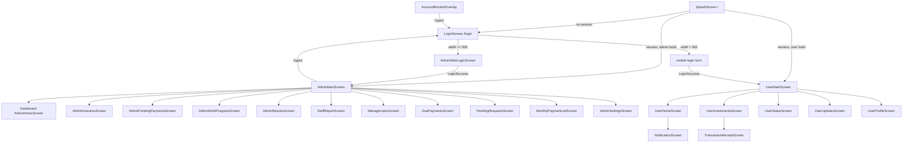

# Navigation

## Mechanism
Imperative Flutter `Navigator` 1.0 with `MaterialPageRoute`. **No** `routes:`, `onGenerateRoute`, `pushNamed`, go_router or similar (grep confirmed). Only two route names exist: the default `/` (splash, `Navigator.defaultRouteName`) and `AccountBlockRoutes.login = '/login'` (`lib/core/account/account_block_routes.dart`). Arguments are passed via widget constructors (e.g. `LoginScreen(home: ...)`, `SplashScreen(homeAfterLogin: ...)`, `isActive`, `tabReselect`).

User build uses a global `notificationNavigatorKey` (`lib/core/notifications/notification_service.dart`) on `MaterialApp.navigatorKey`; admin build passes `null`.

## Entry and role redirects
1. `MaterialApp.home = SplashScreen(homeAfterLogin: isAdmin ? AdminMainScreen() : UserMainScreen())`.
2. `SplashScreen._tryNavigate` (after GIF + text animation + 1 s): `hasSession = storage.hasValidSession() && !AuthNavigationGuard.suppressAuthenticatedNavigation`.
   - session: `pushReplacement` to `homeAfterLogin` (unnamed route).
   - no session: `pushReplacement` to `LoginScreen(home: homeAfterLogin)` with route name `/login`.
3. Redirect is by **build flavour** (`isAdmin`), not by stored role. Role is enforced at login time (`LoginCubit` checks `requiredRole` / `allowedRoles`) and inside the admin shell (`AdminNavPermissions`). A stored admin session opened in the user build (or vice versa) is not re-checked at splash. Unclear - needs human clarification whether that is intended.
4. `LoginScreen` picks UI by width: `< 900` mobile login (investor: `requiredRole: 'Investor'`, `userRole: 'Investor'`), `>= 900` `AdminWebLoginScreen` (role dropdown, `allowedRoles: AdminNavPermissions.adminWebLoginRoles`).
5. On `LoginSuccess` both screens `pushReplacement` to `widget.home`.

## Admin shell (`lib/admin/navigation/admin_main_screen.dart`)
- Not route-based: `AdminSideDrawer` + `IndexedStack(index: _selectedItem.index)` over `AdminDrawerItem.values` (dashboard, investors, fundingPayments, workProgress, reports, staffReport, manageUsers, duePayments, pendingRequests, settings, monthlyList).
- `_screenFor` returns `SizedBox.shrink()` for items the role cannot open so their fetches never run.
- Initial item: `AdminNavPermissions.defaultDrawerItem(role)`; selection blocked by `canOpen`.
- Sidebar auto-collapses below width 1050 and re-expands above 1180.
- Logout: confirm dialog (`showLogoutConfirmDialog`) -> `LoginCubit.logout()` -> `pushAndRemoveUntil(LoginScreen(home: AdminMainScreen()), (_) => false)`.
- Deep screens inside features (detail/add/edit pages) are pushed with `Navigator.push(MaterialPageRoute)`; see feature docs.

## User shell (`lib/user/navigation/user_main_screen.dart`)
- `IndexedStack` with 5 tabs, indices in `UserBottomNav`: 0 Home, 1 Investment, 2 Status, 3 Updates, 4 Profile.
- `selectTab` ignores taps while `AccountBlocked`; re-tapping the current tab calls `TabReselectNotifier.notifyReselect()` (scroll to top).
- Back behaviour: `PopScope(canPop: false)`; when blocked back does nothing; otherwise double-back within 2 s calls `SystemNavigator.pop()` (first press shows snackbar "Press back again to exit").
- Bottom nav is hidden while blocked.

## Account-block guard
- `AccountBlockNavigatorObserver` (attached only in user build) keeps a route stack and exposes `onAuthRoute` (top route is `/` or `/login`).
- `MyApp.builder` (user build) stacks `AccountBlockedOverlay` over the whole navigator when `!onAuthRoute && (AccountBlocked || holdBlockedOverlay)`, and wraps content in `IgnorePointer`.
- `AuthNavigationGuard.suppressAuthenticatedNavigation` stops login success, splash restore and notification taps from opening the home shell during forced logout.
- Notification tap: `NotificationService._openNotificationScreen` pushes `NotificationScreen` via `notificationNavigatorKey` only for a valid investor session.

## Screen map (shells and main screens)

Sub-screens reached from these (add fund, transaction details, create admin/project, complaints, documents, etc.) are documented per feature.
