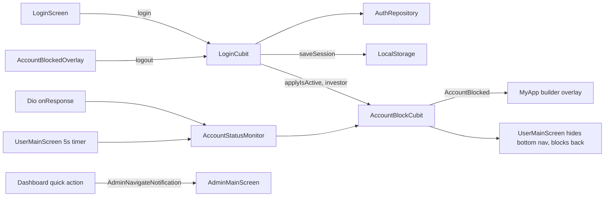

# State Management

Library: `flutter_bloc ^9.1.1`, using **Cubits only** (no Bloc event classes found). States are mostly `sealed class` in `part of` files (`*_state.dart`). Injection via `get_it` (see ARCHITECTURE.md).

## Cubits (all `*_cubit.dart` under `lib/`)
Core / auth
- `LoginCubit` (`auth/cubit`): states `LoginInitial`, `LoginLoading`, `LoginSuccess(LoginResponseModel)`, `LoginFailure(message)`. get_it factory; provided globally in `MyApp`.
- `AccountBlockCubit` (`core/account`): states `AccountActive`, `AccountBlocked`. get_it **singleton**; provided globally only when `!isAdmin`.

Admin (`lib/admin`)
- `DashboardCubit` (factory + global provider), `InvestorsCubit` (factory), `FundingPaymentsCubit` (factory), `PaymentListCubit` (monthly_payment_list), `PendingRequestsCubit`, `ReportCubit` (file `reports/cubit/report__cubit.dart`), `StaffReportCubit`, `CreateAdminCubit`, `CreateProjectCubit`, `InvestorRatingCubit`, `StaffAllocationCubit`, `UserComplaintsCubit`, `DuePaymentsCubit`, `ManageUsersCubit`, `AddBannerCubit`, `UpdateConstructionCubit`, `UpdatePhaseCubit`, `UpdateStatusCubit`, `WorkProgressCubit`.

User (`lib/user`)
- `HomeCubit`, `NotificationsCubit`, `InvestmentsCubit`, `ProfileCubit`, `StatusCubit`, `UpdatesCubit` (all get_it factories).

Class names of the admin cubits above are inferred from file names; exact state class names per feature: see per-feature docs. Unclear - needs human clarification where not covered there.

## Ownership / scoping
- Global (above `MaterialApp`): `LoginCubit`, `DashboardCubit`, `AccountBlockCubit` (user build only).
- Factory-registered cubits are expected to be created with `BlocProvider(create: ...)` in their screens (e.g. `user/home/home_screen.dart` contains a `BlocProvider`). Cubits not in get_it are constructed directly by their screens.
- Repositories are provided with `RepositoryProvider.value` for 7 types (see ARCHITECTURE.md).

## Transitions
```
LoginInitial -> LoginLoading -> LoginSuccess | LoginFailure
logout(): clears storage, then emits LoginInitial
AccountActive <-> AccountBlocked via applyIsActive(bool); syncFromStorage(); reset()
```

## Cross-screen communication
- `AuthNavigationGuard` (static): `suppressAuthenticatedNavigation` (bool) and `holdBlockedOverlay` (`ValueNotifier<bool>`).
- `AccountBlockNavigatorObserver.onAuthRoute` (`ValueNotifier<bool>`) tells `MyApp.builder` whether the top route is splash/login.
- `AdminNavigateNotification` (Flutter `Notification`) bubbles from dashboard quick actions to `AdminMainScreen`, which switches the drawer item.
- `UserMainScreen.goToTab(context, index)` static helper locates the shell state.
- `TabReselectNotifier` (one per user tab) triggers scroll-to-top via `TabReselectScrollBinder`.
- `LocalStorage` is the shared persisted source of truth (role, token, isActive).
- Dio `onResponse` -> `AccountStatusMonitor.onResponse` -> `AccountBlockCubit.applyIsActive` (network layer drives UI state).

## Mermaid flow

