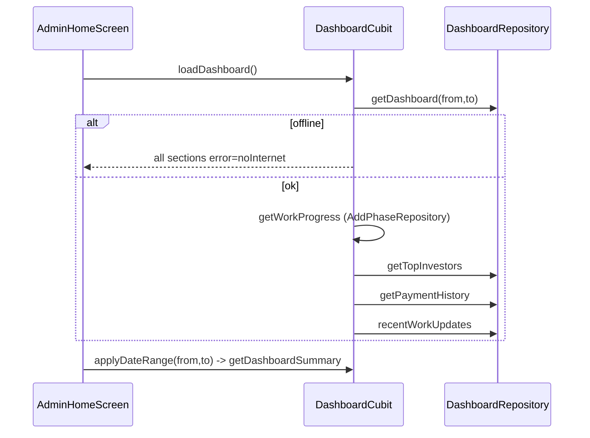

# Admin Dashboard

Source: `lib/admin/dashboard/` (working-tree state; module has uncommitted edits).

## Purpose
Landing screen of the admin shell. Shows funding summary stats for a selectable date range, funding overview ring, work progress per phase, top-rated investors, recent payments, recent work updates, and quick-action shortcuts to other admin tabs.

## Files
| Path | Class | Role |
|---|---|---|
| dashboard_screen.dart | `AdminHomeScreen` (+state) | Screen; triggers `loadDashboard()` when active; pull-to-refresh |
| cubit/dashboard_cubit.dart | `DashboardCubit` | Loads all sections independently |
| cubit/dashboard_state.dart | `DashboardState` (part) | Single state class with per-section loading/error/loaded flags |
| repository/dashboard_repository.dart | `DashboardRepository` | 4 GET calls (Dio) |
| model/dashboard_model.dart | `DashboardModel` | Summary numbers |
| model/top_investors_model.dart | `TopInvestorsModel` | Top investor row |
| model/all_transaction_history_model.dart | `TransactionHistoryModel` | Recent payment row |
| model/recent_updates_model.dart | `WorkUpdateModel` | Recent work update row |
| widgets/dashboard_overview.dart | `DashboardOverview`, `_DashboardDateRangeFilter`, `_SummaryCard`, `_StatsGrid` | Title, date filter, 6 stat cards |
| widgets/dashboard_details_section.dart | `DashboardDetailsSection` | Funding overview, hospital work progress, top rated investors cards |
| widgets/dashboard_activity_section.dart | `DashboardActivitySection` | Recent payments, recent updates, quick actions |
| widgets/dashboard_shimmer.dart | `DashboardShimmer`, `Dashboard*Shimmer` | Loading placeholders |

## Screens & widgets
- `AdminHomeScreen(isActive)` wraps content in `AdminMainScreenLayout` and `RefreshIndicator`; `BlocBuilder` rebuilds only on dashboard summary fields. A refetch progress bar shows when `dashboardLoading` and data/loaded already present.
- Stat cards (from `DashboardModel`): Total Funding (`projectFund`), Amount Received (`totalReceivedAmount`), Amount Remaining (`totalPendingAmount`), Total Investors (`totalInvestors`), Active Investors (also `totalInvestors`, same value), Funding Progress (`fundingProgress` + "%").
- Date filter: two date fields, `showDatePicker` range 2020-2035; if To < From a SnackBar error shows and the range is not applied (cubit also ignores it). Fields disabled while loading.
- Funding Overview: circular ring; `_normalizePercent` multiplies by 100 if value <= 1; ring clamped 0..1. Tiles: Project Fund, Total Investment, Total Received, Total Pending.
- Work progress card: rows per `WorkPhaseListModel`; overall = rounded average of phase `progress`.
- Top investors: first 5; paid% = `totalPaidAmount / investmentAmount * 100` rounded, clamped 0..100 (0 if investment <= 0).
- Recent payments / updates: first 5 each. Errors shown via `AppToast.error` unless message equals the no-internet message.
- Quick actions: Add Investor, Add Payment, Work Progress, Reports, Settings -> `AdminNavigateNotification(item).dispatch(context)`.
- Amount format: rupee symbol, comma grouping, decimals only if non-whole.

## Cubit / state
`DashboardCubit(phaseRepository: AddPhaseRepository, dashboardRepository)`; provided in `main.dart` via `BlocProvider<DashboardCubit>` (also `registerFactory` in service_locator).
Initial state: fromDate = first of current month, toDate = today.
`DashboardState` has per-section fields `<x>Loading`, `<x>Error`, `<x>Loaded` for dashboard, workProgress, topInvestors, recentPayments, recentUpdates, plus data and `copyWith` with `clear*Error` flags.
Methods:
- `loadDashboard()` - `getDashboardSummary()`; if error == no-internet message -> `_emitOfflineForRemainingSections()` and stop; else sequentially `getWorkProgress()`, `getTopInvestors()`, `getRecentPayments()`, `getRecentUpdates()`.
- `applyDateRange(from,to)` - date-only normalisation; return if to < from; emit dates; refetch summary only.
- Each getter: emit loading (clear error) -> call repo -> emit loaded + data; on error emit loaded + error via `ApiErrorMessage.from(e, fallback: ...)`.

## Repository (`DashboardRepository(dio)`)
All parse envelope `{status|Status, message|Message, data|Data}`; success when status is true/1/"true"/"success"; otherwise throws Exception(message). Non-200 throws. Errors are logged and rethrown.
| Method | HTTP | Constant -> path | Request | Response -> model |
|---|---|---|---|---|
| `getDashboard` | GET | `ApiEndpoints.getDashboard` -> /api/Dashboard/GetFundingDashboard | query `FromDate`, `ToDate` (yyyy-MM-dd) | data map -> `DashboardModel` |
| `getTopInvestors` | GET | `topInvestors` -> /api/Investor/GetTopInvestors | none | data list -> `TopInvestorsModel` (null -> []) |
| `getPaymentHistory` | GET | `transactionHistory` -> /api/Investor/AllInvestorTransactionHistory | none | list -> `TransactionHistoryModel` |
| `recentWorkUpdates` | GET | `getWorkUpdates` -> /api/Project/GetWorkUpdates | none | list -> `WorkUpdateModel` |

Work phases come from `AddPhaseRepository.workPhaseList()` (work_progress module): GET `ApiEndpoints.workPhaseList` -> /api/Project/WorkProgressDetails.

## Models (keys accept camelCase or PascalCase; numeric helpers tolerate num/String)
- `DashboardModel`: projectFund, totalInvestmentAmount, totalReceivedAmount, totalPendingAmount (double), totalInvestors (int), fundingProgress (double). fromJson/toJson.
- `TopInvestorsModel`: userId, investorCode, fullName, profileImage, investorType, organization, investmentAmount, totalPaidAmount, pendingAmount, rating (int). fromJson/toJson.
- `TransactionHistoryModel`: transactionId, userId, investorCode, fullName, date, entryNo, investmentAmount, paidAmount, receivedAmount, pendingAmount, status, narration, paymentMethod?. fromJson only; unparsable date -> `DateTime.now()`.
- `WorkUpdateModel`: workUpdateId, title, description, fileName, fileType, mimeType, googleDriveFileId, fileUrl, createdDate, createdBy, status (bool; accepts 1/"true"/"1"). fromJson/toJson.

## Business rules
- Default range: month start to today; invalid range (to < from) rejected.
- Only the summary reacts to the date range; other sections are not date-filtered.
- Offline: single message applied to all sections; toasts suppressed for that message.
- Role access: dashboard hidden from Marketing Manager and Financial Manager (see ADMIN_NAVIGATION.md).

## User workflow
1. Admin signs in; shell opens Dashboard (default for Admin/SuperAdmin).
2. Screen becomes active -> `loadDashboard()` runs.
3. Admin optionally changes From/To dates -> summary refetched.
4. Pull to refresh reloads everything.
5. Quick action tile switches shell tab.

## Navigation
In: shell default tab / drawer. Out: `AdminNavigateNotification` to investors, fundingPayments, workProgress, reports, settings.

## Dependencies
`work_progress` (AddPhaseRepository, WorkPhaseListModel), `navigation` (AdminDrawerItem, notification), core (ApiEndpoints, ApiErrorMessage, AppToast, AppColors, ImageConstants, AdminMainScreenLayout).

## Unclear
- "Active Investors" card shows the same `totalInvestors` value as "Total Investors" - Unclear - needs human clarification whether intentional.
- Whether API `fundingProgress` is a 0-1 fraction or a percentage: details card normalises heuristically, stats card appends "%" without normalising. Unclear - needs human clarification.
