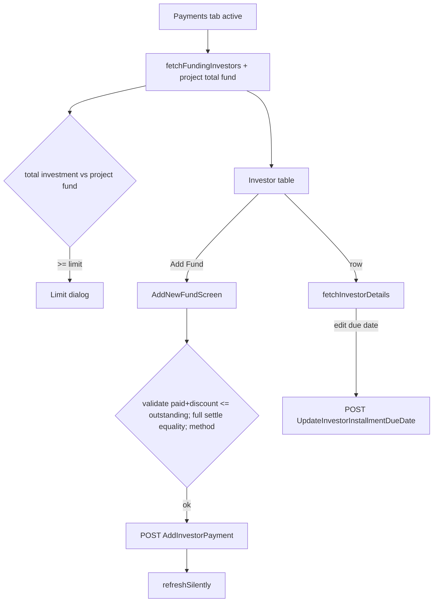

# Admin Funding & Payments

Source: `lib/admin/funding&payments/` (note the literal `&` in the folder name). `funding_payments_screen.dart` has uncommitted edits.

## Purpose
Shows project funding totals and a per-investor funding table, lets an admin record a new investor payment (deposit, discount, full settlement, medical allowance), view an investor's profile and installment schedule, and edit installment due dates. Also warns when total investor investment reaches/exceeds the project fund.

## Files
| Path | Class | Role |
|---|---|---|
| screens/funding&payents/funding_payments_screen.dart | `AdminFundingPaymentsScreen`, `_AdminFundingPaymentsView(State)` | Entry; providers; in-place navigation list / add fund / detail |
| screens/funding&payents/widgets/funding_overview_section.dart | `FundingOverviewSection`, `_FundingLimitAlert`, `_SummaryCard` | 4 stat cards, "Add Fund" action, limit alert |
| screens/funding&payents/widgets/funding_transactions_table.dart | `FundingTransactionsTable`, `FundingTransaction` (UI model) | Search + table of investors |
| screens/add_fund/add_new_fund.dart | `AddNewFundScreen`, `_AddNewFundView(State)` | Add-payment form logic and validation |
| screens/add_fund/widgets/add_fund_form_card.dart | form card; `kFundPaymentMethodOptions` | Form UI |
| screens/add_fund/widgets/add_fund_side_panel.dart | side summary panel | Totals preview |
| screens/transaction_details/transaction_detail_screen.dart | `TransactionDetailScreen` | Investor detail container |
| screens/transaction_details/widgets/investor_profile_overview.dart | `InvestorProfileOverview` | Stat cards |
| screens/transaction_details/widgets/investor_profile_details_section.dart | `InvestorProfileDetailsSection`, `_PendingScheduleCard`, `_EditablePendingDueTile` | Personal info, nominees, editable pending due dates |
| screens/transaction_details/widgets/transaction_payment_history_section.dart | `TransactionPaymentHistorySection` | Ledger of installments/payments with tabs, search, pagination |
| widgets/funding_limit_warning_dialog.dart | `FundingLimitWarningDialog`, `FundingLimitAlertKind` | Limit reached/exceeded dialog |
| cubit/funding_payments_cubit.dart, funding_payments_state.dart | `FundingPaymentsCubit`, `FundingPaymentsState` (sealed) | State |
| repository/funding_payments_repository.dart | `InvestorPaymentRepository` | API calls |
| model/funding_investor_list_model.dart | `FundingInvestorsResponseModel`, `FundingInvestorModel` | Investor list |
| model/investor_details_models.dart | `InvestorDetailsResponseModel`, `InvestorDetailsModel`, `InvestorNomineeModel`, `InvestorDueDateModel`, `InvestorPaymentHistoryModel` | Investor detail |
| model/investor_payment_model.dart | `AddInvestorPaymentRequestModel`, `...ResponseModel`, `InvestorPaymentDataModel` | Add payment |
| model/investor_transaction_history_model.dart | `InvestorTransactionHistoryResponseModel`, `InvestorTransactionHistoryModel` | Transaction history (see Unclear) |
| model/update_due_dates_model.dart | `UpdateDueDatesRequestModel`, `UpdateDueDatesResponseModel` | Due date update |

## Screens & widgets
- `AdminFundingPaymentsScreen(isActive)`: `MultiRepositoryProvider` (getIt `InvestorsRepository`, `InvestorPaymentRepository`) + `BlocProvider(FundingPaymentsCubit(..., projectRepository: ProjectRepository(dio)))..fetchFundingInvestors()` (fetch on creation). On inactive->active transition: reset limit-dialog flag and refetch.
- In-place navigation: `_showAddFund` -> `AddNewFundScreen` (reuses parent cubit via `BlocProvider.value`); `_selectedTransaction` -> `TransactionDetailScreen`; else list. Back clears investor details; after a successful add triggers `refreshSilently()`.
- List mapping `_mapToFundingTransaction`: status display "Received" if totalPaidAmount > 0 or status contains complete/received/paid; "Pending" if contains pending/empty; formatted rupee amounts.
- Stat cards: Total Commitment By Investors, Amount Received from Investors, Amount Pending from Investors, Total Investors. Search covers party name, total, paid, pending, date text.
- Funding limit dialog (`_maybeShowFundingLimitDialog`): shown once per visit when active and no sub-screen is open. `totalInvestment` = sum of `totalInvestmentAmount` over investors; `resolveKind(projectAmount, totalInvestment)`: null if project amount null/<=0; `exceeded` if total > limit + 0.01; `reached` if total + 0.01 >= limit; else none. Titles "Project Funding Exceeded" / "Project Funding Limit Reached".
- Add Fund form fields: investor (dropdown by full name), total amount (read-only display), total paid, remaining, amount paying now, discount, description (narration), payment method (NEFT, RTGS, IMPS, UPI, Cash, Bank Transfer, Cheque), funding date (UI), medical allowance amount and days, "Settle Full" action. Local-only "due" state (`_dueRemainingAmount`, `_dueDate`, `_dueStatus`) is UI-only, "no backend" per source comment.
- Detail screen: on init `fetchInvestorDetails(userId)`; shows overview stats, profile/nominees, pending schedule with inline due-date edit (date picker 2000 .. now+10 years), payment history ledger (tabs completed/pending, search, pagination).

## Cubit / state
`FundingPaymentsCubit({investorsRepository, paymentRepository, projectRepository})` - single cubit with sealed states: `FundingPaymentsInitial`; `FundingInvestorsLoading/Success(investors: List<InvestorModel>)/Failure`; `AddPaymentLoading/Success(message,data)/Failure`; `TransactionHistoryLoading/Success(investors, projectTotalFund)/Empty(message, projectTotalFund)/Failure`; `InvestorDetailsLoading/Success(details)/Failure`; `UpdateDueDateLoading(installmentNumber)/Success/Failure`.
Cached fields exposed by getters: `investors`, `fundingInvestors`, `investorDetails`, `projectTotalFund`.
Methods:
- `fetchInvestors()` - `InvestorsRepository.getInvestors()`; success if `status || code==200 || message contains 'success'` or data non-empty.
- `fetchFundingInvestors()` / `refreshSilently()` -> `_loadFundingInvestors(silent)`: guarded against concurrent calls; runs `getFundingInvestors()` in parallel with `_refreshProjectTotalFund()` (first project's `totalFund` if > 0, else null); emits Success/Empty/Failure; silent errors ignored when cached data exists.
- `addInvestorPayment(request)`: ignored if already loading; failure if `!response.status`; success emits `AddPaymentSuccess` then fire-and-forget refresh of investors and funding list.
- `fetchInvestorDetails(userId)`, `clearInvestorDetails()`.
- `updateInvestorDueDate({userId, installmentNumber, dueDate})`: requires loaded details; normalises date to UTC calendar date; on success patches the installment locally, emits `InvestorDetailsSuccess(patched)` then `UpdateDueDateSuccess`, then silent re-fetch; on failure emits `UpdateDueDateFailure` then restores `InvestorDetailsSuccess(previous)`.

## Repository (`InvestorPaymentRepository(dio)`)
| Method | HTTP | Constant -> path | Request | Response |
|---|---|---|---|---|
| `addInvestorPayment` | POST | `addInvestorPayment` -> /api/Investor/AddInvestorPayment | JSON from `AddInvestorPaymentRequestModel.toJson` | `AddInvestorPaymentResponseModel` |
| `getFundingInvestors` | GET | `investorsList` -> /api/Investor/GetInvestors | none | `FundingInvestorsResponseModel` (data list or nested investors/items/list) |
| `getAllInvestorTransactionHistory` | GET | `transactionHistory` -> /api/Investor/AllInvestorTransactionHistory | none | `InvestorTransactionHistoryResponseModel` |
| `getInvestorDetails({userId})` | GET | `investorDetails` -> /api/Investor/InvestorDetails/ + `userId` (string concatenation) | path id | `InvestorDetailsResponseModel` (non-Map -> status false "Unexpected response format") |
| `updateDueDates` | POST | `updateDueDates` -> /api/Investor/UpdateInvestorInstallmentDueDate | `{investorId, installmentNumber, dueDate (UTC ISO)}` | `UpdateDueDatesResponseModel` |
Other repos used by cubit: `InvestorsRepository.getInvestors()` (investors module), `ProjectRepository.getProjects()` (settings/create_project; constant `ApiEndpoints.getProject` -> /api/Project/GetProjects, assumed).

## Models
- `AddInvestorPaymentRequestModel.toJson`: userId, paidAmount, narration, paymentMethod, isFullSettlement, discountAmount, remarks, medicalAllowance (String), extraAmount, days. Form sends remarks `''`, extraAmount 0, days parsed from medical allowance days field (default 0).
- `AddInvestorPaymentResponseModel`: status, message, data (`InvestorPaymentDataModel`: userId, investorCode, fullName, totalInvestmentAmount, totalPaidAmount, remainingAmount, paidAmount, entryNo), code.
- `FundingInvestorModel`: userId, username, fullName, email, phoneNumber, profileImage (+ `profileImageUrl` via `resolveMediaUrl`), investorCode, investorType, organization, address, isActive, createdDate, modifiedDate, userRole, totalInvestmentAmount, totalPaidAmount, totalPendingAmount, latestPaymentAmount, status. camel/Pascal keys; toJson present.
- `InvestorDetailsModel`: identity, contact, KYC (aadhaar/pan numbers and photos), bank (accountNumber, ifscCode, bankName), dateOfBirth, description, investment (investmentAmount, investmentDate, investmentAdvanceAmount, investmentSplitMonths, investmentSplitGap, investmentSplitType), totals (totalPaidAmount, totalPendingAmount, lastPaymentAmount, lastPaymentDate), legacy single nominee fields, `nominees[]` (falls back to legacy fields when list absent), `dueDates[]`, isActive, dates, userRole. `InvestorDueDateModel`: installmentNumber, dueDate, installmentAmount, paidAmount, pendingAmount, status, payments[] (`InvestorPaymentHistoryModel`: amount, paymentMethod, ...).
- `UpdateDueDatesRequestModel.toJson`: investorId, installmentNumber, dueDate.
- `FundingTransaction` (UI only) in funding_transactions_table.dart.

## Business rules / validation (Add Fund)
- Outstanding balance: `totalPendingAmount` if > 0, else max(`totalInvestmentAmount - totalPaidAmount`, 0).
- Paying now must be provided, numeric, > 0; investor must be selected; discount >= 0.
- paid + discount must not exceed outstanding (epsilon 0.009).
- Full settlement (Settle Full): paid + discount must equal outstanding; Settle Full auto-fills paying = outstanding - discount; blocked if outstanding <= 0 ("Investment is already fully paid").
- Payment method required.
- Changing discount auto-recomputes paying amount when full settlement is selected (deposit cannot go negative).
- Role: all admin roles with Payments access (Admin/SuperAdmin per `AdminNavPermissions`).

## User workflow
1. Open Payments tab -> investors + project fund load; limit dialog may appear.
2. Search/browse; click a row -> investor detail (installments, nominees).
3. In detail, edit a pending installment due date -> saved via API.
4. "Add Fund" -> choose investor, enter amount/discount/method (optionally Settle Full) -> Save -> toast; list refreshes.

## Navigation
In: drawer "Payments"; dashboard quick action "Add Payment". Out: in-place add/detail screens; `TransactionDetailScreen` back uses `Navigator.maybePop` in `_BackHeader` (confirm), while the parent `onBack` callback also exists.

## Dependencies
investors (`InvestorModel`, `InvestorsRepository`), settings/create_project (`ProjectRepository`), pending_requests (uses `InvestorPaymentRepository.getInvestorDetails`), core (`ApiErrorMessage`, `AppToast`, `resolveMediaUrl`).

## Unclear
- Admin add payment posts directly to `AddInvestorPayment`, whereas staff-submitted payments go through Pending Requests (`ReviewPaymentRequest`) - relationship/permissions between them Unclear - needs human clarification.
- `getAllInvestorTransactionHistory` and `fetchInvestors` exist but the active list uses `getFundingInvestors`; whether they are used elsewhere in this module Unclear.
- Local "due" fields in Add Fund are UI-only; purpose Unclear.
- Exact `ProjectRepository.getProjects` endpoint not re-verified in this module.
- Medical allowance semantics (amount String + days) - Unclear.
