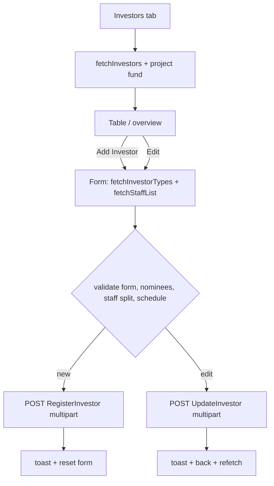

# Admin Investors

Source: `lib/admin/investors/` (`investors_screen.dart` has uncommitted edits).

## Purpose
Lists investors with totals, and provides the register-investor and edit-investor form (basic info, login credentials, investment/installment plan, staff assignment with optional second staff split, KYC and bank details, up to 3 nominees, photos). Warns when total investment reaches/exceeds the project fund.

## Files
| Path | Class | Role |
|---|---|---|
| screens/investors_screen/investors_screen.dart | `AdminInvestorsScreen`, `_AdminInvestorsView(State)` | Entry; provides cubit; list / add-edit switch; limit dialog |
| screens/investors_screen/widgets/investors_overview_section.dart | `InvestorsOverviewSection` | Stat cards + "Add Investor" |
| screens/investors_screen/widgets/investors_table_section.dart | `InvestorsTableSection` | Search + table + Edit button |
| screens/add_new_investor/add_new_investor.dart | `AddNewInvestorScreen`, `_AddNewInvestorView(State)` | Form state, validation, submit, schedule preview |
| screens/add_new_investor/widget/add_investor_form_cards.dart | `AddInvestorFormCards`, `kAdvancePaymentModeOptions` | Basic info, credentials, investment, staff cards |
| screens/add_new_investor/widget/add_investor_additional_information.dart | additional-info cards | Bank/KYC + nominees |
| screens/add_new_investor/widget/add_investor_side_panel.dart | side panel | Payment schedule preview |
| cubit/investors_cubit.dart, investors_state.dart | `InvestorsCubit`, `InvestorsState` (sealed) | State |
| repository/investors_repository.dart | `InvestorsRepository` | API calls |
| model/investor_model.dart | `InvestorModel` | Investor entity |
| model/investor_response_model.dart | `InvestorResponseModel`, `InvestorTotalsModel` | List response + totals |
| model/investor_type_model.dart | `InvestorTypeResponseModel`, `InvestorTypeModel` | Types |
| model/staff_model.dart | `StaffListResponseModel`, `InvestorStaffModel` | Staff dropdown |
| model/register_investor_model.dart | `RegisterInvestorRequestModel`, `...ResponseModel`, `RegisterInvestorDataModel` | Register (multipart) |
| model/update_investor_model.dart | `UpdateInvestorRequestModel`, `UpdateInvestorResponseModel` | Update (multipart) |
| model/investor_nominee_entry.dart | `InvestorNomineeEntry` | Form-side nominee with controllers |
| model/investor_nominee_record.dart | `InvestorNomineeRecord` | Nominee from API |
| model/investor_nominee_submit.dart | `InvestorNomineeSubmitData` + form-data helpers | Nominee multipart fields |
| model/investor_staff_allocation_model.dart | `InvestorStaffAllocationModel`, `parseInvestorStaffAllocations` | Staff split from API |
| model/investor_staff_assignment.dart | `InvestorStaffAssignmentSlot`, `InvestorStaffAssignmentPayload` | Staff split for submit |

## Screens & widgets
- `AdminInvestorsScreen(isActive)`: `BlocProvider(create: getIt<InvestorsCubit>()..fetchInvestors())`. On inactive->active: reset limit flag, refetch investors, reload project total fund. Loads project fund via `ProjectRepository(dio).getProjects()` (first project `totalFund` if > 0).
- Limit dialog: total investment = `state.total.totalInvestmentAmount` if > 0 else sum of investors' `totalInvestmentAmount`; `FundingLimitWarningDialog.resolveKind` (see ADMIN_FUNDING_PAYMENTS.md); once per visit; not while add form is open.
- Overview cards: Total Investors, Active Investors, Total Commitment By Investors, Total Paid Amount By Investors.
- Table search: name, email, phone, type, code, organization, username, "active"/"inactive". Edit icon -> `_editingInvestor` set, add/edit form shown in place. Status badge Active/Inactive from `isActive`.
- Add/Edit screen: separate `InvestorsCubit` instance created with `..fetchInvestorTypes()..fetchStaffList()`; `InvestorsRepository` from getIt. `investorToEdit != null` => edit mode (credentials not editable; schedule preview not required).
- Form details: frequency options Month / Week / Day; installment count options 10, 12, 20, 25, Custom; interval required for Week/Day; advance payment modes NEFT, RTGS, IMPS, UPI, Cash, Bank Transfer, Cheque; max 3 nominees (min 1 card kept); photos picked via `PhotoPickerHelper` (profile, Aadhaar, PAN, nominee photos).

## Cubit / state
States: `InvestorsInitial`, `InvestorsLoading`, `InvestorsSuccess(investors, total)`, `InvestorsFailure(message)`, `InvestorTypesLoading/Success(types)/Failure`, `StaffListLoading/Success(staff)/Failure`, `RegisterInvestorLoading/Success(message, data)/Failure`, `UpdateInvestorLoading/Success(message, data: String?)/Failure`.
Methods: `fetchInvestors()` (success if `status || code==200 || message contains 'success'` or data non-empty), `fetchStaffList()`, `fetchInvestorTypes()` (caches `investorTypes`, `staffList` getters), `registerInvestor(request)` (ignored if already loading; success = `status || code == 200`; empty failure message -> "Failed to register investor. Please try again."), `updateInvestor(request)`. Errors via `ApiErrorMessage.from`.

## Repository (`InvestorsRepository(dio)`)
| Method | HTTP | Constant -> path | Request | Response |
|---|---|---|---|---|
| `getInvestors` | GET | `investorsList` -> /api/Investor/GetInvestors | none | `InvestorResponseModel` (data list or nested investors/items/list; optional `total`) |
| `getStaffList` | GET | `staffList` -> /api/Staff/GetStaffList | none | `StaffListResponseModel` |
| `getInvestorTypes` | GET | `investorTypes` -> /api/Investor/GetInvestorTypes | none | `InvestorTypeResponseModel` |
| `registerInvestor` | POST (multipart FormData) | `registerInvestor` -> /api/Investor/RegisterInvestor | `RegisterInvestorRequestModel.toFormData()` | `RegisterInvestorResponseModel` |
| `updateInvestor` | POST (multipart FormData) | `updateInvestor` -> /api/Investor/UpdateInvestor | `UpdateInvestorRequestModel.toFormData()` | `UpdateInvestorResponseModel` |

Register form fields: Username, Password, FullName, StaffId, StaffId2, StaffAllocationPercentage, Staff2AllocationPercentage, Email, PhoneNumber, AlternativeNumber, InvestorType, Organization, Description, Address, InvestmentAmount, InvestmentDate (ISO), InvestmentSplitMonths, InvestmentSplitType, InvestmentSplitGap, InvestmentAdvanceAmount, PaymentMethod, AadhaarNumber, PanCardNumber, AccountNumber, IFSCCode, BankName, DateOfBirth, nominee fields (via `InvestorNomineeSubmitData` helpers), files ProfileImage, AadhaarPhoto, PanCardPhoto (+ nominee photos). Update form: UserId plus the same profile/KYC/bank/investment/staff/nominee fields (no Username/Password), `DateOfBirth`, files with same keys. Nominee key naming for the exact suffix scheme: see `investor_nominee_submit.dart` (`<prefix>Name`, `NomineeName<suffix>`, etc.).

## Models
- `InvestorModel` (camel/Pascal tolerant): userId, username, fullName, email, phoneNumber, alternativeNumber, profileImage (+ `profileImageUrl` via `resolveMediaUrl`), investorCode, investorType, staffId/staffName, staffId2/staffName2, staffAllocationPercentage, staff2AllocationPercentage, `staffAllocations[]`, organization, description, address, refundAmount, discountAmount, aadhaarNumber/Image, panCardNumber/Image, accountNumber, ifscCode, bankName, dateOfBirth, investmentAmount, investmentDate, investmentSplitMonths/Type/Gap, investmentAdvanceAmount, paymentMethod, isActive, createdDate, modifiedDate, userRole, totalInvestmentAmount, totalPaidAmount, totalPendingAmount, latestPaymentAmount, nextDueDate, nextDueAmount, status, legacy single-nominee fields, `nominees[]` (`InvestorNomineeRecord`).
- `InvestorTotalsModel`: totalInvestmentAmount, totalPaidAmount (read from root `total`/`Total` or `data.total`).
- `InvestorTypeModel`: investorTypeId, investorTypeName. `InvestorStaffModel`: staffId, fullName, designation, phoneNumber.
- `InvestorStaffAssignmentPayload.toFormFields`: StaffId, StaffId2 (blank if none), StaffAllocationPercentage, Staff2AllocationPercentage.

## Business rules / validation
- Form validators: full name, mobile (10 digits, required), alternate mobile (optional 10 digits), email, address required; username >= 3 chars and password >= 6 chars (register only); investment amount valid; investment date required; installments > 0; interval > 0 for Week/Day; advance >= 0 and <= total investment.
- Submit order: form validation, investor type, nominee completeness (any filled nominee needs name, relationship, 10-digit phone), staff selected, staff allocation, date, installment count/interval, advance, then (register only) a non-empty schedule.
- Staff allocation: one staff = 100%. With second staff: must differ from first; staff-1 percent integer 1-99; sum must be 100. Default when second staff added: 70/30.
- KYC format helpers in edit prefill: Aadhaar 12 digits, PAN `^[A-Z]{5}[0-9]{4}[A-Z]$`, IFSC `^[A-Z]{4}0[A-Z0-9]{6}$`, account number length >= 9 (prefilled only if valid).
- Schedule preview: remaining = amount - advance; per installment = remaining / count rounded to 2 decimals; last installment takes the remainder; due dates: Month = +N months keeping day (clamped), Week = +interval*7*N days, Day = +interval*N days, counted from today; status "Pending". Empty when advance covers full amount.
- Role: Admin/SuperAdmin only (drawer).

## User workflow
1. Open Investors tab -> list + totals load; limit dialog may show.
2. "Add Investor": fill form, preview schedule, Submit -> toast; form resets (stays in add screen).
3. Edit icon on a row: form prefilled; Submit -> toast; returns to list and refetches.

## Navigation
In: drawer "Investors"; dashboard quick action "Add Investor" (only switches tab; does not open the form). Out: in-place form.

## Dependencies
settings/create_project (`ProjectRepository`), funding&payments (`FundingLimitWarningDialog`), core (`resolveMediaUrl`, `PhotoPickerHelper`, `ApiErrorMessage`, `AppToast`, `getIt`).

## Unclear
- Exact registration payload for second-staff and nominee suffix naming beyond what is listed - see the model files; not fully enumerated here.
- Whether "Active Investors" counts use `isActive` only - Unclear.
- Role-specific restrictions inside the form (none found).
- `getIt<InvestorsCubit>` is a factory; the add/edit screen creates its own cubit rather than using it.
