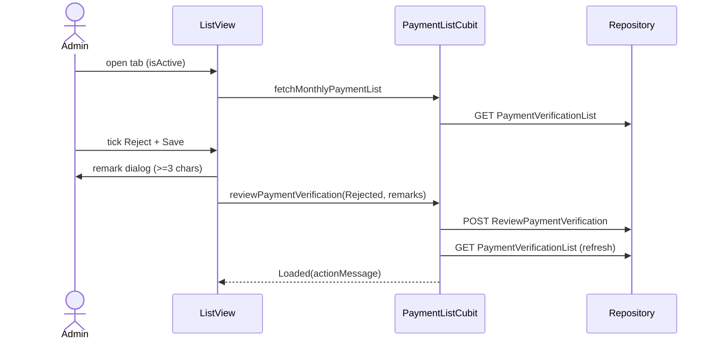

# Admin Monthly Payment List (Payment Verification)

Source: `lib/admin/monthly_payment_list/` (working-tree state; several files modified/untracked in git).

## Purpose
Lets a permitted admin (Financial Manager; see Navigation) list payments received in a date range, approve or reject each pending payment (with mandatory remark on rejection), batch-approve, and view a history of verified payments.

## Files
| Path | Class | Role |
|---|---|---|
| screen/monthly_payments_list_screen.dart | `MonthlyPaymentListScreen`, `_MonthlyPaymentListView(State)`, `_MonthlyPaymentListError`, `_MonthlyPaymentListAccessDenied` | Main screen; creates repository + cubit; permission gate |
| screen/payment_verification_history_screen.dart | `PaymentVerificationHistoryScreen`, `PaymentVerificationHistoryRow`, `mapVerificationHistoryRows`, `_DateFilterCard`, `_DateField`, `_HistoryTable`, `_VerificationHistoryError/Title` | History view (in-place swap, not a route) |
| screen/widgets/montly_payment_overview.dart | `MonthlyPaymentOverview` | Summary cards |
| screen/widgets/montly_payment_table.dart | `MonthlyPayment` (UI model), `PaymentStatus`/`PaymentReviewIntent` usage, `MonthlyPaymentTable` | Table, filters, selection checkboxes |
| screen/widgets/reject_payment_verification_dialog.dart | `showRejectPaymentVerificationDialog` | Remark dialog |
| cubit/payment_list_cubit.dart, payment_list_state.dart | `PaymentListCubit`, `PaymentListState` (sealed) | State |
| repository/monthly_payment_list_repository.dart | `MonthlyPaymentListRepository` | 3 API calls |
| model/monthly_payment_list_model.dart | `MonthlyPaymentListResponseModel`, `MonthlyPaymentListDataModel`, `MonthlyPaymentTransactionModel` | List response |
| model/payment_verification_history_model.dart | `PaymentVerificationHistoryResponseModel`, `...DataModel`, `...TransactionModel` | History response |
| model/review_payment_verification_model.dart | `ReviewPaymentVerificationRequestModel`, `...ResponseModel`, `...DataModel` | Review request/response |

## Screens & widgets
- `MonthlyPaymentListScreen(isActive)`: reads role from `LocalStorage`; if `!AdminNavPermissions.canAccessMonthlyList(role)` shows `_MonthlyPaymentListAccessDenied`. Otherwise `RepositoryProvider(MonthlyPaymentListRepository(dio: getIt<Dio>()))` + `BlocProvider(PaymentListCubit)` (screen-scoped, not global).
- View: fetches when `isActive` first true and on each inactive->active transition. Default range: first day of current month to today.
- Overview: total payments, total amount (from API), pending count (computed client side from all returned rows, not search-filtered). Approved/rejected summary cards removed.
- Table: search box (investor name, code, contact, staff - case-insensitive contains), From/To date pickers (2020-2035; changing either clears review intents and refetches), per-row Approve / Reject checkboxes for pending rows, per-row "Save", header "Select all approve", "Approve All", "View History" button. Empty state "No payments match your search or date range".
- Status mapping `_parsePaymentStatus`: contains "reject" -> rejected; contains "approv" -> approved; else pending. `paymentDate` null -> falls back to range-from date.
- Reject dialog returns trimmed remark; validator requires non-empty and at least 3 characters.
- History screen: own From/To pickers (default month start..today), table with verification status (contains "reject" -> Rejected else Approved), verified by (default em dash), verified date, reject reason (remarks only if rejected). `onBack` returns to list (`_showVerificationHistory` flag).
- Toasts: `AppToast.success/error` from `actionMessage`/`actionIsSuccess` via BlocConsumer, then `clearActionFeedback()`.

## Cubit / state
States (sealed `PaymentListState`): `PaymentListInitial`, `PaymentListLoading`, `PaymentListError(message)`, `PaymentListLoaded{data, isListRefreshing, isReviewSubmitting, actionMessage, actionIsSuccess, historyData, isHistoryRefreshing, historyErrorMessage, historyActionMessage}` with `copyWith` and clear flags.
Methods:
- `fetchMonthlyPaymentList(from,to)`: remembers range; if already loaded -> emit refreshing copy, else `Loading`. Success -> `Loaded` preserving history fields. Failure with prior data -> loaded + error action message; otherwise `PaymentListError`.
- `fetchPaymentVerificationHistory(from,to)`: works on current Loaded (or a fresh `PaymentListLoaded`); sets `isHistoryRefreshing`; success sets `historyData`; failure -> `historyErrorMessage` if no prior history else `historyActionMessage`.
- `reviewPaymentVerification(transactionId,status,remarks)`: ignored unless Loaded and not already submitting; calls repo, then `_refreshAfterReview()` (refetch list with last range), then emits success message (server message or "Payment review submitted successfully.").
- `approvePaymentsBatch(transactionIds)`: sequential `reviewPaymentVerification` calls with status `Approved` (one request per id, no server batch endpoint); aborts on first error; then refresh; message "N payments approved successfully." (or single server message).
- `clearActionFeedback()`, `clearHistoryActionFeedback()`.
Error text: `error.toString()` minus "Exception: " prefix.

## Repository (`MonthlyPaymentListRepository(dio)`)
| Method | HTTP | Constant -> path | Request | Response |
|---|---|---|---|---|
| `getMonthlyPaymentList` | GET | `ApiEndpoints.monthlyPaymentList` -> /api/Investor/PaymentVerificationList | query `FromDate`, `ToDate` (yyyy-MM-dd) | `MonthlyPaymentListResponseModel`; throws if `status != true` |
| `getPaymentVerificationHistory` | GET | `paymentVerificationHistory` -> /api/Investor/PaymentVerificationHistory | query `FromDate`, `ToDate` | `PaymentVerificationHistoryResponseModel` |
| `reviewPaymentVerification` | POST | `acceptOrRejectPaymentStatus` -> /api/Investor/ReviewPaymentVerification | JSON `{transactionId, status, remarks}` | `ReviewPaymentVerificationResponseModel` |
Error mapping (all three): server `message` if present; timeouts -> "Request timed out. Please try again."; connectionError -> "Unable to connect to the server. Check your internet connection."; 401 -> "Session expired. Please log in again."; 403 -> not-authorized message; 404 -> endpoint-not-found message; else generic. Supports `CancelToken` (cancel rethrown).

## Models
- Response wrapper (all three): `status` (== true), `message`, `data` (Map or null); review also `code`.
- `MonthlyPaymentListDataModel`: `totalPayments`, `totalAmount`, `transactions[]`.
- `MonthlyPaymentTransactionModel`: transactionId, investorId, userId, investorName, investorCode, mobileNumber, staffName, paymentMethod, paidAmount, paymentDate?, entryNo, receiptNumber, paymentStatus (fallback keys `VerificationStatus`/`verificationStatus`), verificationRemarks? (fallbacks `rejectReason`, `RejectReason`, `remarks`, `Remarks`), verifiedByName?, verifiedDate?. fromJson only.
- `PaymentVerificationHistoryTransactionModel`: same core fields + paymentStatus, verificationStatus, verifiedBy (int?), verifiedByName?, verifiedDate?, remarks?. fromJson only.
- `ReviewPaymentVerificationRequestModel.toJson`: transactionId, status, remarks. Response data: transactionId, investorId, investorName, paidAmount, paymentDate, entryNo, verificationStatus, verifiedBy, verifiedByName, verifiedDate, remarks (camel or Pascal keys).
- Parsers: lenient int/double/date; blank optional strings -> null.

## Business rules
- Status values sent to API: exactly `Approved` or `Rejected`; remark `''` for approval; rejection remark must be >= 3 chars.
- Only pending rows can be selected/saved. "Approve All" acts on pending rows of the current search-filtered list; blocked with toast if none pending or if any pending row has a Reject intent selected. Confirms via `showUserManagementConfirmDialog` (green Approve All) before batching.
- Approve All is a sequential per-transaction loop.
- Role gate: `AdminNavPermissions.canAccessMonthlyList`. Per the permission table, Admin, SuperAdmin and FinancialManager can access; MarketingManager cannot (access-denied widget).

## User workflow
1. Open Monthly List tab -> list for current month loads.
2. Optionally set dates/search.
3. Tick Approve or Reject on pending rows; click Save (Reject opens remark dialog) or use Approve All.
4. List refreshes; toast shows result.
5. "View History" shows verified payments for a range; Back returns.

## Navigation
In: drawer item "Monthly List" (default tab for Financial Manager). Out: in-place history screen; no route pushes.

## Dependencies
navigation (`AdminNavPermissions`), core (`LocalStorage`, `getIt<Dio>`, `AppToast`, ApiEndpoints), user_management shared widget `UserManagementTableCard`, `AdminInitialLoadingBody`.

## Unclear
- Net role access: `canAccessMonthlyList` = `canOpen(monthlyList)`; per `AdminNavPermissions`, Admin/SuperAdmin/FinancialManager pass. Whether Admin should see it - Unclear - needs human clarification.
- `receiptNumber`, `entryNo`, `investorId`, `userId` are parsed but not obviously displayed in the list table - Unclear.
- Batch approve stops at the first failing id with earlier ones already approved server-side.
