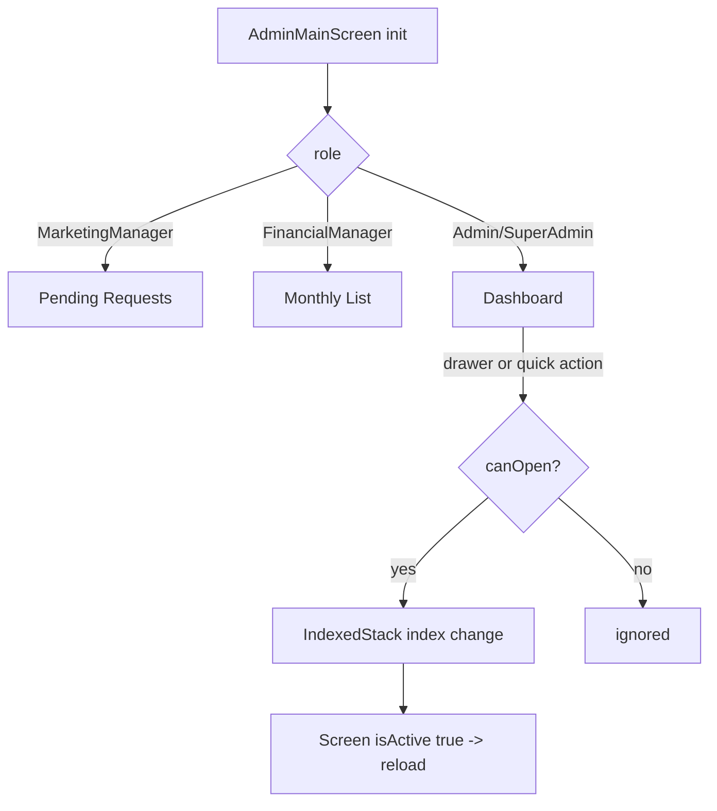

# Admin Navigation (Shell, Drawer, Role Permissions)

Source: `lib/admin/navigation/` (admin_nav_permissions.dart and admin_main_screen.dart have uncommitted edits).

## Purpose
Hosts the admin web shell: a side drawer plus an `IndexedStack` of module screens, with role-based visibility of drawer items.

## Files
| Path | Class | Role |
|---|---|---|
| admin_main_screen.dart | `AdminMainScreen` | Shell; holds selected item, collapse state, logout |
| admin_side_drawer.dart | `AdminSideDrawer`, `AdminDrawerItem` (enum), `AdminNavigateNotification`, `_DrawerDestination`, `_ExpandableDrawerGroup`, `_AppVersionLabel`, `_DrawerNavTile` | Drawer UI and destinations |
| admin_nav_permissions.dart | `AdminNavPermissions` | Role -> allowed items |

## Screens & widgets
- `AdminMainScreen`: `LayoutBuilder`; drawer collapses when width < 1050 and expands when > 1180 (hysteresis). Body = `Row[AdminSideDrawer, Expanded(Column[IndexedStack, AdminFooter])]`. `NotificationListener<AdminNavigateNotification>` calls `_onSelect`.
- `AdminDrawerItem` enum order (also the IndexedStack index): dashboard, investors, fundingPayments, workProgress, reports, staffReport, manageUsers, duePayments, pendingRequests, settings, monthlyList.
- Drawer labels: Dashboard, Investors, Payments, Work Progress, Reports (group: Overview, Staff Report), Pending Requests, Monthly List, User Management (group: Manage Users, Due Payments), Settings; plus Logout (always shown, outside permission set). Groups are hidden when no child is allowed.
- `_screenFor(item)` returns `SizedBox.shrink()` if the role cannot open it (so its init fetch never runs); otherwise builds the screen with `isActive: _selectedItem == item`. Settings and Work Progress take no `isActive`.
- Mapping: dashboard->`AdminHomeScreen`, investors->`AdminInvestorsScreen`, fundingPayments->`AdminFundingPaymentsScreen`, workProgress->`AdminWorkProgressScreen`, reports->`AdminReportsScreen`, staffReport->`StaffReportScreen`, manageUsers->`ManageUsersScreen`, duePayments->`DuePaymentsScreen`, pendingRequests->`PendingRequestsScreen`, monthlyList->`MonthlyPaymentListScreen`, settings->`AdminSettingsScreen`.

## Cubit/state
None in this module. Uses `LoginCubit.logout()` (auth) and `getIt<LocalStorage>().getUserRole()`.

## Repository / API
None.

## Business rules / permissions (`AdminNavPermissions`)
- Roles: `Admin`, `SuperAdmin`, `FinancialManager`, `MarketingManager`. Web-login roles = these four; dropdown labels "Admin", "Super Admin", "Financial Manager", "Marketing Manager"; `apiRoleForWebLoginLabel` maps label -> API role (default Admin).
- `normalizeRole`: lowercase, whitespace removed.
- `allowedDrawerItems`: MarketingManager -> {pendingRequests}; FinancialManager -> {monthlyList}; otherwise (Admin, SuperAdmin, other, null) -> all items except pendingRequests.
- `defaultDrawerItem`: Marketing -> pendingRequests; Financial -> monthlyList; else dashboard. Shell falls back to first allowed item if default is not openable.
- `_onSelect` ignores the already-selected item and items the role cannot open.
- Source comment: permissions are local "until backend permissions arrive".

## Workflow
1. Shell reads role from local storage and picks the default tab.
2. User clicks a drawer item -> `_onSelect` -> `setState`; the screen's `isActive` flips and it (re)loads.
3. Logout: confirm dialog -> `LoginCubit.logout()` -> `pushAndRemoveUntil(LoginScreen(home: AdminMainScreen()))`.

## Navigation
In: after login (`LoginScreen(home: AdminMainScreen())`). Out: logout to `LoginScreen`.

## Dependencies
All admin module screens, auth (LoginCubit, LoginScreen), core (LocalStorage, service_locator, AdminFooter, logout dialog).

## Unclear
- Whether every screen reloads on `isActive` transition identically - see per-module docs.
- Backend-driven permissions are not implemented; Unclear - needs human clarification on planned model.
