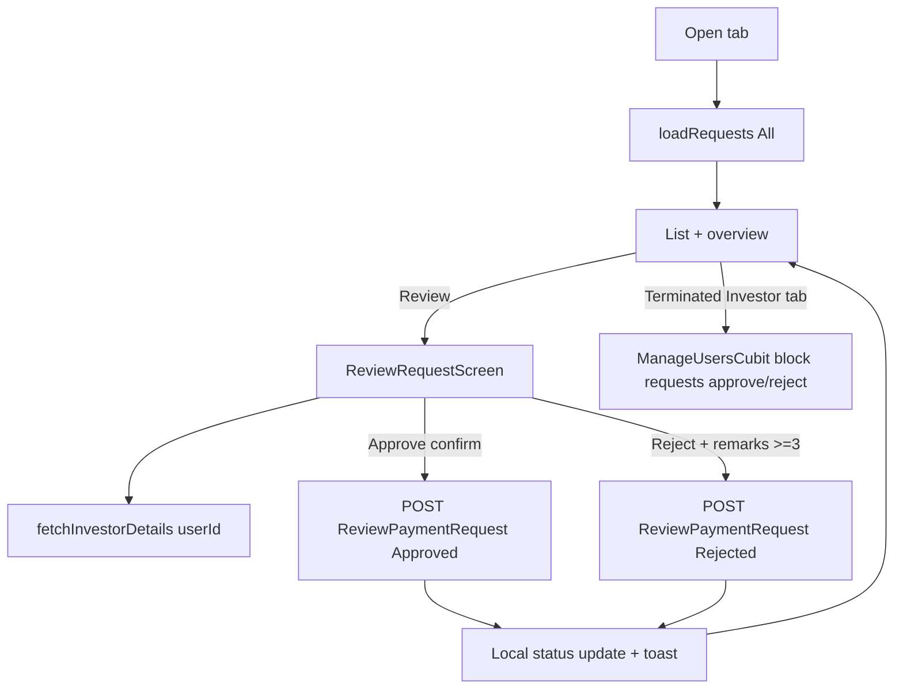

# Admin Pending Requests

Source: `lib/admin/pending_requests/` (working-tree state; `pending_requests_screen.dart` modified in git).

## Purpose
Marketing-side review queue for investor payment requests (submitted by staff), with approve / reject (reject needs remarks), a detail view with investor KYC/bank/nominee info, and a "Terminated Investor" tab that reviews investor block (termination) requests via the user_management module.

## Files
| Path | Class | Role |
|---|---|---|
| screens/pending_requests/pending_requests_screen.dart | `PendingRequestsScreen`, `_PendingRequestsView(State)`, `_PendingRequestsAccessDenied`, `_RefreshButton` | Entry screen, providers, permission gate, 1-min silent refresh |
| screens/pending_requests/widgets/pending_requests_overview_section.dart | `PendingRequestsOverviewSection` | Total / Pending / Approved / Rejected cards + refresh |
| screens/pending_requests/widgets/pending_requests_list_section.dart | `PendingRequestsListSection` | Filter tabs, search, list, empty/error/loading |
| screens/pending_requests/widgets/pending_request_card.dart | `PendingRequestCard` (+ wide/compact layouts) | One request row with Review action |
| screens/pending_requests/widgets/terminated_investors_section.dart | `TerminatedInvestorsSection`, `_TerminatedInvestorCard` | Block-request list with Approve/Reject (uses `ManageUsersCubit`) |
| screens/review_request/review_request_screen.dart | `ReviewRequestScreen` | Detail + decision screen |
| screens/review_request/widgets/review_request_header.dart | `ReviewRequestHeader` | Back/title |
| screens/review_request/widgets/review_request_details_section.dart | `ReviewRequestDetailsSection` + private cards | Payment summary, personal, KYC, bank, nominees |
| screens/review_request/widgets/kyc_image_preview_dialog.dart | KYC image dialog | Enlarged Aadhaar/PAN images |
| screens/review_request/widgets/reject_payment_request_dialog.dart | `showRejectPaymentRequestDialog` | Remarks dialog |
| cubit/pending_requests_cubit.dart, pending_requests_state.dart | `PendingRequestsCubit`, `PendingRequestsState` (sealed) | State |
| repository/pending_request_repository.dart | `PaymentRequestRepository` | 2 API calls |
| model/payment_request_model.dart | `PaymentRequestModel`, `PaymentRequestResponseModel`, `PaymentRequestDataModel` | List request/response |
| model/pending_request_model.dart | `PendingRequestModel`, `PendingRequestStatus`, `PendingRequestsListFilter`, `PendingRequestNominee`, `PendingRequestsOverviewStats` | UI model |
| model/review_payment_model.dart | `AcceptOrRejectPaymentRequestModel`, `...ResponseModel`, `...DataModel` | Review request/response |

## Screens & widgets
- `PendingRequestsScreen(isActive)`: if `!AdminNavPermissions.canAccessPendingRequests(role)` (MarketingManager only) shows access denied. Else provides `PaymentRequestRepository`, `ManageUsersRepository`, `PendingRequestsCubit(repository, paymentRepository: getIt<InvestorPaymentRepository>())` and `ManageUsersCubit`.
- View loads on first activation and each re-activation; `Timer.periodic` every 1 minute calls `loadRequests(silent: true)` only while active, no request selected, and no refresh in flight.
- Selecting a request (`_selectedRequestId`) swaps the body to `ReviewRequestScreen(requestId, onBack)` (no route push).
- List section filters: All, Pending, Approved, Rejected, Terminated Investor. Search (name, investor code/request ID, email, phone, allocation/narration, payment method; client-side). Terminated tab shows `TerminatedInvestorsSection` and triggers `ManageUsersCubit.fetchBlockRequests()`; its search covers name, code, email, phone, requested-by name, remarks.
- Review screen: on init fetches investor details by `userId`; shows payment summary (Approve/Reject buttons only if request is awaiting review), personal & request info, KYC documents (thumbnails open preview dialog), bank details, nominees (from investor details). Approve shows confirm dialog ("Approve request?"); Reject shows remarks dialog (required, at least 3 chars). Success/failure toasts then `clearReviewFeedback()`.
- Terminated tab: per-card Approve/Reject (enabled only for pending-review items and when no review in progress); calls `ManageUsersCubit.reviewBlockRequest(requestId, status: 'Approved'|'Rejected')` and toasts result. No remarks captured on this tab.

## Cubit / state
States: `PendingRequestsInitial`, `PendingRequestsLoading{statusFilter}`, `PendingRequestsSuccess{requests, overview, statusFilter, isListLoading, investorDetails, isInvestorDetailsLoading, investorDetailsError, isReviewSubmitting, reviewFeedback}`, `PendingRequestsFailure{message, statusFilter, overview}`; `PendingRequestReviewFeedback{isSuccess, message, status}`.
Methods:
- `loadRequests({statusFilter, silent})`: cancels previous `CancelToken`; if filter is `terminatedInvestor` emits empty `Success` (no API call). Non-silent -> `Loading` (or `isListLoading` on Success). Calls repo with `statusFilter.apiStatus` (label: All/Pending/Approved/Rejected); maps `PaymentRequestDataModel` -> `PendingRequestModel.fromPaymentRequest`; overview recomputed from list only when filter is All, otherwise previous overview kept (unless empty). Silent failure with existing Success is ignored.
- `fetchInvestorDetails(userId)`: requires Success and userId > 0; calls `InvestorPaymentRepository.getInvestorDetails(userId:)` (funding module); success judged by `status || code==200 || message contains 'success'`; sets `investorDetails` or `investorDetailsError`.
- `clearInvestorDetails()`, `clearReviewFeedback()`.
- `reviewPaymentRequest({requestId, status, remarks})`: guarded by `isReviewSubmitting`; POST; on success updates that request's status locally (no refetch), recomputes overview if filter All, sets feedback (server message or default "Payment request approved/rejected successfully"); on error feedback with `ApiErrorMessage`.
- `close()` cancels tokens.

## Repository (`PaymentRequestRepository(dio)`)
| Method | HTTP | Constant -> path | Request | Response |
|---|---|---|---|---|
| `getPaymentRequests({status='All'})` | GET | `ApiEndpoints.getPaymentRequests` -> /api/Investor/GetPaymentRequests | query `status` | `PaymentRequestResponseModel` (throws `Exception(message)` if `status` false) |
| `acceptOrRejectPaymentRequest({requestId,status,remarks})` | POST | `acceptOrRejectPaymentRequest` -> /api/Investor/ReviewPaymentRequest | JSON `{requestId, status, remarks}` | `AcceptOrRejectPaymentResponseModel` (throws if `status` false) |
Related (other modules): `InvestorPaymentRepository.getInvestorDetails` (see ADMIN_FUNDING_PAYMENTS.md); `ManageUsersRepository` block requests: `ApiEndpoints.getBlockRequests` (/api/Investor/GetBlockRequests) and `reviewBlockRequest` (/api/Investor/ReviewBlockRequest) - documented under user_management.

## Models
- `PaymentRequestResponseModel`: status, message, data[], code.
- `PaymentRequestDataModel` keys: requestId, userId, investorCode, fullName, email, phoneNumber, paidAmount, narration, paymentMethod, isFullSettlement, discountAmount, remarks, medicalAllowance (parsed via tryParse, default 0.0), status, requestedDate, requestedBy, requestedByName, reviewedBy, reviewedByName, reviewedDate, reviewRemarks, paymentEntryNo. fromJson only; numeric casts `as num?`.
- `PendingRequestModel.fromPaymentRequest`: id = requestId string; `requestId` field = investorCode or "REQ-<id>"; allocation = narration, else payment method, else "Payment request"; applicantName default "Unknown"; amount = amountPayingNow = paidAmount; submittedAt default now; status via `PendingRequestStatusX.fromApi` (approved/rejected, anything else pending). Computed: `pendingAmount` (amount - amountPayingNow, min 0), `initials`, `statusLabel`.
- Optional detail fields (dateOfBirth, address, KYC, bank, nominees) exist on `PendingRequestModel` but are not populated by `fromPaymentRequest`; the detail screen uses `InvestorDetailsModel` instead.
- `AcceptOrRejectPaymentRequestModel.toJson`: requestId, status, remarks. Response data: userId, investorCode, fullName, totalInvestmentAmount, totalPaidAmount, remainingAmount, paidAmount, paymentMethod, requestId, status, entryNo.

## Business rules
- Role: only MarketingManager reaches this screen; Admin/SuperAdmin/FinancialManager drawer excludes it.
- Reject requires remark (non-empty, >= 3 chars); approve sends empty remarks after confirmation.
- Only requests in Pending status show decision buttons.
- Overview counts reflect the full list only when last fetched with the All filter.
- Silent refresh paused while a request detail is open.

## User workflow
1. Marketing Manager logs in -> Pending Requests tab is default.
2. List loads (All); optionally filter tab / search.
3. Click Review on a pending request -> detail screen loads investor details.
4. Approve (confirm) or Reject (remarks) -> toast; status updated in list.
5. Back to list. "Terminated Investor" tab handles block requests the same way without remarks.

## Navigation
In: drawer "Pending Requests". Out: in-place detail screen and back. No named routes.

## Dependencies
funding&payments (`InvestorPaymentRepository`, `InvestorDetailsModel`), user_management (`ManageUsersCubit/Repository`, `InvestorBlockRequestModel`, `UserManagementSectionHeader`, confirm dialog), navigation (`AdminNavPermissions`), core (`ApiErrorMessage`, `AppToast`, `LocalStorage`, `getIt`).

## Unclear
- Whether approve on a payment request creates the payment entry server-side (response has `entryNo`) - Unclear - needs human clarification.
- `isFullSettlement`, `discountAmount`, `medicalAllowance`, `remarks` are parsed but whether they are displayed on the review screen was not confirmed - Unclear.
- Terminated-investor approval semantics (what block/terminate does to the investor) live in user_management - Unclear here.
