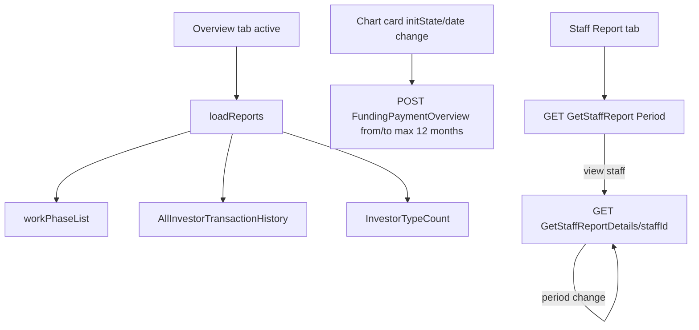

# Admin Reports (Overview + Staff Report)

Source: `lib/admin/reports/` (`reports_screen.dart` and `staff_report/staff_report_screen.dart` have uncommitted edits). Two drawer entries under the "Reports" group: **Overview** (`AdminReportsScreen`) and **Staff Report** (`StaffReportScreen`).

## Purpose
- Overview: funding/payments summary cards, a 12-month-max funding bar/line chart, work progress report, investor summary by type, latest 10 transactions.
- Staff Report: per-staff total amounts received for a period (This Month / Last Month / Custom), with a per-staff drill-down of investor payments.

## Files
| Path | Class | Role |
|---|---|---|
| screens/reports_screen.dart | `AdminReportsScreen`, `_AdminReportsView(State)` | Entry; providers; error toasts; reload on activation |
| screens/widgets/reports_overview_cards.dart | `ReportsOverviewCards` | 4 stat cards (from funding overview summary) |
| screens/widgets/reports_details_section.dart | `ReportsDetailsSection`, `_FundingPaymentsOverviewCard`, `_GroupedBarLineChart` (+ `CustomPaint` painter), `_WorkProgressReportCard`, `_InvestorSummaryCard` | Chart, work progress, investor summary |
| screens/widgets/reports_recent_transactions_table.dart | `ReportsRecentTransactionsTable` | Recent transactions table |
| cubit/report__cubit.dart, report__state.dart | `ReportCubit`, `ReportState` | Overview state |
| repository/report_repository.dart | `ReportRepository` | 2 API calls |
| model/funding_payment_overview_model.dart | `FundingPaymentOverviewModel`, `FundingPaymentMonthModel`, `FundingPaymentSummaryModel` | Funding overview |
| model/investor_type_count_model.dart | `InvestorTypeCountModel`, `InvestorTypeCountItem` | Investor summary |
| staff_report/staff_report_screen.dart | `StaffReportScreen`, `_StaffReportContent` | Staff list entry; owns cubit |
| staff_report/staff_details_screen.dart | `StaffDetailsScreen` | Staff drill-down |
| staff_report/widgets/staff_report_table_section.dart | `StaffReportPeriod` (enum), `StaffReportTableSection` | List table, period chooser, search |
| staff_report/widgets/staff_details_investors_section.dart | `StaffDetailsInvestorsSection` | Investor rows for a staff |
| staff_report/cubit/staff_report_cubit.dart, staff_report_state.dart | `StaffReportCubit`, `StaffReportState` | Staff report state |
| staff_report/repository/staff_report_repository.dart | `StaffReportRepository` | 2 API calls |
| staff_report/model/staff_report_model.dart | `StaffReportResponseModel`, `StaffReportModel` | List |
| staff_report/model/staff_report_details_model.dart | `StaffReportDetailsResponseModel`, `StaffReportDetailsModel` | Details |
| staff_report/model/staff_report_row_model.dart, staff_investor_amount_model.dart | `StaffReportRowModel`, `StaffInvestorAmountModel` | UI models |

## Screens & widgets
Overview:
- `AdminReportsScreen(isActive)`: `MultiRepositoryProvider` creates `AddPhaseRepository`, `InvestorPaymentRepository`, `ReportRepository` (each from `getIt<Dio>()`), `BlocProvider(ReportCubit)..loadReports()`. On inactive->active: `loadReports()`; pull-to-refresh also. Errors toast once per distinct message (titles: Work Progress, Recent Transactions, Funding & Payments Overview). Investor-type-count errors are shown inline only.
- Overview cards: Total Project Investment (`summary.projectAmount`), Total Commitment By Investors, Total Amount Received (`totalPaidAmount`), Total Pending Amount; show "—" while first load.
- Funding & Payments Overview chart: default range = first day of month five months ago .. today. From/To pickers constrained to max 12 months span (`_maxRangeMonths = 12`); if the other end would exceed 12 months it is auto-shifted and `AppToast.info('Date range limited to 12 months')`; if To < From the other end is aligned. Each change calls `fetchFundingPaymentOverview`. Legend: Funding Received, Pending Amount; custom painter draws grouped bars/line by month (`month`, `monthDate`, `dueAmount`, `fundingReceived`, `pendingAmount`).
- Work progress card: one row per phase, label = `stageName` (or "Untitled stage"), percent = `progress` clamped 0..100, colour by percent/status text (contains "progress" or >= 50 -> amber, else red; completed shown green - see source).
- Investor Summary: "Active Investors" = `totalInvestors`; "Investor Status Breakdown" rows per `investorTypes` (blank type -> "Other").
- Recent transactions: latest 10 (cubit sorts by `date` descending); columns Date, party, Description (`narration` or "-"), Amount (`paidAmount`), Discount (`discountAmount`), Status (default "Completed").

Staff Report:
- `StaffReportScreen(isActive)`: creates `StaffReportCubit(StaffReportRepository(getIt<Dio>()))` in `initState`. Fetches only while the tab is active (`_refreshIfActive`); on inactive→active, resets list UI (period/search) and calls `fetchStaffReport(period: 'ThisMonth')` again (IndexedStack keeps the screen alive). When tab becomes inactive while a staff is selected, selection is cleared and details reset. Selecting a staff swaps in `StaffDetailsScreen` in place.
- List table: period dropdown This Month / Last Month / Custom (Custom opens `showStaffReportCustomDateRangeDialog`; selection refetches with FromDate/ToDate), client-side search (name, code, mobile), columns incl. "Total Amount (<period>)", view action per row, retry on failure.
- Details screen: period chip text (e.g. "This Month (Nov 2026)"), investor list (code, name, amount received, date), total = sum of `paymentAmount` while details loaded, else staff's list `totalAmount`; search by investor name/code; back returns to list. Custom period without both dates does not load.

## Cubit / state
`ReportCubit({phaseRepository, paymentRepository, overviewRepository})`; `ReportState` single class with per-section `*Loading`, `*Error` and data: phases, transactions, fundingOverview, investorTypeCount; helpers `hasWorkProgressData`, `hasTransactionsData`, `hasFundingOverviewData`, `hasInvestorTypeCountData`, `fundingOverviewMonths`, `fundingOverviewSummary` (first summary item).
- `loadReports({overviewFromDate, overviewToDate})`: `Future.wait` of `fetchWorkPhaseList`, `fetchRecentTransactions`, `fetchInvestorTypeCount`, and `fetchFundingPaymentOverview` only if a from/to is known (remembered from last call). Note: first `loadReports()` has no dates, so the card's own `initState` fetch supplies the first overview.
- `fetchWorkPhaseList` -> `AddPhaseRepository.workPhaseList()`; `fetchRecentTransactions` -> `InvestorPaymentRepository.getAllInvestorTransactionHistory()` (success if `status` or message contains "success" or data non-empty; sorted by date desc); `fetchFundingPaymentOverview({fromDate,toDate})`; `fetchInvestorTypeCount()`.
- `StaffReportCubit`: `StaffReportState{listStatus, staffList, listMessage, listErrorMessage, detailsStatus, details, detailsMessage, detailsErrorMessage}` with enums `StaffReportListStatus` / `StaffReportDetailsStatus` {initial, loading, success, failure}. Methods `fetchStaffReport({period='ThisMonth', fromDate, toDate, search})`, `fetchStaffReportDetails({staffId, period, fromDate, toDate, search})`, `resetDetails()`. Success flag read from `response.success`; failures carry `e.toString()` as message.

## Repository
| Method | HTTP | Constant -> path | Request | Response |
|---|---|---|---|---|
| `ReportRepository.getFundingPaymentOverview` | POST | `ApiEndpoints.fundingPaymentOverview` -> /api/Investor/FundingPaymentOverview | JSON `{fromDate, toDate}` (yyyy-MM-dd) | map (or its `data`) -> `FundingPaymentOverviewModel`; requires HTTP 200 |
| `ReportRepository.getInvestorTypeCount` | GET | `investorTypeCount` -> /api/Investor/InvestorTypeCount | none | `data` map -> `InvestorTypeCountModel`; null data -> empty model |
| `StaffReportRepository.getStaffReport` | GET | `getStaffReport` -> /api/Staff/GetStaffReport | query `Period` (ThisMonth/LastMonth/Custom), optional `FromDate`, `ToDate`, `Search` | `StaffReportResponseModel` |
| `StaffReportRepository.getStaffReportDetails` | GET | `getStaffReportByID` -> /api/Staff/GetStaffReportDetails/{staffId} (placeholder replaced) | same query | `StaffReportDetailsResponseModel` |
Also used: `AddPhaseRepository.workPhaseList` (GET /api/Project/WorkProgressDetails) and `InvestorPaymentRepository.getAllInvestorTransactionHistory` (GET /api/Investor/AllInvestorTransactionHistory).
Repository quirk: in `getInvestorTypeCount` the message lookup uses the key `'m essage'` (typo with a space), so the server message is never read there; also both overview calls treat HTTP 200 as success regardless of `status`.

## Models
- `FundingPaymentOverviewModel`: `data[]` (`FundingPaymentMonthModel`: month, monthDate, dueAmount, fundingReceived, pendingAmount) and `summary[]` (`FundingPaymentSummaryModel`: projectAmount, totalInvestmentAmount, totalPaidAmount, totalPendingAmount); keys `data/Data`, `summary/Summary`.
- `InvestorTypeCountModel`: totalInvestors, investorTypes[] (`investorType`, `count`).
- `StaffReportModel`: staffId, staffCode, staffName, mobileNumber, totalAmount. Response wrapper uses `success` (not `status`), `message`, `data[]`.
- `StaffReportDetailsModel`: transactionType, userId, investorCode, investorName, investmentAmount, allocationPercentage, paymentDate, paymentAmount, staffAllocatedAmount, refundAmount, netAmount. UI shows investorCode, investorName, paymentAmount, paymentDate only.
- All fromJson only; no toJson.

## Business rules / permissions
- Funding overview range limited to 12 months in UI.
- Staff report period values sent exactly `ThisMonth`, `LastMonth`, `Custom`; From/To included only for Custom.
- Staff total on detail screen uses `paymentAmount` sum (not `staffAllocatedAmount`/`netAmount`).
- Access: Admin and SuperAdmin only (drawer excludes these for Financial/Marketing managers); `_screenFor` returns empty widget for others so no fetch occurs.

## User workflow
1. Reports > Overview: cards, chart, work progress, investor summary, recent transactions load. Change chart dates to refetch.
2. Reports > Staff Report: choose period (Custom opens date range dialog), search, click a staff to see per-investor payments, Back to return.

## Navigation
In: drawer Reports > Overview / Staff Report; dashboard quick action "Reports" (opens Overview). Out: in-place staff details and back.

## Dependencies
work_progress (`AddPhaseRepository`, `WorkPhaseListModel`), funding&payments (`InvestorPaymentRepository`, `InvestorTransactionHistoryModel`), user_management (`UserManagementSectionHeader`), core (`CurrencyFormatter`, `AppToast`, `getIt<Dio>`).

## Unclear
- Whether the custom date range dialog enforces any limit - not examined; Unclear - needs human clarification.
- Meaning of `staffAllocatedAmount`, `refundAmount`, `netAmount` and why only `paymentAmount` is displayed/summed - Unclear.
- The staff report does not refetch when its tab is re-activated (only on first build and on period change) - intentional? Unclear.
- Work progress status colours (completed/progress) were only partly inspected.
- First `loadReports()` leaves the funding overview unfetched until the chart card's post-frame fetch; behaviour on re-activation relies on remembered dates.
