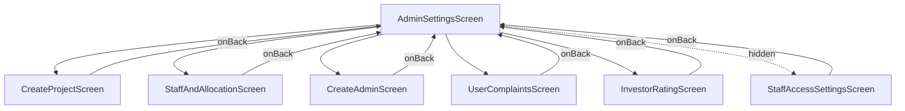
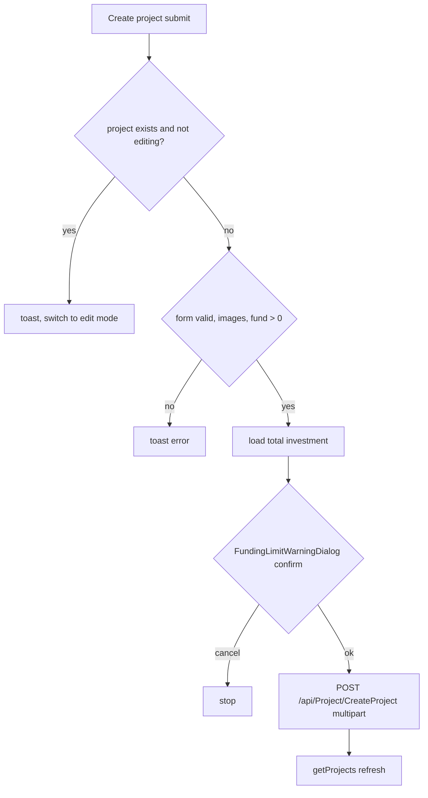
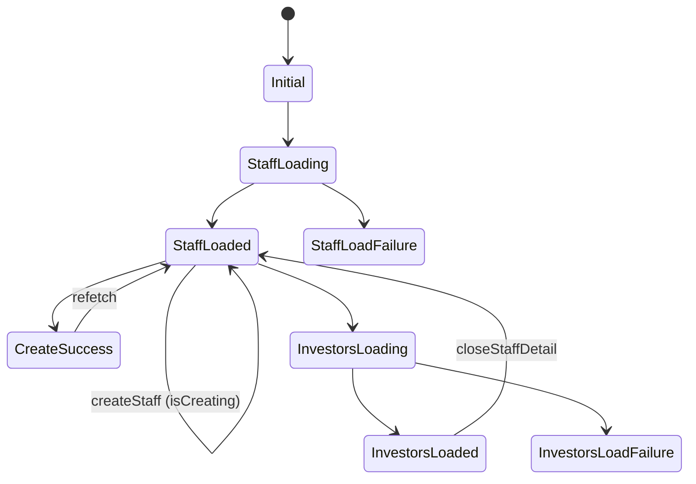

# ADMIN_SETTINGS

Source: `lib/admin/settings/` (working tree, includes uncommitted edits to `screens/settings/settings_screen.dart`). Endpoints from `lib/core/constants/api_endpoints.dart`.

## 1. Purpose
Admin "Settings" hub. A card menu that opens six in-place sub-screens (no router, a boolean flag per screen): Create Project, Staff and Allocation, Add Admin/Manager, User Complaints, Investor Rating, and (hidden) Admin Settings / staff screen permissions.

## 2. Files
Base: `lib/admin/settings/screens/`

| Path | Class | Role |
|---|---|---|
| settings/settings_screen.dart | AdminSettingsScreen | Hub; holds 6 `_show*` booleans, swaps child screen |
| settings/widgets/settings_option_cards.dart | SettingsOptionType (enum), SettingsOptionCards | Menu cards (createProject, addStaffAndAllocation, addAdmin, adminSettings [commented out, not shown], userComplaints, investorRating) |
| admin_settings/admin_settings_screen.dart | StaffAccessSettingsScreen | List of staff with allowed-screen counts (local only) |
| admin_settings/staff_permissions_screen.dart | StaffPermissionsScreen | Toggle per-screen access for one staff; Save |
| admin_settings/model/admin_staff_permission_model.dart | AdminScreenAccess, AdminStaffPermissionModel, `adminPermissionScreens` | Permission catalog (9 ids) |
| admin_settings/data/dummy_admin_staff.dart | `dummyAdminStaff` | Hard-coded sample staff |
| create_admin/cubit/create_admin_cubit.dart + _state.dart | CreateAdminCubit, CreateAdminState/ViewState, CreateAdminActionFeedback | Admin list + creation |
| create_admin/model/admins_response_model.dart | AdminsResponseModel, AdminModel | GetAdmins response |
| create_admin/model/create_admin_model.dart | CreateAdminModel | Create request + response data |
| create_admin/repository/create_admin_repository.dart | CreateAdminRepository, CreateAdminResult | HTTP |
| create_admin/screen/create_admin_screen.dart | CreateAdminScreen | Screen, provides repo+cubit |
| create_admin/screen/widgets/create_admin_form_card.dart | CreateAdminFormCard | Form + validators, role map |
| create_admin/screen/widgets/admins_list_section.dart | AdminsListSection | List of existing admins |
| create_project/create_project_screen.dart | CreateProjectScreen | View/Add(edit) modes, submit logic |
| create_project/cubit/create_project_cubit.dart + _state.dart | CreateProjectCubit, CreateProjectState subclasses | |
| create_project/model/projcet_model.dart | ProjectRequestModel, ProjectResponseModel, ProjectListResponseModel, ProjectModel | |
| create_project/repository/create_project_repository.dart | ProjectRepository | |
| create_project/widgets/create_project_form_card.dart, projects_list_section.dart | form card, project list | |
| investor_rating/investor_rating_screen.dart | InvestorRatingScreen, _InvestorRatingView, _InvestorAddingFeatureToggle | |
| investor_rating/cubit/investor_rating_cubit.dart + _state.dart | InvestorRatingCubit, InvestorRatingState | |
| investor_rating/repository/investor_rating_repository.dart | InvestorRatingRepository | |
| investor_rating/model/*.dart | InvestorRatingDetails*, InvestorRatingUpdate*, AddTopInvestor*, RemoveTopInvestor*, TopInvestors*, TopInvestorButton* | |
| investor_rating/widgets/ | InteractiveStarRating, ReadOnlyStarRating, InvestorRatingTableSection, TopRatedInvestorsSection | |
| staff_allocation/staff_and_allocation_screen.dart | StaffAndAllocationScreen | |
| staff_allocation/cubit/*.dart | StaffAllocationCubit, StaffAllocationState (sealed) | |
| staff_allocation/model/*.dart | CreateStaffRequestModel, CreateStaffResponseModel, GetStaffResponseModel, StaffModel, GetInvestorsByStaffResponseModel, StaffInvestorModel | |
| staff_allocation/repository/staff_allocation_repository.dart | StaffRepository | |
| staff_allocation/widgets/ | AddStaffFormCard, StaffAllocationHeader (also reused by Admin Settings), StaffListSection, StaffInvestorAllocationsView | |
| user_complaints/user_complaints_screen.dart | UserComplaintsScreen | |
| user_complaints/cubit/*.dart | UserComplaintsCubit, UserComplaintsState (sealed) | |
| user_complaints/model/*.dart | UserComplaintModel (complaint_ui_model.dart), ViewComplaintModel, SolveComplaintModel | |
| user_complaints/repository/user_complaints_respository.dart | UserComplaintsRepository | (filename typo is in source) |
| user_complaints/widgets/ | ComplaintCard, ComplaintsDateFilterBar | |

## 3. Screens and widgets
- **AdminSettingsScreen**: heading "Account & Access"; `SettingsOptionCards`. `_navigate` defers state change via `scheduleFrameCallback` + `Future.delayed(Duration.zero)` (comment: avoid desktop hover-tracking issues). Each sub-screen receives `onBack` which resets all flags.
- **CreateProjectScreen**: modes view / add. Provides `ProjectRepository(getIt<Dio>())` and `CreateProjectCubit`. Form: name, description, total fund, project image, signature image.
- **CreateAdminScreen**: form card + admins list; toasts via `AppToast`.
- **StaffAndAllocationScreen**: add staff form, staff list, tap a staff -> assigned-investors view.
- **UserComplaintsScreen**: date range filter, list of `ComplaintCard`; actions Mark as read / Mark as Solved.
- **InvestorRatingScreen**: top-rated toggle ("investor adding feature"), rating table with star widgets and checkboxes, Top Rated section.
- **StaffAccessSettingsScreen / StaffPermissionsScreen**: UI-only (see rules).

## 4. Cubits and states

### CreateAdminCubit (`CreateAdminViewState`: admins, isSubmitting, isAdminsLoading, adminsError, actionFeedback)
- `fetchAdmins()`: guarded by isAdminsLoading; sets loading, calls repo, sets `admins`, or `adminsError` (message from DioException body `message`/`Message`, else fallback "Failed to retrieve admins").
- `createAdmin(CreateAdminModel)`: guarded by isSubmitting; success -> `actionFeedback(isSuccess:true,message,data)`; failure -> feedback with isSuccess false. It does not itself refetch admins (the screen is expected to call `fetchAdmins` - Unclear - needs human clarification whether the screen does so; not verified).
- `clearActionFeedback()`.

### CreateProjectCubit (sealed states)
`CreateProjectInitial`, `ProjectsLoading`, `ProjectsSuccess(projects)`, `ProjectsFailure(message)`, `CreateProjectLoading/Success(message,data)/Failure`, `UpdateProjectLoading/Success/Failure`. Field `projects` (unmodifiable cache, used by the screen). Methods `getProjects()`, `createProject(req)`, `updateProject(req)`; after successful create/update calls `getProjects()`. Repo returns null on any error -> generic failure message.

### InvestorRatingCubit (`InvestorRatingState`, non-sealed class)
Fields: investors, topInvestors, draftRatings (code->1..5), selectedInvestorCodes, savingInvestorCodes, removingTopInvestorUserIds, topInvestorAddingEnabled (default false), isLoading, isSaving, isLoadingTopInvestors, isUpdatingTopInvestorButton, loadError, bannerMessage, bannerIsError. `maxTopRated = 5`.
- `fetchInvestorRatingDetails()`: load list, reset drafts/selection, then `fetchTopInvestors(silent:true)`.
- `fetchTopInvestors({silent})`: loads Top Rated list, then enriches each entry’s `rating` from Investor Rating Details when GetTopInvestors returns 0/missing (default stars not yet persisted via SaveInvestorStarRating).
- `updateTopInvestorAddingFeature(bool)`: optimistic update of the toggle; reverts on failure (rollback to previousEnabled - see lines 94-160).
- `setDraftRating(code, rating)`: clamps 1..5.
- `toggleInvestorSelected(code)`: ignored if already Top Rated; blocks selection when top + selected >= 5.
- `saveInvestorRating(code)`: requires effective rating 1..5; POST rating; refreshes top investors if the investor is in Top Rated.
- `saveAllRatings()`: (really "Add selected to Top Rated") see rules.
- `removeTopInvestor(userId)`; `dismissBanner()`.

### StaffAllocationCubit (sealed)
States: Initial, StaffLoading, StaffLoadFailure(message), StaffLoaded(staffMembers,isCreating,isRefreshing), InvestorsLoading/Loaded/LoadFailure (each carries staff + staffMembers), CreateSuccess(message), CreateFailure(message).
- `fetchStaff({showLoading})`: if list already present re-emits as refreshing; on error keeps the existing list.
- `createStaff(req)`: emits Loaded(isCreating:true); on success emits CreateSuccess then `fetchStaff(showLoading:false)`; on failure emits CreateFailure then Loaded(isCreating:false).
- `fetchInvestorsByStaff(staff)`: staffId <= 0 -> failure "Invalid staff id".
- `closeStaffDetail()` -> Loaded.
- Filters: staff with staffId>0 and non-empty name; investors with userId>0 and non-empty name.

### UserComplaintsCubit (sealed)
States: Initial, Loading, Success(complaints,message), Failure(message), ViewComplaintLoading/Success/Failure, SolveComplaintLoading/Success/Failure (with complaintId).
- `fetchUserComplaints(fromDate,toDate)`.
- `markAsRead(id)`: id<=0 -> failure; skips if another view in flight or already read; on success sets local status "Viewed", emits ViewComplaintSuccess then UserComplaintsSuccess.
- `solveComplaint(id)`: same pattern; success requires `apiStatus != false` and response status == "solved"; local status "Solved".

## 5. Repository methods

| Repo method | HTTP | Constant | Path | Request | Response -> model |
|---|---|---|---|---|---|
| CreateAdminRepository.createAdmin | POST | createAdmin | /api/User/CreateAdmin | JSON: username, password, fullName, email, phoneNumber, alternativeNumber, userRole | `status` read leniently (bool/num/string/code); `data` -> CreateAdminModel; throws Exception(message) when not success |
| CreateAdminRepository.getAdmins | GET | getAdmins | /api/User/GetAdmins | none | AdminsResponseModel; throws if `!status || code != 200` |
| ProjectRepository.createProject | POST | createProject | /api/Project/CreateProject | multipart: ProjectId(0), Name, Description, TotalFund, Image?, SignatureImage? | ProjectResponseModel; returns null on errors |
| ProjectRepository.updateProject | POST | createProject (same) | /api/Project/CreateProject | same, ProjectId must be != 0 | ProjectResponseModel |
| ProjectRepository.getProjects | GET | getProject | /api/Project/GetProjects | none | ProjectListResponseModel |
| InvestorRatingRepository.getInvestorRatingDetails | GET | investorRatingDetails | /api/Investor/InvestorRatingDetails | none | InvestorRatingDetailsResponse |
| .updateInvestorRating | POST | saveInvestorRating | /api/Investor/SaveInvestorStarRating | investorId (= userId), rating | InvestorRatingUpdateResponseModel |
| .addTopInvestor | POST | addTopInvestor | /api/Investor/AddTopInvestor | investorIds: [int] | AddTopInvestorResponseModel |
| .getTopInvestors | GET | topInvestors | /api/Investor/GetTopInvestors | none | TopInvestorsResponse |
| .removeTopInvestor | POST | removeTopInvestor | /api/Investor/RemoveTopInvestor | investorIds: [int] | RemoveTopInvestorResponseModel (removedInvestorIds, notFoundInvestorIds) |
| .updateTopInvestorButton | POST | topInvestorButton | /api/Settings/UpdateTopInvestorsInvestorVisibility | isEnabled: bool | TopInvestorButtonResponseModel (data: id,name,status) |
| StaffRepository.createStaff | POST | createStaff | /api/Staff/CreateStaff | fullName, designation, email, phoneNumber, role | CreateStaffResponseModel (`success`,`message`,`data`->StaffModel) |
| .getStaff | GET | staffList | /api/Staff/GetStaffList | none | GetStaffResponseModel |
| .getInvestorByStaff | GET | getInvestorByStaff | /api/Staff/GetInvestorsByStaff/{staffId} (placeholder replaced) | path staffId | GetInvestorsByStaffResponseModel |
| UserComplaintsRepository.getUserComplaints | GET | userComplaints | /api/Investor/GetComplaints | query fromDate, toDate (yyyy-MM-dd) | `data` list -> UserComplaintModel; null on error |
| .viewComplaint | POST | viewComplaint | /api/Investor/ViewComplaint | complaintId | ViewComplaintModel |
| .solveComplaint | POST | solveComplaint | /api/Investor/SolveComplaint | complaintId | SolveComplaintModel |

Note: staff models read `success`; investor-rating/project/admin models read `status` (inconsistent envelope between modules - source as is).

## 6. Models (key JSON)
- AdminModel: userId, username, fullName, email, phoneNumber, alternativeNumber, investorCode, isActive, createdDate, modifiedDate, userRole.
- ProjectModel (accepts PascalCase or camelCase): ProjectId, Name, Description, TotalFund, Status(int), Image, ProjectSignaturePath, Createdby, CreatedDate, Modifiedby, ModifiedDate; `imageUrl` via `resolveMediaUrl`.
- InvestorRatingDetailsModel: investorName, investorCode, totalInvestmentAmount, totalDueCount, onTimePaymentCount, delayedPaymentCount, onTimePaymentPercentage, rating, userId; `savedStarRating` = rating if 1..5 else null; labels 5 Excellent, 4 Good, 3 Fair (rest in source).
- TopInvestorModel: userId, investorCode, fullName, profileImage, investorType, organization, investmentAmount, totalPaidAmount, pendingAmount, rating (also reads starRating/investorRating keys); `savedStarRating` when 0.5–5.
- StaffModel: staffId, fullName, designation, email, phoneNumber, isActive, createdDate. StaffInvestorModel: userId, investorCode, fullName, email, phoneNumber, profileImage, createdDate.
- UserComplaintModel: complaintId, investorId, investorCode, investorName, profileImage, complaint, complaintDate, status (reads camel or Pascal). Derived: id = `CMP-<id>`, isRead (viewed/read/solved), isSolved, isPending (pending/empty), createdAt (ISO parse, else dd-mm-yyyy / dd/mm/yyyy, else now).

## 7. Business rules, validation, permissions
- **Create Project**: only ONE project may exist. If a project exists, create is blocked with a toast and the form switches to editing the first project; "Clear" while editing reloads the existing project. Required: image and signature image (existing server image counts when editing), total fund parsed after stripping commas and must be > 0. Before saving, total investor investment (`InvestorsRepository.getInvestors`, `total.totalInvestmentAmount`, else sum of investors) is compared to the project amount via `FundingLimitWarningDialog.showIfNeeded(mode: confirmSave)`; if loading investors fails, save proceeds. Both create and update post to the same endpoint, differing by ProjectId.
- **Create Admin**: fullName required; username >= 3; password >= 6; email regex-validated; phone and alternate phone must be 10 digits (see source for whether alternate is optional - Unclear - needs human clarification); role dropdown: Admin -> `Admin`, Marketing Manager -> `MarketingManager`, Financial Manager -> `FinancialManager`.
- **Add Staff**: fullName, designation (only option `Relationship Manager`; `Financial Manager` commented out), email regex, phoneNumber required 10 digits; `role` sent = selected designation.
- **Investor Rating**: rating 1..5; max 5 Top Rated; new Top Rated requires saved (not draft) rating; unsaved drafts block adding; remove blocked while saving/removing in progress. Color tone of on-time %: >=90 success, >=70 warning, else (see source) other; percentage shown as null when totalDueCount == 0.
- **Complaints**: default range last 30 days to today; marking solved is irreversible in UI (button disabled when solved).
- **Admin Settings / permissions**: purely local (`setState`), seeded from `dummyAdminStaff`; no API; card is commented out in `settings_option_cards.dart`, though the screen is still wired in `_showAdminSettings`. Permission ids: dashboard, investors, payments, workProgress, reports, manageUsers, duePayments, pendingRequests, settings. Real navigation permissions live in `lib/admin/navigation/admin_nav_permissions.dart` (other module; not read here).

## 8. Workflows
1. Create project: Settings -> Create Project -> view list -> Add -> fill form -> Create -> investment-limit dialog -> POST -> toast -> `onCreateSuccess` returns to Settings.
2. Update project: tap the project in the list (or Add mode with existing) -> form pre-filled -> Update.
3. Create admin: fill form -> validate -> POST -> toast.
4. Add staff -> list refresh; tap staff -> investors assigned.
5. Complaints: choose date range -> list -> Mark as read -> Mark as solved.
6. Investor rating: set stars -> Save per investor -> tick checkboxes (max 5) -> Add to Top Rated -> toggle dashboard visibility.

## 9. Navigation
In: admin shell (`lib/admin/navigation/admin_main_screen.dart`, permission `settings`). Out: none; sub-screens use `onBack`, fallback `Navigator.maybePop()`.

## 10. Dependencies
`core/constants/api_endpoints.dart`, `get_it` (`Dio`, `InvestorsRepository`), `ApiErrorMessage`, `resolveMediaUrl`, `AppToast`, `AdminMainScreenLayout`, `admin/investors/...add_investor_form_cards.dart` (form field widgets), `admin/funding&payments/widgets/funding_limit_warning_dialog.dart`, `user_management` badge widgets (rating table).

## 11. Unclear
- Whether CreateAdminScreen refetches admins after create.
- Whether alternate phone is required on Create Admin.
- Purpose/future of the local-only Admin Settings permission screen and dummy data.
- Backend semantics of `Status` in ProjectModel.
- `status` vs `success` envelope inconsistency is backend-driven.
