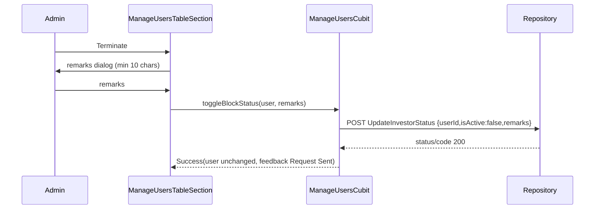
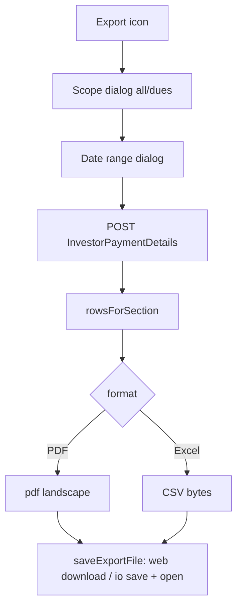
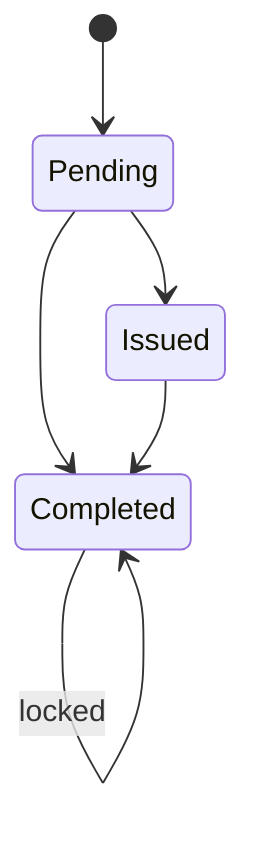

# ADMIN_USER_MANAGEMENT

Source: `lib/admin/user_management/` (working tree; `manage_users_screen.dart`, `pdf_excel_model.dart`, `manage_users_export_file.dart`, `due_payments_screen.dart` have uncommitted edits). Endpoints from `lib/core/constants/api_endpoints.dart`.

## 1. Purpose
Two admin screens plus shared pieces:
- **Manage Users**: list investors, search/filter, terminate (block) an investor with remarks, open an investor detail page (benefits summary, refund, MOU and LLP document status/upload, receipts download), and export a payment report (PDF/CSV).
- **Due Payments**: payment status report per investor with status filter and search, payment details dialog, and a WhatsApp reminder (opens `wa.me` link; no backend call).
- Shared: model enums, table/toolbar/stat-card widgets, confirm dialog.

## 2. Files
Base `lib/admin/user_management/`

| Path | Class | Role |
|---|---|---|
| model/managed_user_model.dart | ManagedUserModel; enums UserPaymentStatus, ManageUsersStatusFilter, DuePaymentsStatusFilter, DocumentProcessStatus (+ext) | Shared enums and a legacy-style user model (used by Due Payments `toManagedUser()` for the details dialog) |
| widgets/user_management_confirm_dialog.dart | showUserManagementConfirmDialog | Confirm dialog returning bool |
| widgets/user_management_list_toolbar.dart | UserManagementListToolbar, UserManagementExportIcons, export scope + date-range dialogs, enums UserManagementExportFormat {excel,pdf}, UserManagementExportScope {allTransactions,dues} | Search, filter chips, export controls |
| widgets/user_management_stat_cards.dart | UserManagementStatCards, UserManagementSectionHeader | Summary cards, header |
| widgets/user_management_table_widgets.dart | UserManagementTableCard/HeaderRow/HeaderCell/DataCell/StatusBadge/TableFrame, enum UserManagementBadgeTone | Table building blocks (also used by Settings investor rating table) |
| screens/manage_users/screens/manage_users_screen.dart | ManageUsersScreen, _ManageUsersView | List screen; provides repository + cubit; swaps to detail |
| screens/manage_users/screens/user_status_update_screen.dart | UserStatusUpdateScreen | Investor detail page |
| screens/manage_users/screens/widgets/manage_users_overview_section.dart | ManageUsersOverviewSection | totals cards |
| .../manage_users_table_section.dart | ManageUsersTableSection, _ManageUserRow | table, search, filter, export, terminate |
| .../terminate_user_remarks_dialog.dart | showTerminateUserRemarksDialog | remarks dialog |
| .../user_benefits_summary_card.dart | UserBenefitsSummaryCard | investor benefits (discount, medical allowance etc.) |
| .../user_refund_card.dart | UserRefundCard | refund form |
| .../user_status_checkbox_card.dart | UserStatusCheckboxCard | MOU/LLP status + document upload |
| .../user_receipts_card.dart | UserReceiptsCard | receipt list + download |
| .../user_status_update_header.dart | UserStatusUpdateHeader | header with back |
| screens/manage_users/cubit/manage_users_cubit.dart, manage_users_state.dart | ManageUsersCubit, ManageUsersState (sealed) | all logic |
| screens/manage_users/repository/manage_users_repository.dart | ManageUsersRepository | HTTP |
| screens/manage_users/model/manage_users_response_model.dart | ManageUsersResponse, ManageUsersTotals, ManageUsersInvestor | |
| .../block_user_request_model.dart | BlockUserRequestModel, BlockUserResponseModel | |
| .../refund_investor_request_model.dart | RefundInvestorRequestModel, RefundInvestorDataModel, RefundInvestorResponseModel | |
| .../save_investor_mou_request_model.dart | SaveInvestorMOURequestModel, SaveInvestorMOUResponseModel, SaveInvestorMOUDataModel | used for both MOU and LLP |
| .../investor_block_requests_model.dart | InvestorBlockRequestsResponse, InvestorBlockRequestModel | |
| .../review_block_request_model.dart | ReviewBlockRequestModel, ReviewBlockRequestResponse, ReviewBlockRequestResult | |
| .../pdf_excel_model.dart | PdfExcelRequestModel, PdfExcelResponseModel, PdfExcelInvestorModel, PdfExcelPaymentDetailModel | export data |
| screens/manage_users/utils/manage_users_export_file.dart | ManageUsersExportFile | builds PDF / CSV bytes |
| .../export_file_saver.dart (+_io, _web) | saveExportFile, ExportSaveResult | conditional import: io vs `dart.library.html` |
| screens/due_payments/due_payments_screen.dart | DuePaymentsScreen | |
| screens/due_payments/cubit/due_payments_cubit.dart, _state.dart | DuePaymentsCubit, DuePaymentsState, DuePaymentsOverviewStats | |
| screens/due_payments/repository/due_payments_repository.dart | PaymentStatusReportRepository | |
| screens/due_payments/model/payment_status_report_model.dart | PaymentStatusReportResponseModel, PaymentStatusReportModel | |
| screens/due_payments/widgets/ | DuePaymentsOverviewSection, DuePaymentsTableSection, payment details dialog, send reminder preview dialog (`buildWhatsAppReminderMessage`, `normalizeWhatsAppPhone`) | |

## 3. Screens and widgets
- **ManageUsersScreen(isActive)**: lives in the admin shell IndexedStack; refetches users when it becomes active; drops the detail view when the tab becomes inactive. Tapping a row sets `_selectedUserId/_selectedCommittedAmount/_selectedPaidAmount` and shows `UserStatusUpdateScreen`. Navigation swaps are deferred (`scheduleFrameCallback` + `Future.delayed(Duration.zero)`).
- **ManageUsersTableSection**: search "Search by name, mobile, email...", filter All / Active / Blocked (client-side), export icons. Row action: "Terminate" for active users; after request submitted shows "Req sent" (still Active); terminated rows show "Terminated".
- **UserStatusUpdateScreen**: on init fetches MOU and LLP status; shows UserBenefitsSummaryCard, UserRefundCard, two UserStatusCheckboxCards (MOU, LLP), UserReceiptsCard. If the user is not found in cubit state, shows "Investor not found".
- **DuePaymentsScreen(isActive)**: overview stats + table; row actions: view details dialog, send WhatsApp reminder (only when outstanding dues and not already sending).

## 4. Cubit / state classes

### ManageUsersCubit
States (sealed): `ManageUsersInitial`, `ManageUsersLoading`, `ManageUsersEmpty(isTableLoading,isExporting)`, `ManageUsersSuccess` (see fields), `ManageUsersFailure`, plus subclasses of Success: `InvestorTransactionHistoryLoading/Success/Failure`.
`ManageUsersSuccess` fields: users; mouStatus/llpStatus (Map<investorId, DocumentProcessStatus>); mou/llp IssuedAt/CompletedAt; mou/llp DocumentPath and DocumentUpdatedAt; statusUpdatingUserId, refundUpdatingUserId, mouUpdatingUserId, mouLoadingUserId, llpUpdatingUserId, llpLoadingUserId; statusFeedback (isSuccess,title,message); isTableLoading; isExporting; transactionHistoryResponse/isTransactionHistoryLoading/transactionHistoryError; blockRequestsResponse, isBlockRequestsLoading, blockRequestsError, blockRequestsStatusFilter, blockRequestReviewingId. Getters: totalUsers, activeUsers (`!isBlocked`), blockedUsers, usersWithPendingDues, blockRequests.

Methods:
- `fetchUsers()`: Loading (or table-loading flag if data exists) -> Success / Empty (no rows) / Failure. A response is considered successful if status true OR code 200 OR message contains "success", or rows exist.
- `toggleBlockStatus(user, {terminateRemarks})`: only valid when state is Success and none in progress. `targetIsActive = user.isBlocked`; if terminating (target inactive) remarks must be non-empty or it silently returns. Terminate success does **not** flip local `isActive`; sets `hasPendingTerminateRequest` so the row shows "Req sent", toast "Request Sent". Flag is preserved across list refresh while still Active. Unblock success still updates `isActive` locally.
- `refundUser(user, refundAmount, paymentMethod, remarks)` -> bool. On success: `amountPaid` := `data.remainingRefundableAmount` if returned, else `(amountPaid - refundAmount)` floored at 0; feedback "Refund Saved".
- `fetchInvestorMouStatus(id)`, `saveInvestorMouStatus({investorId,status,documentBytes,documentFileName})`, `uploadInvestorMouDocument`, `clearInvestorMouDocument`; same four for LLP.
  Rule `_canDowngradeDocumentStatus`: Completed can only stay Completed; Pending cannot be re-selected once beyond Pending (next == pending only allowed if current is pending). A save without a document and with unchanged status is a no-op. Status is applied optimistically then synced from `response.latestRecord`.
- `fetchInvestorTransactionHistory(userId)` (receipts).
- `fetchBlockRequests({status})`, `reviewBlockRequest({requestId,status,remarks})` -> message; status normalised to `Approved` or `Rejected` (anything else returns null). These two are used by the Pending Requests module (`pending_requests/.../terminated_investors_section.dart`), not by screens in this module.
- `exportInvestorPaymentReport({asPdf, section, fromDate, toDate})` -> ManageUsersExportResult(success,message,savedLocation); guarded by `_exportInProgress`; sets `isExporting` on the state; section normalised to `due` or `all`.
- `clearStatusFeedback()`.

### DuePaymentsCubit
States: Initial, Loading, Success(items,statusFilter,search,overview,isTableLoading), Empty(...), Failure(message,statusFilter,search,overview). Method `fetchPaymentStatusReport({statusFilter, search})`: cancels previous request (`CancelToken`), keeps filter/search in the cubit, emits table-loading, calls repo with `status` = All | Pending | PartiallyPaid | FullyPaid. Overview stats (total outstanding, counts of pending / partially paid / fully paid) are recomputed only when filter is All and search is empty; otherwise the previous overview is retained.

## 5. Repository methods

| Method | HTTP | Constant | Path | Request | Response -> model |
|---|---|---|---|---|---|
| ManageUsersRepository.getInvestors | GET | investorsList | /api/Investor/GetInvestors | none | `_decodePayload` (accepts JSON string) -> ManageUsersResponse (data list or nested investors/items/list/data; totals from `total`) |
| getBlockRequests({status}) | GET | getBlockRequests | /api/Investor/GetBlockRequests | optional query `status` | InvestorBlockRequestsResponse; throws unless status or code 200 |
| reviewBlockRequest | POST | reviewBlockRequest | /api/Investor/ReviewBlockRequest | JSON requestId, status, remarks | ReviewBlockRequestResponse |
| blockUser | POST | blockUser | /api/Investor/UpdateInvestorStatus | JSON userId, isActive, remarks (only if non-empty) | BlockUserResponseModel |
| refundInvestor | POST | refundInvestor | /api/Investor/RefundInvestor | JSON userId, refundAmount, paymentMethod, remarks | RefundInvestorResponseModel |
| saveInvestorMOU | POST | saveMOU | /api/Investor/SaveInvestorMOU | multipart investorId, status (Pending/Issued/Completed else ArgumentError), optional `Document` file | SaveInvestorMOUResponseModel; throws unless status && code 200 |
| getInvestorMOU | GET | getInvestorsMOU | /api/Investor/GetInvestorMOU/{investorId} | path | same |
| saveInvestorLLP | POST | saveLLP | /api/Investor/SaveInvestorLLP | same as MOU | same |
| getInvestorLLP | GET | getInvestorsLLP | /api/Investor/GetInvestorLLP/{investorId} | path | same |
| getPdfExcel | POST | getPdfExcel | /api/Investor/InvestorPaymentDetails | JSON fromDate, toDate (UTC ISO-8601), section (`all`/`due`) | PdfExcelResponseModel; throws unless status && code 200 |
| getInvestorTransactionHistory(userId) | GET | investorTransactionHistory | /api/Investor/InvestorTransactionHistory/{userId} | path suffix | InvestorTransactionHistoryResponseModel (defined in `user/investments/model`, other module) |
| PaymentStatusReportRepository.getPaymentStatusReport | GET | paymentStatusReport | /api/Investor/PaymentStatusReport | query status, optional search | PaymentStatusReportResponseModel; throws if `status` false; maps timeouts/401/403/404 to friendly messages |

## 6. Models (key JSON)
- ManageUsersInvestor (camel or Pascal keys): userId, userName/username, fullName, email, phoneNumber, totalInvestmentAmount (fallback investmentAmount) -> totalPayable, totalPaidAmount -> amountPaid, totalPendingAmount, isActive, createdDate, discountAmount/depositDiscountAmount/totalDiscountAmount, medicalAllowanceDescription/Note/medicalAllowance. Derived: `isBlocked = !isActive`; label "Terminated"/"Active"; `outstandingBalance = max(totalPayable - amountPaid, totalPendingAmount, 0)`; `hasPendingDues` if > 0.01. `terminateRemarks` is local-only (set at terminate; remainder of fromJson not read - Unclear - needs human clarification whether API returns remarks).
- InvestorBlockRequestModel: requestId, userId, investorCode, fullName, email, phoneNumber, isActive, status (`pending` => isPendingReview), remarks, requestedDate, requestedBy(+Name), reviewedBy(+Name), reviewedDate, reviewRemarks.
- SaveInvestorMOUDataModel: id, investorId, status, documentPath, createdDateTime, modifiedDateTime. Response helpers: `latestRecord` (furthest status rank then newest), `recordForStatus`, `timestampForStatus`, `latestDocumentRecord`, `effectiveDocumentPath`.
- PdfExcelInvestorModel: tolerant multi-key reading. due = first of totalInvestmentAmount/dueAmount/totalPayable/investmentAmount/committedAmount/installmentAmount; paid = first of totalPaidTillDate/amountPaidDuringPeriod/paidAmount/amountPaid/totalPaidAmount/receivedAmount; pending = first of pendingAmountAsOfToDate/pendingAmount/outstanding/totalPendingAmount, else computed due - paid when > 0.01; paymentDetails list; `exportRows` expands each paymentDetail into a row (paid = paidAmount if > 0 else receivedAmount). `PdfExcelResponseModel.rowsForSection('due')` returns investors as-is; for 'all' returns expanded transaction rows.
- PaymentStatusReportModel: userId, investorCode, name, email, phoneNumber, totalPayable, amountPaid, outstanding, discountAmount, dueAmount, dueDate, paymentStatus, latestPaymentAmount, paymentMethod, narration, paymentDate.
- ManagedUserModel: see enums; outstandingBalance = max(totalPayable - amountPaid, 0); paymentStatus fullyPaid when outstanding <= 0.01, partiallyPaid when amountPaid > 0.

## 7. Business rules
- Terminate requires remarks: dialog validator "Remarks are required to terminate this user" and minimum 10 characters. Unblocking is disabled in UI (cubit still supports it).
- Refund form: payment method required; amount must be > 0 and <= `paidAmount` of the investor (committed/paid values passed from list); remarks required.
- MOU/LLP: statuses Pending -> Issued -> Completed. Locked rules shown in UI: Completed cannot change; Issued cannot go back to Pending. Selecting Completed asks confirmation. Documents: one file only, extensions pdf, doc, docx, jpg, jpeg, png; file must have bytes; pending (local) file shown until uploaded; upload calls save with current status and file.
- Export: date range dialog defaults to last 30 days to today, first selectable date 2020-01-01, last = today; To cannot be before From. `fromDate` = start of day, `toDate` = 23:59:59.999 local, sent as UTC. Scope: all transactions -> `all`, dues -> `due`.
- Export files: name `investor_payments_<all|dues>_<yyyyMMdd_HHmmss>.<pdf|csv>`. IMPORTANT: the "Excel" option actually generates a **CSV** (UTF-8 with BOM), mime `text/csv`. PDF is A4 landscape with Montserrat-Bold font (`assets/font/Montserrat-Bold.ttf`). Columns: User ID, Investor Code, Full Name, Date, Payment Method, Due Amount, Paid Amount, Pending Amount. Empty data still produces a file ("No investor records found...").
- Saving: web triggers an anchor download; IO writes to `/storage/emulated/0/Download` on Android if writable, else application documents dir, then opens with OpenFilex.
- WhatsApp phone normalisation: strip non-digits; < 10 digits invalid; exactly 10 digits -> prefix `91`; else as is. Reminder text includes name, investor code (or userId), total payable, amount paid, due amount, due date. URL `https://wa.me/<phone>?text=<encoded>` launched externally.
- Permissions: nav access to these screens is controlled outside this module (`admin/navigation/admin_nav_permissions.dart`); ids manageUsers and duePayments exist in the settings permission catalogue. Unclear - needs human clarification how roles map.

## 8. Workflows
1. Terminate an investor: Manage Users -> row "Terminate" -> remarks dialog -> POST UpdateInvestorStatus(isActive:false, remarks) -> toast "Request Sent"; row stays Active until approve.
2. Refund: row -> detail -> Refund card -> amount/method/remarks -> POST RefundInvestor -> paid amount updated.
3. MOU/LLP: detail -> pick status (confirm for Completed) and/or choose file -> upload -> status and dates synced.
4. Export: toolbar export icon -> choose scope -> choose date range -> API -> file generated and saved/opened.
5. Receipt: detail -> receipts card loads history -> download button uses `TransactionReceiptDownloader.download` (user module).
6. Due reminder: Due Payments -> WhatsApp icon -> preview dialog -> confirm -> WhatsApp opens.

## 9. Navigation
In: admin shell tabs (Manage Users, Due Payments) with `isActive` flag. Pending Requests screen reuses `ManageUsersCubit` for block requests. Out: Manage Users list <-> UserStatusUpdateScreen via local state, no named routes.

## 10. Dependencies
`core` (api_endpoints, AppToast, CurrencyFormatter, ApiErrorMessage, AdminMainScreenLayout, ImageConstants), get_it Dio, `user/investments` (transaction history model + TransactionReceiptDownloader), packages: file_picker, pdf, open_filex, path_provider, url_launcher, dio. Pending Requests module consumes block-request methods. Settings investor rating table uses table widgets.

## 11. Unclear
- Whether the server returns terminate remarks on investors list.
- Role-to-screen permission mapping.
- Why Excel is a CSV (naming) - code only; no xlsx library used here.
- Exact UserBenefitsSummaryCard fields (reads medical allowance and discount from `ManageUsersInvestor`; not fully traced).
