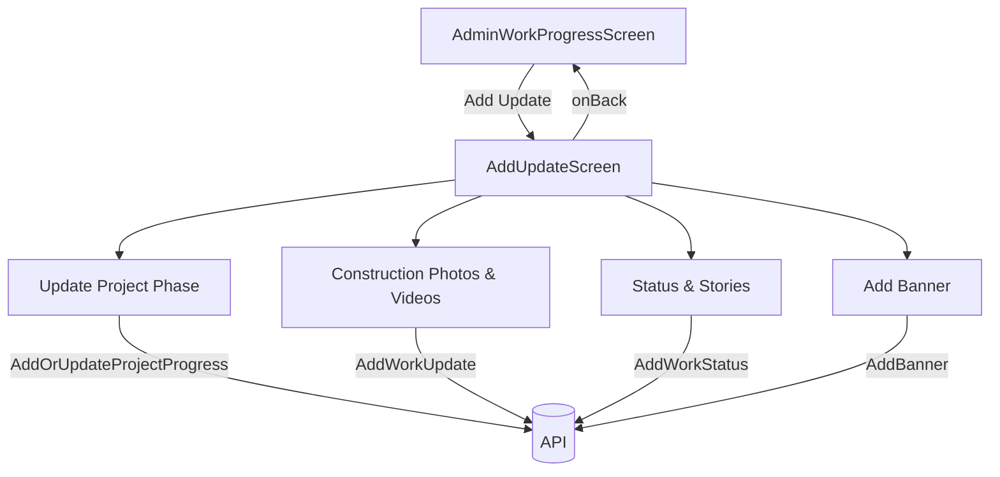
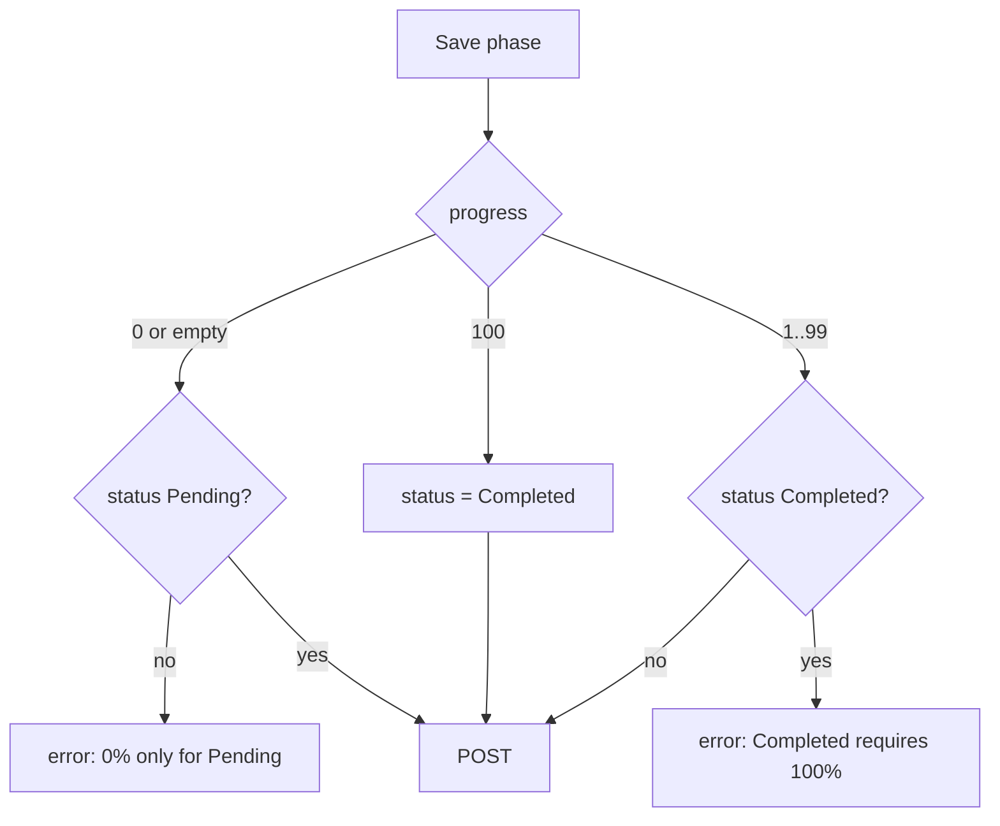
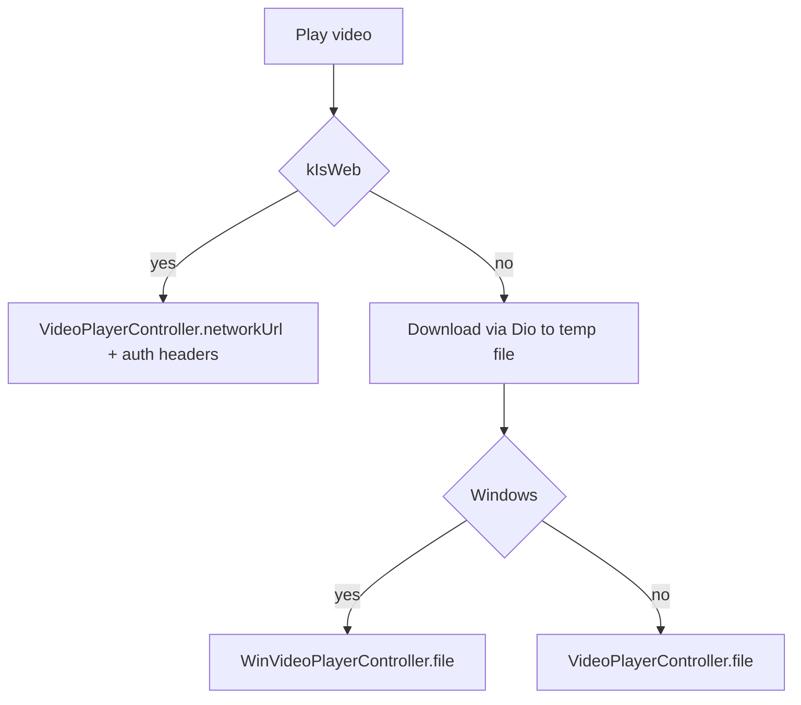

# ADMIN_WORK_PROGRESS

Source: `lib/admin/work_progress/` (working tree; `work_progress_screen.dart` has uncommitted edits). Endpoints from `lib/core/constants/api_endpoints.dart`. Note: one directory is literally named `add _banner` (with a space) and another `update_status_stroies` (typo) in source.

## 1. Purpose
- **Work Progress** (dashboard): construction timeline table with overall stats, read from the work phase list.
- **Add Update** (sub-flow opened from Work Progress): four tools - Update Project Phase, Status & Stories Media, Construction Photos & Videos, Add Banner. Each has add and view/delete (or edit) modes.

## 2. Files
Base `lib/admin/work_progress/`

| Path | Class | Role |
|---|---|---|
| models/add_update_models.dart | ProjectPhaseUpdate, MediaUpdate, SavedUpdateEntry | Local UI models (not API) |
| screens/work_progress/work_progress_screen.dart | AdminWorkProgressScreen | Dashboard; provides `AddPhaseRepository` + `WorkProgressCubit`; toggles to AddUpdateScreen |
| screens/work_progress/cubit/work_progress_cubit.dart, _state.dart | WorkProgressCubit, WorkProgressState | phase list |
| screens/work_progress/widgets/work_progress_overview_section.dart | WorkProgressOverviewSection | title row with "Add Update" button + 4 stat cards |
| screens/work_progress/widgets/work_progress_timeline_table.dart | WorkProgressTimelineRow, WorkProgressTimelineTable | search + table |
| screens/work_progress/widgets/work_progress_big_cards.dart | (all commented out) | dead code |
| screens/add_update/add_update_screen.dart | AddUpdateScreen | option cards + selected content |
| screens/add_update/widgets/add_update_option_cards.dart | AddUpdateOptionType {projectPhase, statusStories, constructionMedia, banner}, AddUpdateOptionCards | |
| screens/add_update/add _banner/add_banner.dart | AddBanner (+ BannerScreenMode add/view toggle) | |
| .../add _banner/cubit/add_banner_cubit.dart, _state.dart | AddBannerCubit, AddBannerState | |
| .../add _banner/models/ | AddBannerModel, BannerModel, DeleteBannerModel | |
| .../add _banner/repository/add_banner_repository.dart | AddBannerRepository | |
| .../add _banner/widgets/ | add_banner_form.dart, view_delete_banners.dart, banner_common_widgets.dart | |
| screens/add_update/update_phase/update_project_phase_form.dart | UpdateProjectPhaseForm | add stage / add or edit phase |
| .../update_phase/view_updates_list.dart | ViewUpdatesList, `workPhaseToProjectPhaseUpdate` | list and tap-to-edit |
| .../update_phase/cubit/*.dart | UpdatePhaseCubit, UpdatePhaseState | |
| .../update_phase/model/ | AddPhaseRequestModel, AddPhaseModel, AddOrUpdatePhaseRequestModel, AddOrUpdatePhaseResponseModel, WorkPhaseListModel | |
| .../update_phase/repository/update_phase_repository.dart | AddPhaseRepository | |
| screens/add_update/update_construction_photos_videos/update_construction_toggle.dart | UpdateConstructionMedia, mode enum ConstructionMediaScreenMode {add,view} | provides cubit |
| .../update_construction_media_form.dart | form (pick one photo or video, title, description) | |
| .../view_delete_construction_media.dart | ViewDeleteConstructionMedia, previews, `_downloadVideoFile`, network/thumbnail players | |
| .../cubit/*.dart, model/*.dart, repository/update_construction_repository.dart | UpdateConstructionCubit/State, AddWorkUpdateModel, WorkUpdateData, GetWorkUpdatesModel, WorkUpdateModel, DeleteWorkUpdateModel, WorkUpdateRepository | |
| .../windows_video_play_support/win_video_support.dart | conditional export | `win_local_video_player_stub.dart` by default, `win_local_video_player.dart` if `dart.library.io` |
| .../win_local_video_player.dart | `supportsWinVideoPlayer` (= !kIsWeb && Platform.isWindows), WinVideoThumbnail, WinLocalVideoPlayer | uses `video_player_win` (`WinVideoPlayerController`) |
| .../win_local_video_player_stub.dart | stubs | `supportsWinVideoPlayer` false; WinLocalVideoPlayer calls onFailed(UnsupportedError) |
| screens/add_update/update_status_stroies/update_status_stories_form.dart, view_delete_status_stories.dart | UpdateStatusStoriesForm, ViewDeleteStatusStories | same UX as construction media |
| .../update_status_stroies/cubit/, model/, repository/add_work_status_repository.dart | UpdateStatusCubit/State, AddWorkStatusResponseModel, WorkStatusModel, DeleteWorkStatusModel, GetWorkStatusResponseModel, AddWorkStatusRepository | |

## 3. Screens and widgets
- **AdminWorkProgressScreen**: refetches phases on creation (`WorkProgressCubit..fetchWorkPhaseList()`); error toast; shows refetch progress only if phases were cached. "Add Update" sets `_showAddUpdate` (plain setState, no route). Returning rebuilds the screen (new cubit, refetch).
- **WorkProgressOverviewSection stats** (computed client-side from phases): Overall Progress = rounded average of `progress` (0..100 clamp), Completed Tasks "completed/total", In Progress count, Pending Task count.
- **WorkProgressTimelineTable**: client-side search over stage, team, dates, progress, status; columns stage, assigned team, start, due, progress bar, status badge. Progress colour: >= 80 green, >= 50 yellow, > 0 red. Status mapping from string: contains "complete" -> completed; contains "progress" -> inProgress; else pending. Empty team -> "-", empty stage -> "Untitled stage", no due date -> "-".
- **AddUpdateScreen**: back via `onBack` (fallback `Navigator.pop`). Picking an option clears editing state. Project phase section has Add/View toggle with count; tapping a phase in the list opens the form in edit mode (`workPhaseToProjectPhaseUpdate`). After a successful save, switches to View mode. Statuses/Construction media/Banner contents are created with their own BlocProviders; `_saveConstructionMedia` keeps a local `_mediaUpdates` list (local only, appears unused for display - Unclear - needs human clarification).

## 4. Cubit / state classes
- **WorkProgressCubit**: Initial, Loading, Success(phases), Failure(message). `fetchWorkPhaseList()`.
- **UpdatePhaseCubit**: states StageList{Loading,Success,Failure}, UpdatePhase{Initial,Loading,Success(phase,message),Error}, WorkPhaseList{Loading,Success,Failure}, SaveWorkPhase{Loading,Success(phase,message,isUpdate),Failure}. Methods: `fetchStageListIfNeeded/fetchStageList`, `addPhase(stageName)` (rejects empty; appends to cached stages if not duplicate by id or name case-insensitive), `restoreStageListState`, `fetchWorkPhaseListIfNeeded/fetchWorkPhaseList`, `addOrUpdateWorkPhase(request,isUpdate)` (after success refetches list).
- **UpdateConstructionCubit**: Initial, UpdateConstruction{Loading,Success(response),Error}, GetWorkUpdates{Loading,Success(updates),Error}, DeleteWorkUpdate{Loading(id),Success(id,message),Error}. `addWorkUpdate(title,description,file)` -> on success invalidates cache and refetches; `fetchWorkUpdates(IfNeeded)`; `deleteWorkUpdate(id)` guarded against concurrent delete and id <= 0; removes the item locally.
- **UpdateStatusCubit**: Initial, UpdateStatus{Loading,Success(message,data),Error}, GetWorkStatus{Loading,Success,Error}, DeleteWorkStatus{...}. `addWorkStatus`, `fetchWorkStatus(IfNeeded)`, `deleteWorkStatus`. Same pattern as construction.
- **AddBannerCubit**: Initial, AddBanner{Loading,Success(banner,message,uploadedCount),Failure}, GetBanners{Loading,Success,Failure}, DeleteBanner{Loading(id),Success,Failure}. `fetchBanners(IfNeeded)`, `addBanner(image)`, `addBanners(images)` (empty -> failure "Please select at least one banner image."; one image -> addBanner; multiple -> uploads sequentially, partial success message "Uploaded n of m banners."), `deleteBanner(bannerId)`; refetches after successful add.

## 5. Repository methods

| Method | HTTP | Constant | Path | Request | Response -> model |
|---|---|---|---|---|---|
| AddPhaseRepository.addPhase | POST | addStage | /api/Project/AddProjectStage | JSON stageName | `data` -> AddPhaseModel (stageId, stageName); null on failure |
| .getStageList | GET | stageList | /api/Project/ProjectStageList | none | `data` list -> List<AddPhaseModel> |
| .addOrUpdatePhase | POST | addOrUpdatePhase | /api/Project/AddOrUpdateProjectProgress | JSON stageId, startDate (UTC ISO), dueDate? (UTC ISO), constructionTeam, progress, status, description | `data` -> AddOrUpdatePhaseResponseModel (null on failure). No phase id in request: backend keys on stage (Unclear - needs human clarification) |
| .workPhaseList | GET | workPhaseList (=/api/Project/WorkProgressDetails) | | none | `data` list -> List<WorkPhaseListModel>; throws Exception on invalid body/status false |
| WorkUpdateRepository.addWorkUpdate | POST | workUpdate | /api/Project/AddWorkUpdate | multipart Title, Description, File | AddWorkUpdateModel |
| .getWorkUpdates | GET | getWorkUpdates | /api/Project/GetWorkUpdates | none | GetWorkUpdatesModel |
| .deleteWorkUpdate | DELETE | deleteWorkUpdate | /api/Project/DeleteWorkUpdate/{id} (id appended) | path | DeleteWorkUpdateModel |
| AddWorkStatusRepository.addWorkStatus | POST | addWorkStatus | /api/Project/AddWorkStatus | multipart Title, Description, File (contentType multipart/form-data) | AddWorkStatusResponseModel |
| .getWorkStatus | GET | getWorkStatus | /api/Project/GetWorkStatus | none | GetWorkStatusResponseModel |
| .deleteWorkStatus | DELETE | deleteWorkStatus | /api/Project/DeleteWorkStatus/{id} | path | DeleteWorkStatusModel |
| AddBannerRepository.addBanner | POST | addBanner | /api/Project/AddBanner | multipart Image | AddBannerModel (status,message,code,data.bannerId,data.bannerImage); null if HTTP not 200/201 |
| .getBanners | GET | getBanner | /api/Project/GetBanners | none | `data` list -> BannerModel (bannerId, bannerImage; `bannerImageUrl` via resolveMediaUrl) |
| .deleteBanner | DELETE | deleteBanner | /api/Project/DeleteBanner | JSON body bannerId | DeleteBannerModel; if response lacks id falls back to requested id |

Repositories mostly swallow errors and return null (banner, work-update add, status) or throw (phase list); cubits turn these into generic messages. `AddWorkStatusRepository` takes Dio from `getIt<Dio>()` internally; others receive Dio from caller.

## 6. Models (key JSON)
- WorkPhaseListModel / AddOrUpdatePhaseResponseModel: phaseId, projectId, projectName, stageId, stageName, startDate, dueDate (year <= 1 treated as null), constructionTeam, progress, status, description, progressDate (camel or Pascal).
- WorkUpdateModel / WorkStatusModel: workUpdateId (workStatusId), title, description, fileName, fileType, mimeType, googleDriveFileId, fileUrl, createdDate (string), createdBy, status. `isVideo` = fileType contains "video" or mime starts `video/`; `isImage` similarly; `mediaPreviewUrl` = `resolveMediaUrl(fileUrl)`.
- Local UI models: ProjectPhaseUpdate (id, stageId, stage, assignedTeam, start/due, progress, status, description, updatedAt), MediaUpdate, SavedUpdateEntry.

## 7. Business rules and validation
**Project phase form**
- Statuses: Completed, In Progress, Pending. Stage must be chosen from the stage list or added (new stage name must be non-empty, unique case-insensitive). Start date required. Description max **20 words**. Progress is an integer percent; "%" stripped; cannot be < 0 or > 100.
- Linked status/progress rules: progress 0 -> Pending only; progress 100 -> forced Completed; Completed requires 100%; In Progress requires progress > 0 (and progress entered); selecting Completed with empty progress sets 100; `_syncStatusWithProgress`: <=0 Pending, >=100 Completed, else In Progress (applied when editing/typing).
- Update vs add decided by `widget.initial != null`; request carries stageId only.
- Due date optional (sent only if set); earliest picker date 2000-01-01.

**Construction media and Status stories (identical rules)**
- Exactly one file; photo types png, jpg, jpeg max 10 MB; video types mp4, mov max 50 MB; cannot switch photo/video while a file is selected. Title required; description required. Web: file bytes used (never `path`); desktop/mobile video may use path (MultipartFile from file path), photos use bytes. Content types: image/jpeg|png, video/mp4, video/quicktime for mov.
- Delete asks confirmation, then DELETE by id.

**Banner**
- Multiple images; types jpg, jpeg, png, webp; max 5 MB each; at least one required; delete requires confirm.

**Video playback (view screens)**
- Web: `VideoPlayerController.networkUrl` with auth headers. IO platforms: download the file first via Dio (receive timeout 5 min, send timeout 2 min in status viewer) to a temp file, then Windows uses `WinVideoPlayerController.file` (Media Foundation via `video_player_win`, looped, autoplay), others use `VideoPlayerController.file`. Thumbnails follow the same split (`WinVideoThumbnail` on Windows).
- Windows support is chosen at compile time by conditional export (`dart.library.io`) and at runtime by `Platform.isWindows`.

**Permissions**: screen is the `workProgress` drawer item (`admin_main_screen.dart` returns `AdminWorkProgressScreen`); allowed-screen ids live in the nav permissions module (not part of this module).

## 8. Workflows
1. View progress: open Work Progress -> phases fetched -> stats and table; search filters rows locally.
2. Add stage + phase: Add Update -> Update Project Phase -> (optional) add stage name -> choose stage, dates, team, progress, status, description -> POST AddOrUpdateProjectProgress -> toast -> list refresh and switch to view mode.
3. Edit phase: View mode -> tap a phase -> form pre-filled (isUpdate) -> save.
4. Upload construction media: pick a photo or video -> title + description -> POST AddWorkUpdate multipart -> list refetch.
5. Upload status/story media: same with AddWorkStatus.
6. Banners: select images (<= 5 MB) -> upload each sequentially -> list refresh; view -> delete with confirm.

## 9. Navigation
In: admin drawer item Work Progress. Out: Add Update by local state; back via callback; no named routes.

## 10. Dependencies
`api_endpoints.dart`, get_it Dio, `ApiErrorMessage`, `resolveMediaUrl`, `AppToast`, `AdminMainScreenLayout`; packages: file_picker, video_player, video_player_win, dio. Downstream: banners, work updates, work statuses and work progress are consumed by the investor user app (`ApiEndpoints.getBanners`, `getWorkUpdates`, `workProgressDetails`, `workProgressGraph`) - not read in this pass.

## 11. Unclear
- Whether `_mediaUpdates` in AddUpdateScreen is displayed anywhere (local list only).
- How backend identifies a phase on update (request has no phaseId).
- "Status & Stories" display rules/expiry in the user app (no expiry logic seen in admin code).
- Whether `ProjectPhaseUpdate/MediaUpdate` local models are still needed.
- `work_progress_big_cards.dart` is fully commented out (dead).
