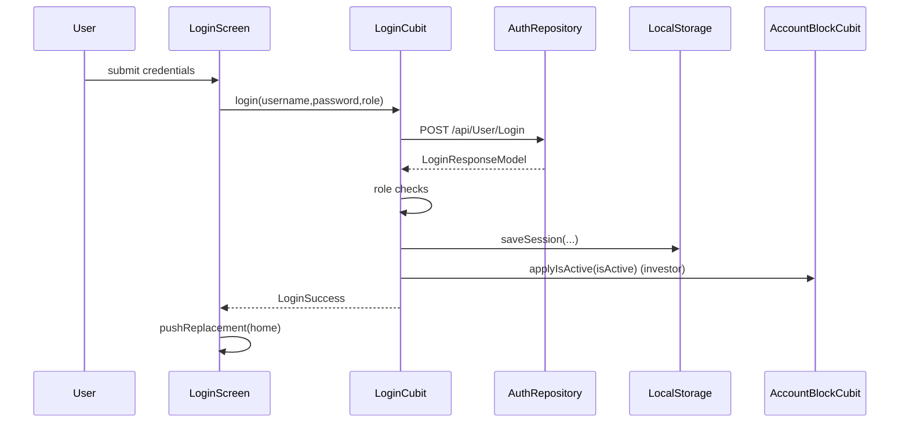
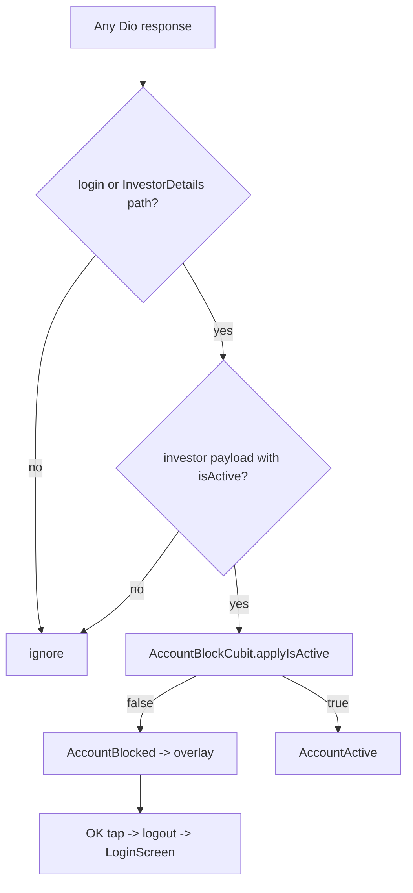

# Auth and Account Block (lib/auth/**, lib/core/account/**)

## 1. Purpose
Handles sign-in for both the investor mobile app and the admin web/desktop app, session restore at startup (splash), forced logout, and the "account terminated" (blocked investor) overlay driven by the `isActive` flag returned by the API.

## 2. Files
| Path | Class | Role |
|---|---|---|
| lib/auth/login_screen.dart | `LoginScreen` | Investor login form (mobile). If width >= `webBreakpoint` (900) it renders `AdminWebLoginScreen` instead. |
| lib/auth/admin_web_login_screen.dart | `AdminWebLoginScreen`, `_WebLoginRoleDropdown`, `_WebLoginField` | Admin web login with role dropdown. |
| lib/auth/splash_screen.dart | `SplashScreen` | Animated splash (GIF + text); decides home vs login. |
| lib/auth/cubit/login_cubit.dart, login_state.dart | `LoginCubit`, `LoginState` | Login / logout orchestration. |
| lib/auth/model/login_request_model.dart | `LoginRequestModel` | Request body. |
| lib/auth/model/login_response_model.dart | `LoginResponseModel`, `LoginDataModel` | Response parsing. |
| lib/auth/repository/login_repository.dart | `AuthRepository` | POST login. |
| lib/core/account/account_block_cubit.dart, account_block_state.dart | `AccountBlockCubit`, `AccountActive`, `AccountBlocked` | Block state holder. |
| lib/core/account/account_status_monitor.dart | `AccountStatusMonitor` | Inspects Dio responses / refreshes investor details to detect `isActive`. |
| lib/core/account/auth_navigation_guard.dart | `AuthNavigationGuard` | Static flags to suppress authenticated navigation during forced logout. |
| lib/core/account/account_block_routes.dart | `AccountBlockRoutes`, `AccountBlockNavigatorObserver`, global `accountBlockNavigatorObserver` | Tracks whether top route is an auth route (splash/login). |
| lib/core/account/account_blocked_overlay.dart | `AccountBlockedOverlay` | Full-screen non-dismissible "Account Terminated" overlay with OK button. |

Wiring (outside scope but relevant): lib/main.dart (MaterialApp builder stacks the overlay, only for the non-admin app), lib/core/network/service_locator.dart (Dio interceptor calls `AccountStatusMonitor.onResponse`; registers `LoginCubit` as factory, `AccountBlockCubit` as singleton).

## 3. Screens and widgets
- `LoginScreen`: username field, password field (show/hide toggle), login button with loading state, app version label. Validators: username must be non-empty after trim ("Please enter your username"); password must be non-empty ("Please enter your password"). Optional `snackBarMessage` shown after first frame (used after logout/termination). Props: `home` (widget to open after success), `snackBarMessage`.
- `AdminWebLoginScreen`: card layout, role dropdown (Admin, Super Admin, Financial Manager, Marketing Manager), username/password fields, loading state. Uses `AppToast` instead of snackbars.
- `SplashScreen`: runs text animation + GIF; navigates once both finish plus a delay (`_delayBeforeNavigate`).
- `AccountBlockedOverlay`: icon, "Account Terminated", text "Your account has been terminated by the administrator. Please contact the administrator for assistance.", OK button (logs out). `PopScope(canPop:false)`.

## 4. Cubit / state
`LoginState` (sealed): `LoginInitial`, `LoginLoading`, `LoginSuccess(response)`, `LoginFailure(message)`.

`LoginCubit.login({username, password, userRole, requiredRole, allowedRoles})`:
1. Reset `AuthNavigationGuard.suppressAuthenticatedNavigation=false` and `holdBlockedOverlay=false`; emit `LoginLoading`.
2. `AuthRepository.login`. If `!status` or `data==null` -> `LoginFailure(message or 'Login failed')`.
3. If a role was selected, compare `AdminNavPermissions.normalizeRole(selected)` to returned `userRole`; mismatch -> failure "This account is not registered as the selected role. Please choose the correct role and try again."
4. If `allowedRoles` given (admin web): returned role must be in list, else failure "Access denied. Only Admin, Super Admin, Financial Manager, and Marketing Manager accounts can log in here." Else if `requiredRole` given (investor app passes `'Investor'`): case-insensitive equality else "Access denied. Only Investor accounts can log in here."
5. `LocalStorage.saveSession(...)` (token, userId, username, fullName, userRole, email, investorCode, profileImage, isActive). `saveSession` clears the old session first.
6. If role is investor and `AccountBlockCubit` registered -> `applyIsActive(data.isActive)`.
7. If investor -> `NotificationService.registerDeviceToken()` (calls `/api/Notification/RegisterDevice` through the notifications repository; see USER_HOME.md).
8. Emit `LoginSuccess`. Any exception -> `LoginFailure(message without 'Exception: ')`.

`LoginCubit.logout()`: set `suppressAuthenticatedNavigation=true` before first await, `LocalStorage.clearSession()`, `AccountBlockCubit.reset()`, emit `LoginInitial`.

`AccountBlockState`: `AccountActive` (initial), `AccountBlocked`.
`AccountBlockCubit` methods: `syncFromStorage()` (emit Blocked only if stored isActive is explicitly false and a valid session exists), `applyIsActive(bool)` (ignored if session was cleared / suppression flag set; persists with `setIsActive`; emits Active/Blocked only on change), `reset()`.

## 5. Repository
`AuthRepository.login({username, password, userRole?})`
- HTTP POST `ApiEndpoints.login` = `/api/User/Login`.
- Body (`LoginRequestModel.toJson`): `username`, `password`, optional `userRole`.
- Response -> `LoginResponseModel.fromJson` (keys `status`, `message`, `data`, `code`); `data` -> `LoginDataModel`.
- Errors: `DioException` -> `Exception(response.data['message'] ?? e.message ?? 'Something went wrong')`; other -> `Exception('Something went wrong')`.
- The Dio interceptor does not attach the Authorization header to login requests (`_isPublicAuthRequest`) and attaches `Bearer <token>` from `LocalStorage` to all others.

`AccountStatusMonitor` (not a repository, but reads responses):
- `onResponse(Response)`: only for paths containing `ApiEndpoints.login` (`/api/User/Login`) or `ApiEndpoints.investorDetails` (`/api/Investor/InvestorDetails/`). Reads `body['data']`; requires the payload to be an investor account (payload `userRole` == investor or stored role investor) and to contain `isActive`/`IsActive`; coerces bool/num/string ("true"/"1") then calls `AccountBlockCubit.applyIsActive`. Ignored when suppression flag is on or (non-login) when no valid session. Never throws.
- `refresh()`: if investor with valid session and not already blocked, calls `ProfileRepository.getInvestorDetails(userId)` (guarded by `_refreshing`) purely so `onResponse` sees `isActive`.

## 6. Models
`LoginRequestModel`: `username`, `password`, `userRole?`.
`LoginResponseModel`: `status` (bool, default false), `message`, `data` (`LoginDataModel?`), `code` (int).
`LoginDataModel` JSON keys: `userId`, `username`, `fullName`, `email`, `phoneNumber`, `investorCode`, `profileImage`, `userRole`, `token`, `isActive` (default false).

## 7. Business rules
- Investor mobile login always sends `userRole: 'Investor'` and requires returned role Investor.
- Admin web login sends API role mapped from dropdown via `AdminNavPermissions.apiRoleForWebLoginLabel`; allowed roles list `AdminNavPermissions.adminWebLoginRoles`.
- Screen width >= 900 on `LoginScreen` switches to the admin web login (so a wide window shows admin login even in the investor build).
- Block detection: `isActive == false` on login response or any investor-details response -> overlay. Missing flag keeps account active.
- Forced logout protections: `suppressAuthenticatedNavigation` blocks login success navigation, splash restore, notification taps and late responses from restoring state; `holdBlockedOverlay` keeps overlay up until login route is on top.
- Overlay only shows when not on an auth route (`accountBlockNavigatorObserver.onAuthRoute` false); route names considered auth: `Navigator.defaultRouteName` ('/') and `/login`.
- Splash: `hasSession = hasValidSession && !suppressAuthenticatedNavigation`. If session and role investor, `syncFromStorage()` before opening home so overlay is on first frame; then `NotificationService.handlePendingInitialMessage()`.

## 8. Workflows
Investor login:
1. App starts -> `SplashScreen` -> no session -> `LoginScreen` (route name `/login`).
2. Enter username/password -> validators -> `LoginCubit.login(requiredRole:'Investor', userRole:'Investor')`.
3. Success: snackbar (server message or "Logged in successfully"), `pushReplacement` to `widget.home` (`UserMainScreen`), handle pending initial push message.
4. Failure: snackbar with message.

Admin web login: same with role dropdown, `allowedRoles`, `AppToast`, navigates to `widget.home` (admin shell, per main.dart `AdminMainScreen`).

Blocked account:
1. Dio response for login/InvestorDetails has `isActive:false` -> `AccountBlockCubit.applyIsActive(false)` -> `AccountBlocked`.
2. main.dart builder shows `AccountBlockedOverlay` above the app and ignores pointer events below; `UserMainScreen` hides bottom nav and swallows back.
3. User taps OK -> `holdBlockedOverlay=true`, `LoginCubit.logout()`, `pushAndRemoveUntil` to `LoginScreen(snackBarMessage: 'Your account has been terminated')` with route name `/login`.

## 9. Navigation
In: `SplashScreen` (app home), logout from profile (`LoginScreen` with 'Logged out successfully'), overlay OK. Out: `UserMainScreen` (investor), `AdminMainScreen` (admin, chosen in main.dart / by `home` argument).

## 10. Dependencies
`LocalStorage`, `getIt`/service_locator, `NotificationService` (registerDeviceToken, handlePendingInitialMessage, `notificationNavigatorKey`), `AdminNavPermissions` (admin module), `ProfileRepository` (user profile), `ApiEndpoints`, `AppSnackBar`, `AppToast`.

## 11. Unclear items
- Unclear - needs human clarification: `refreshToken` handling; `saveSession` accepts it but login model has no refresh token and no 401 handling exists in the Dio interceptor.
- Unclear - needs human clarification: `LoginDataModel.phoneNumber` is parsed but not saved to storage.
- Unclear - needs human clarification: whether the 900px breakpoint switch to admin login in the investor build is intentional.
- `isLoggedIn` flag set inside `saveSession` was not inspected in detail (`hasValidSession` requires token + `getIsLoggedIn()`).
