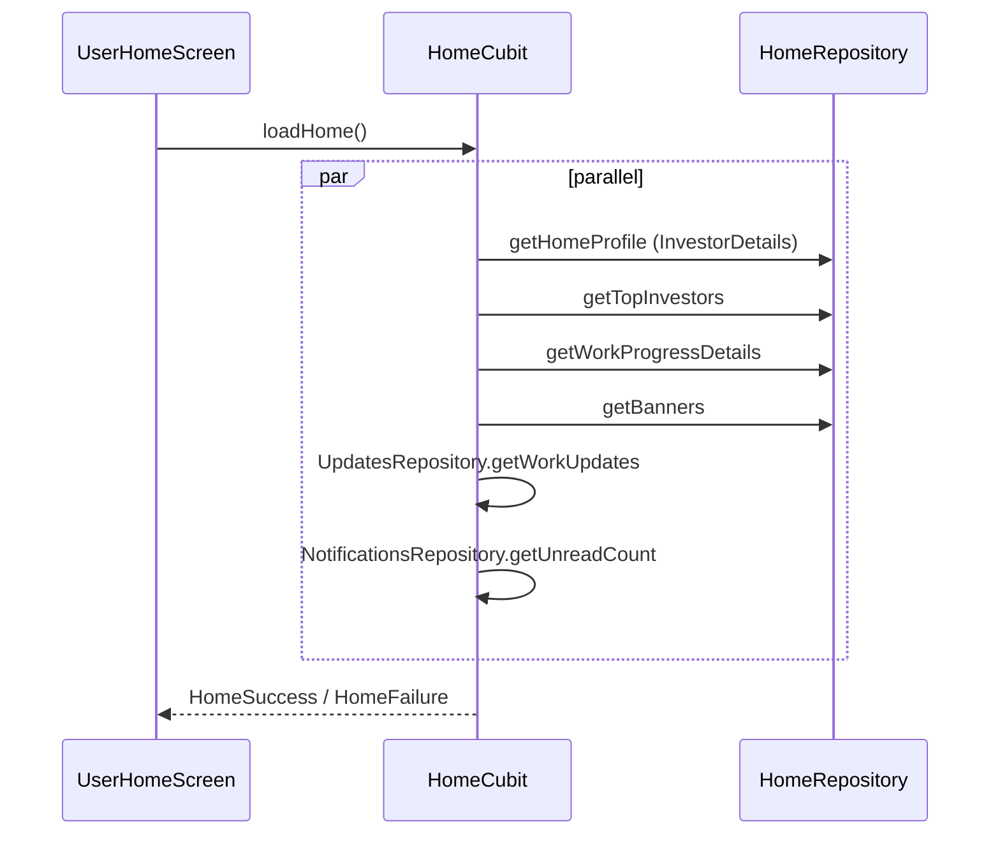

# User Home (lib/user/home/**)

## 1. Purpose
Investor landing tab: greeting, investment summary (collected vs commitment), top investors carousel, banner gallery, work progress, latest project update, notification bell with unread badge, and the notifications list screen.

## 2. Files
| Path | Class | Role |
|---|---|---|
| home_screen.dart | `UserHomeScreen`, `_UserHomeView`, `_HomeHeader`, ... | Home tab. |
| notification_screen.dart | `NotificationScreen`, `_NotificationCard` | Notification list. |
| cubit/home_cubit.dart, home_state.dart | `HomeCubit`, `HomeState` | Aggregated home load. |
| cubit/notifications_cubit.dart, notifications_state.dart | `NotificationsCubit`, `NotificationsState` | Notification list, mark read. |
| repository/home_repository.dart | `HomeRepository` | Profile, top investors, work progress, banners. |
| repository/notifications_repository.dart | `NotificationsRepository` | Device registration and notification APIs. |
| model/home_profile_model.dart | `HomeProfileModel` | displayName, investorCode, profileImageUrl, totalCollection, totalCommitment, discountAmount. |
| model/top_investor_model.dart, top_investors_response_model.dart | `TopInvestorModel`, `TopInvestorsResponseModel` | |
| model/work_progress_item_model.dart, work_progress_details_response_model.dart | `WorkProgressItemModel`, `WorkProgressDetailsResponseModel` | |
| model/banner_item_model.dart, banners_response_model.dart | `BannerItemModel`, `BannersResponseModel` | |
| model/app_notification_model.dart, notifications_response_model.dart | `AppNotificationModel`, `NotificationsResponseModel`, `MarkAsReadResponseModel`, `UnreadCountResponseModel`, `RegisterDeviceRequestModel`, `RegisterDeviceResponseModel` | |
| widgets/investment_summary_card.dart | `InvestmentSummaryCard` | Total Collection / Total Commitment cards + profile header. |
| widgets/top_investors_carousel.dart | `TopInvestorsCarousel`, `_InvestorCard`, `_StarRating`, `_SlidingText` | |
| widgets/service_gallery_carousel.dart | `ServiceGalleryCarousel` | Banner carousel with dots. |
| widgets/work_progress_card.dart | `WorkProgressCard` | Progress bars per phase. |
| widgets/latest_project_updates.dart | `LatestProjectUpdates` | Most recent work update (image/video) with link to Updates tab. |

## 3. Screens and widgets
`UserHomeScreen` creates `HomeCubit` (via getIt) and calls `loadHome()`. Layout: header (greeting from displayName + bell with unread count) then pull-to-refresh scroll with `InvestmentSummaryCard`, `TopInvestorsCarousel`, `ServiceGalleryCarousel` (only if loading or banners non-empty), `WorkProgressCard` (loading or non-empty), `LatestProjectUpdates` (loading or latestUpdate != null). Shimmer placeholders while `HomeInitial/HomeLoading`. Failure -> snackbar.
Silent refresh timer every 5 s only while the tab is active (`isActive`); on tab becoming active a silent load is triggered. Tapping the bell pushes `NotificationScreen` and calls `HomeCubit.refreshUnreadCount()` on return.
`NotificationScreen`: list of cards (title, message, unread dot, relative date/time), "mark all as read" action, Retry on error, pull to refresh, silent timer refresh. Tapping a card calls `markAsRead(notificationId)` only (no deep link; see Unclear).

## 4. Cubit / state
`HomeState`: `HomeInitial`, `HomeLoading`, `HomeSuccess(profile, topInvestors, workProgress, banners, latestUpdate, unreadNotificationCount)`, `HomeFailure(message)`.
`HomeCubit.loadHome({silent})`: guard `_isLoading`; unless silent emit Loading; runs six requests in parallel with `Future.wait`, each with its own error capture: `getHomeProfile`, `getTopInvestors`, `getWorkProgressDetails`, `getBanners`, `UpdatesRepository.getWorkUpdates(forceRefresh:true)` (latest picked by `createdDate` descending), `NotificationsRepository.getUnreadCount`. Each failing section falls back to the previous state's value. Emits `HomeSuccess` if profile is available; otherwise (unless silent with prior data) `HomeFailure` with the first error message. `refreshUnreadCount()` re-emits success with new count.

`NotificationsState`: `NotificationsInitial`, `NotificationsLoading`, `NotificationsSuccess(notifications)` (`unreadCount` getter), `NotificationsFailure(message)`.
`NotificationsCubit`: `loadNotifications({silent})` uses a token counter to discard stale responses; non-silent failures keep the shimmer for at least 3 s (`_minShimmerDuration`) before showing failure. `markAsRead(id)` optimistic update, reverts on failure, dedupes via `_markingAsReadIds`. `markAllAsRead()` optimistic, reverts on failure.

## 5. Repository
| Method | HTTP | Endpoint | Request | Response -> model |
|---|---|---|---|---|
| `HomeRepository.getHomeProfile` | GET (via `ProfileRepository.getInvestorDetails`) | `ApiEndpoints.investorDetails` `/api/Investor/InvestorDetails/{userId}` | userId from `LocalStorage` | `InvestorDetailsModel` -> `HomeProfileModel` (displayName = fullName or username, title-cased; totalCollection=`totalPaidAmount`; totalCommitment=`investmentAmount`; discountAmount). Falls back to local storage values (fullName/username/'Investor', investorCode, profileImage) when no userId or no data. |
| `getTopInvestors` | GET | `topInvestors` `/api/Investor/GetTopInvestors` | none | `TopInvestorsResponseModel` -> `List<TopInvestorModel>` |
| `getWorkProgressDetails` | GET | `workProgressDetails` `/api/Project/WorkProgressDetails` | none | `WorkProgressDetailsResponseModel` -> `List<WorkProgressItemModel>` |
| `getBanners` | GET | `getBanners` `/api/Project/GetBanners` | none | `BannersResponseModel` -> `List<BannerItemModel>` |
| `NotificationsRepository.registerDevice` | POST | `registerDevice` `/api/Notification/RegisterDevice` | `deviceToken`, `platform` (`RegisterDeviceRequestModel`; exact JSON key casing is in model toJson) | `RegisterDeviceResponseModel` |
| `getMyNotifications` | GET | `getMyNotifications` `/api/Notification/GetMyNotifications` | none | `NotificationsResponseModel` -> `List<AppNotificationModel>` |
| `getUnreadCount` | GET | `getUnreadCount` `/api/Notification/GetUnreadCount` | none | `UnreadCountResponseModel.data` (int, negative clamped to 0) |
| `markAsRead` | POST | `markAsRead` `/api/Notification/MarkAsRead/{notificationId}` | id in path | `MarkAsReadResponseModel` |
| `markAllAsRead` | POST | `markAllAsRead` `/api/Notification/MarkAllAsRead` | none | `MarkAsReadResponseModel` |
Success heuristic used everywhere: `status == true || code == 200 || message contains 'success'`; list endpoints only throw when that is false AND the list is empty. Errors are logged and rethrown. All JSON keys are read in both camelCase and PascalCase.

## 6. Models
- `TopInvestorModel`: userId, fullName, investorCode, profileImage, investorType, organization, investmentAmount, totalPaidAmount, pendingAmount, rating.
- `WorkProgressItemModel`: phaseId, projectId, projectName, stageId, stageName, startDate, dueDate, constructionTeam, progress (double), status, description, progressDate; has `progressFraction` used by the bar.
- `BannerItemModel`: bannerId, bannerImage.
- `AppNotificationModel`: notificationId, title, message, type, relatedId, isRead, createdDate, readDate; `copyWith`.
- Response wrappers: status, message, data, code.

## 7. Business rules
- Commitment-completed celebration: `isCommitmentFullyCollected` = `totalCommitment > 0 && (totalCollection + discountAmount) >= totalCommitment` (lib/core/utils/commitment_completed_overlay.dart). Home shows `showCommitmentCompletedOverlay` once per screen instance (`_commitmentOverlayShown`).
- Work progress row is "completed" when `progress >= 100` or status contains "complet"; shows `round(progress)%`.
- Notification relative date: Today/Yesterday label logic in `notification_screen.dart`.

## 8. Workflows
Load home: tab shown -> `loadHome()` -> parallel calls -> `HomeSuccess` -> overlay check. Refresh: pull-to-refresh (`loadHome()`), or silent every 5 s while tab active.
Read notification: bell -> `NotificationScreen` -> list loads -> tap card -> optimistic read -> POST MarkAsRead; on back, home recounts unread.

## 9. Navigation
In: tab 0 of `UserMainScreen`; push notification tap -> `NotificationScreen` via `notificationNavigatorKey` (NotificationService). Out: `NotificationScreen`; `UserMainScreen.goToTab(updatesIndex)` from `LatestProjectUpdates`.

## 10. Dependencies
user/profile (`ProfileRepository`, `InvestorDetailsModel`), user/updates (`UpdatesRepository`, `WorkUpdateModel`, media cache/video widgets), core/notifications (`NotificationService`), core utils (`ApiErrorMessage`, `AppSnackBar`, `CurrencyFormatter`, `resolveMediaUrl`, commitment overlay), `LocalStorage`.

## 11. Unclear items
- Unclear - needs human clarification: notification tap does not use `type`/`relatedId` to navigate; only marks as read.
- Unclear - needs human clarification: `TopInvestorsCarousel` display rules (sort/filter, how `rating` is derived server side).
- Unclear - needs human clarification: `registerDevice` request JSON key names were not inspected in detail.
