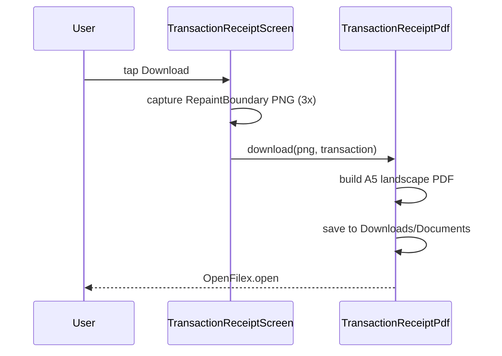

# User Investments (lib/user/investments/**)

## 1. Purpose
Investor "Investment" tab: project hero, total investment, next payment, capital allocation (paid / balance / discount), a work-progress graph per stage, recent transactions list, and printable/shareable payment receipt (PDF).

## 2. Files
| Path | Class | Role |
|---|---|---|
| investments_screen.dart | `UserInvestmentsScreen` (+ private cards) | Tab UI; static formatters `formatCurrency`, `investorCodeLabel`, `formatDate` (DD-MMM-YYYY uppercase month), `formatTransactionTime`. |
| cubit/investments_cubit.dart, investments_state.dart | `InvestmentsCubit`, `InvestmentsState` | |
| repository/investments_repository.dart | `InvestmentsRepository` | |
| model/investor_transaction_history_response_model.dart | `InvestorTransactionHistoryResponseModel` | |
| model/investor_transaction_history_data_model.dart | `InvestorTransactionHistoryDataModel` | |
| model/investor_transaction_item_model.dart | `InvestorTransactionItemModel` | |
| model/project_stage_model.dart | `ProjectStageModel` | stageId, stageName. |
| model/work_progress_graph_point_model.dart, work_progress_graph_response_model.dart | `WorkProgressGraphPointModel`, `WorkProgressGraphResponseModel` | |
| widgets/recent_transactions_section.dart | `RecentTransactionsSection` | Transaction cards. |
| widgets/work_progress_graph_card.dart | `WorkProgressGraphCard` | Stage dropdown + line chart (custom painter). |
| transaction_receipt_screen.dart | `TransactionReceiptScreen`, `TransactionReceiptDocument` | Receipt view with Share / Download. |
| utils/transaction_receipt_pdf.dart | `TransactionReceiptPdf` | PNG -> A5 landscape PDF, open/share/save. |
| utils/transaction_receipt_downloader.dart | `TransactionReceiptDownloader` | Renders receipt off-screen to PNG and saves PDF. |

## 3. Screens and widgets
`UserInvestmentsScreen` provides `InvestmentsCubit` (getIt) and calls `loadInvestments()`. Header shows investor code (`INV-` prefix added unless it already starts with INV) and an Active/Inactive chip (Inactive when `AccountBlockCubit` is `AccountBlocked`). Body (pull-to-refresh also calls `AccountStatusMonitor.refresh()`): `_ProjectHeroCard`, `_InvestmentAmountCard`, `_NextPaymentCard` (nextDueDate/nextDueAmount), `_CapitalAllocationCard` (Total Paid, Total Balance, Discount row only if > 0), `WorkProgressGraphCard`, `RecentTransactionsSection`. Shimmer while loading. Go-to-top button appears when more than 3 transactions and scrolled. Silent refresh every 5 s (also `AccountStatusMonitor.refresh()`).
`RecentTransactionsSection`: title "Recent Transactions (n)"; empty text "No transactions yet". Card: title = project name (or 'Investment'), entry no, subtitle (paymentMethod, else status, else narration), date, time, amount (`paidAmount` if > 0 else `receivedAmount`), closing balance (`pendingAmount`), download button -> `TransactionReceiptScreen`.
`WorkProgressGraphCard`: loads stages, selects first, loads graph for it; dropdown to change stage; at most the latest 6 points (sorted by date ascending, last 6 kept); y axis 0-100%; tapping a point shows a tooltip. Stale-response guard via `_graphRequestId`. Uses `getIt<InvestmentsRepository>()` directly (not a cubit).
`TransactionReceiptScreen`: A5-landscape-ratio "Provisional Project Contribution Receipt" document; Share and Download buttons; busy flags prevent double use; messages 'Receipt downloaded', 'Could not download receipt. Please try again.', 'Could not share receipt. Please try again.'.

## 4. Cubit / state
`InvestmentsState`: `InvestmentsInitial`, `InvestmentsLoading`, `InvestmentsSuccess(data)`, `InvestmentsFailure(message)`.
`loadInvestments({silent})`: non-silent emits Loading; userId from `LocalStorage` (missing -> Failure 'User not logged in'); calls repository; success heuristic (`status || code==200 || message contains success`) and `data != null` else Failure (message or 'Failed to load investment history'); silent failures keep the previous success.

## 5. Repository
| Method | HTTP | Endpoint | Request | Response |
|---|---|---|---|---|
| `getInvestorTransactionHistory(userId)` | GET | `investorTransactionHistory` `/api/Investor/InvestorTransactionHistory/{userId}` | userId in path | `InvestorTransactionHistoryResponseModel` -> `InvestorTransactionHistoryDataModel` |
| `getWorkProgressStages()` | GET | `workProgressDetails` `/api/Project/WorkProgressDetails` | none | parsed as `WorkProgressDetailsResponseModel` (home model); distinct items with stageId > 0 and non-empty stageName -> `List<ProjectStageModel>` |
| `getWorkProgressGraph(stageId)` | GET | `workProgressGraph` `/api/Project/WorkProgressGraph` | query `stageId` | `WorkProgressGraphResponseModel` -> `List<WorkProgressGraphPointModel>` |

## 6. Models
`InvestorTransactionHistoryDataModel`: userId, investorCode, fullName, profileImage, investorAddress, projectId, projectName, projectDescription, projectImage, projectSignaturePath (+ `projectSignaturePathUrl` via `resolveMediaUrl`), totalInvestmentAmount, totalPaidAmount, totalPendingAmount, nextDueDate, nextDueAmount, transactions.
`InvestorTransactionItemModel`: transactionId, userId, investorCode, fullName, date, entryNo, investmentAmount, paidAmount, receivedAmount, pendingAmount, discountAmount, status, narration, paymentMethod.
`WorkProgressGraphPointModel`: date, progress. `ProjectStageModel`: stageId, stageName. JSON keys accepted in camelCase and PascalCase.

## 7. Business rules
- Discount shown in capital allocation = sum of `discountAmount` over all transactions (client calculation).
- Receipt amount = `paidAmount > 0 ? paidAmount : receivedAmount`; amount in words via `CurrencyFormatter.amountInWords`; receipt number = `entryNo` if > 0 else `transactionId`; payment method contains "cheque"/"check" -> Cheque box ticked, otherwise method name placed in Others; investor address and project signature image shown when available ('—' otherwise).
- PDF: A5 landscape, margin 8, image of the receipt captured at pixelRatio 3. File name `Payment Receipt - {entryNo or transactionId} - {DD-MMM-YYYY}.pdf`. Android tries `/storage/emulated/0/Download` (write probe), else app documents directory; then `OpenFilex.open`. Share uses `SharePlus` with subject 'Provisional Project Contribution Receipt'.

## 8. Workflows
View investments: tab -> load -> cards. Download receipt: tap download on a transaction -> receipt screen -> Download (capture PNG, build PDF, save, open) or Share.

## 9. Navigation
In: tab 1 of `UserMainScreen`. Out: `TransactionReceiptScreen` (push, back pops).

## 10. Dependencies
`LocalStorage`, `AccountBlockCubit`, `AccountStatusMonitor`, user/home models (`WorkProgressDetailsResponseModel`), core utils (`CurrencyFormatter`, `GoToTopButton`, `ApiErrorMessage`, `AppSnackBar`, `resolveMediaUrl`), packages pdf, open_filex, share_plus, path_provider.

## 11. Unclear items
- Unclear - needs human clarification: the work-progress stages come from the global WorkProgressDetails endpoint (not per investor) - confirm intended.
- Unclear - needs human clarification: `TransactionReceiptDownloader` (off-screen download) usage was not found in the user module files inspected; may be used from elsewhere (e.g., admin).
- Unclear - needs human clarification: only one project per investor is represented (single projectId in data model).
