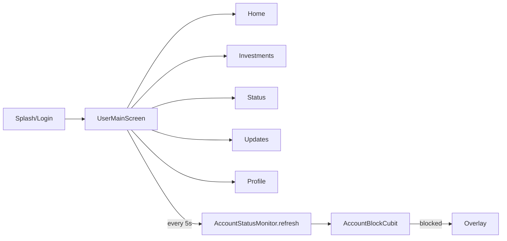

# User Navigation (lib/user/navigation/**)

## 1. Purpose
Investor app shell: five-tab bottom navigation, tab keep-alive, scroll-to-top on tab re-tap, double-back-to-exit, and a 5-second account-status poll that drives the blocked overlay.

## 2. Files
| Path | Class | Role |
|---|---|---|
| lib/user/navigation/user_main_screen.dart | `UserMainScreen` / `_UserMainScreenState` | Shell with `IndexedStack`, back handling, status polling. Static `goToTab(context, index)`. |
| lib/user/navigation/user_bottom_nav.dart | `UserBottomNav` | Bottom bar. Index constants: home 0, investment 1, status 2, updates 3, profile 4. Labels: Home, Investment, Status, Updates, Profile. |
| lib/user/navigation/tab_reselect_notifier.dart | `TabReselectNotifier`, `TabReselectScrollBinder` | Notifies when the active tab is tapped again; binder scrolls a `ScrollController` to top via `GoToTopButton.animateToTop`. |

## 3. Screens and widgets
Tabs (all built once inside `IndexedStack`, so state persists):
0 `UserHomeScreen(isActive, tabReselect)`, 1 `UserInvestmentsScreen(tabReselect)`, 2 `UserStatusScreen(isActive, tabReselect)`, 3 `UserUpdatesScreen(isActive, tabReselect)`, 4 `UserProfileScreen(tabReselect)`. `isActive` is true only when that tab is selected (used to pause/resume polling and video).

## 4. Cubit/state
None of its own. Reads `AccountBlockCubit` (`BlocBuilder`): when `AccountBlocked`, bottom nav is removed (`bottomNavigationBar: null`).

## 5. Repository
None directly. `AccountStatusMonitor.refresh()` triggers `GET /api/Investor/InvestorDetails/{userId}` (see AUTH_AND_ACCOUNT.md).

## 6. Models
None.

## 7. Business rules
- `initState`: `AccountBlockCubit.syncFromStorage()`, start `Timer.periodic(5s)` -> `AccountStatusMonitor.refresh()`, and one immediate refresh. Timer cancels itself if `AuthNavigationGuard.suppressAuthenticatedNavigation` becomes true.
- `selectTab(index)`: ignored when blocked; if same tab -> `notifyReselect()` (scroll to top); else switch and refresh account status.
- Back: `PopScope(canPop:false)`. When blocked, back does nothing. Otherwise first back shows snackbar "Press back again to exit"; second back within 2 seconds calls `SystemNavigator.pop()`.

## 8. Workflows
1. Login/splash opens `UserMainScreen` on Home.
2. User taps tabs; tapping current tab scrolls it to top.
3. Every 5 s the account status is rechecked; if blocked the overlay appears and navigation is disabled.

## 9. Navigation
In: `SplashScreen`, `LoginScreen`, `AccountBlockedOverlay` (route home arg). Out: five tab screens; `UserMainScreen.goToTab` is called by home `LatestProjectUpdates` ("view" action) to jump to the Updates tab. Logout navigates to `LoginScreen`.

## 10. Dependencies
`AccountBlockCubit`, `AccountStatusMonitor`, `AuthNavigationGuard`, `getIt`, `AppSnackBar`, `GoToTopButton`, all user tab screens.

## 11. Unclear items
- Unclear - needs human clarification: no per-tab lazy loading; all five screens (and their cubits created in their own `BlocProvider`s) are built when the shell first builds because `IndexedStack` builds all children.
