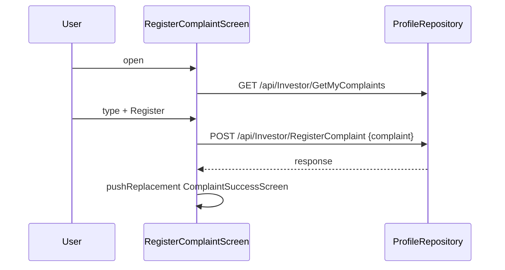
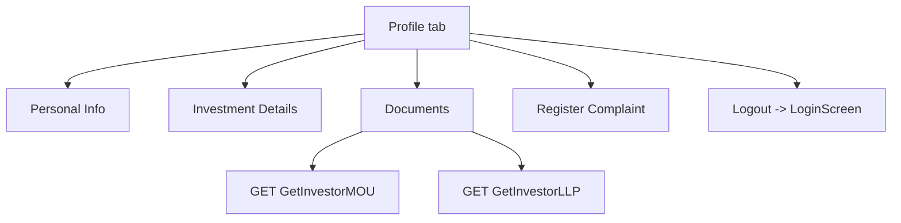

# User Profile (lib/user/profile/**)

## 1. Purpose
Investor "Profile" tab and its sub-screens: profile summary, Personal Info (with relationship managers), Investment Details (payment schedule), Documents (MOU/LLP status, ID details, bank, nominees), Register Complaint (submit + history), logout, social links.

## 2. Files
| Path | Class | Role |
|---|---|---|
| profile_screen.dart | `UserProfileScreen`, `_UserProfileView`, `_MenuTile`, `_SocialMediaRow`, `_AppVersionLabel` | Tab with menu. |
| cubit/profile_cubit.dart, profile_state.dart | `ProfileCubit`, `ProfileState` | |
| repository/profile_repository.dart | `ProfileRepository` | Investor details, complaints, MOU, LLP. |
| model/investor_details_model.dart, investor_details_response_model.dart | `InvestorDetailsModel`, `InvestorDetailsResponseModel` | |
| model/investment_due_date_model.dart | `InvestmentDueDateModel`, `InvestmentPaymentModel` | |
| model/investor_nominee_model.dart | `InvestorNomineeModel` | |
| model/staff_allocation_model.dart | `StaffAllocationModel` | |
| model/investor_mou_response_model.dart | `InvestorMouResponseModel`, `InvestorMouModel` | |
| model/investor_llp_response_model.dart | `InvestorLlpResponseModel`, `InvestorLlpModel` | |
| model/my_complaints_response_model.dart | `MyComplaintsResponseModel`, `MyComplaintModel` | |
| model/register_complaint_response_model.dart | `RegisterComplaintRequestModel`, `RegisterComplaintResponseModel`, `RegisterComplaintDataModel` | |
| screens/personal_info_screen/personal_info_screen.dart | `PersonalInfoScreen` | |
| .../widgets/personal_info_card.dart | `PersonalInfoCard` | |
| .../widgets/relationship_manager_card.dart | `RelationshipManagerCard`, `_SlideToCall` | |
| .../widgets/change_request_screen.dart | `ChangeRequestScreen` | Currently unreachable (entry button commented out). |
| screens/investment_details_screen/investment_details_screen.dart | `InvestmentDetailsScreen` | |
| .../widgets/investment_summary_section.dart | `InvestmentSummarySection` | |
| .../widgets/payment_schedule_section.dart | `PaymentScheduleSection` | |
| screens/document_screen/documents_screen.dart | `DocumentsScreen` | |
| .../widgets/legal_documentation_card.dart | `LegalDocumentationCard`, `DocumentProcessStep` | MOU/LLP timeline. |
| .../widgets/additional_information_card.dart | `AdditionalInformationCard` | Aadhaar, PAN, email, photos. |
| .../widgets/bank_details_card.dart | `BankDetailsCard` | |
| .../widgets/nominee_details_card.dart | `NomineeDetailsCard` | |
| .../widgets/document_fullscreen_image.dart | `DocumentFullscreenImage` | |
| screens/register_complaint_screen/register_complaint_screen.dart | `RegisterComplaintScreen` | |
| .../widgets/register_complaint_section.dart | `RegisterComplaintSection` | |
| .../widgets/registered_complaints_section.dart | `RegisteredComplaintsSection` | |
| .../widgets/complaint_success_screen.dart | `ComplaintSuccessScreen` | |

## 3. Screens and widgets
- Profile tab: avatar, name (or 'Investor'), investor code label (`INV - {code}` unless it starts with INV; 'Not Provided' if empty), email and phone tiles. Menu tiles: Personal Info, Investment Details, Documents, Register Complaints, Team Overview (onTap is empty - no action), Logout (red). Social icons open YouTube, WhatsApp, Instagram, website via `launchUrl(externalApplication)`. App version label. Pull to refresh -> `loadProfile()`.
- Personal Info: `PersonalInfoCard` rows Name, Email Address, Phone Number, Alternate Phone Number, Permanent Address, Description, Medical Allowance (each 'Not Provided' when empty); `RelationshipManagerCard` lists `staffAllocations` (title "Relationship Manager" or "Relationship Managers"; empty list shows one placeholder entry) with a slide-to-call control (`tel:` URI of digits and +; snackbar 'Unable to open the phone app' on failure).
- Investment Details: `InvestmentSummarySection` (name, code, avatar, Total Commitment, "Commitment completed" or "Balance: x", optional Discount, "Last Payment: amount - date", installment duration label e.g. Monthly / Every N Weeks / Daily) + `PaymentScheduleSection` cards (Completed / Partially Completed / Next Due / Pending). Silent refresh immediately and every 5 s using the passed `ProfileCubit`; go-to-top when more than 8 installments.
- Documents: pulls `getInvestorDetails` itself; refresh also refreshes MOU/LLP. Cards: Legal Documentation (MOU, LLP Registration), Additional information (Aadhaar masked into 4-4-rest groups, PAN, email, Aadhaar/PAN photos), Bank Details (Account No, IFSC Code, bank name), Nominee Details (name, relationship, phone, address, Aadhaar, PAN, photos per nominee).
- Register Complaint: multiline text field (10 lines, hint 'Text here...'), submit button enabled only when text non-empty, then `ComplaintSuccessScreen`; below, 'Registered Complaints' list with status chips.
- `ChangeRequestScreen`: text request form that just navigates to a success screen; no API call.

## 4. Cubit / state
`ProfileState`: `ProfileInitial`, `ProfileLoading`, `ProfileSuccess(details)`, `ProfileFailure(message)`.
`ProfileCubit.loadProfile({silent})`: gets userId from `LocalStorage` ('User not logged in' failure if missing); `getInvestorDetails`; success heuristic and non-null data else failure (message or 'Failed to load investor details'); silent failures keep the previous success. Documents, complaints and legal cards do not use a cubit; they call `ProfileRepository` (via `context.read`) and keep state in `StatefulWidget`s.

## 5. Repository (`ProfileRepository`)
| Method | HTTP | Endpoint | Request | Response |
|---|---|---|---|---|
| `getInvestorDetails(userId)` | GET | `investorDetails` `/api/Investor/InvestorDetails/{userId}` | path | `InvestorDetailsResponseModel` -> `InvestorDetailsModel` |
| `registerComplaint(complaint)` | POST | `registerComplaint` `/api/Investor/RegisterComplaint` | body `{ "complaint": "<text>" }` | `RegisterComplaintResponseModel` (`data`: complaintId, investorId, complaint, complaintDate, status) |
| `getMyComplaints()` | GET | `getMyComplaints` `/api/Investor/GetMyComplaints` | none | `MyComplaintsResponseModel` -> `List<MyComplaintModel>` |
| `getInvestorMou(investorId)` | GET | `getInvestorsMOU` `/api/Investor/GetInvestorMOU/{investorId}` | id replaces placeholder | `InvestorMouResponseModel` -> `List<InvestorMouModel>` |
| `getInvestorLlp(investorId)` | GET | `getInvestorsLLP` `/api/Investor/GetInvestorLLP/{investorId}` | id replaces placeholder | `InvestorLlpResponseModel` -> `List<InvestorLlpModel>` |
Errors are logged and rethrown (Dio response is logged for complaint/MOU/LLP calls). `getInvestorDetails` responses are also inspected globally for `isActive` by `AccountStatusMonitor`.

## 6. Models
- `InvestorDetailsModel`: userId, username, fullName, email, phoneNumber, alternativeNumber, staffAllocations, profileImage (+URL getter), investorCode, investorType, organization, address, aadhaarNumber, panCardNumber, aadhaarPhoto/panCardPhoto (keys also `aadhaarCardImage`/`panCardImage`), accountNumber, ifscCode, bankName, dateOfBirth, description, medicalAllowance, investmentAmount (fallback key `totalInvestmentAmount`), investmentDate, investmentAdvanceAmount, investmentSplitMonths, investmentSplitGap (default 1), investmentSplitType, totalPaidAmount, totalPendingAmount, discountAmount, lastPaymentAmount, lastPaymentDate, nominees, dueDates, isActive, createdDate, modifiedDate, userRole.
- `InvestmentDueDateModel`: installmentNumber, dueDate, installmentAmount, paidAmount, pendingAmount, status, payments (`InvestmentPaymentModel`: amount, paymentMethod). `isFullyPaid` = status 'completed'/'paid' or (pending <= 0 and paid > 0); `isPartiallyPaid` = status contains 'partial'.
- `InvestorNomineeModel`: nomineeId, nomineeName, nomineeRelationship, nomineeAddress, nomineeDateOfBirth, nomineeAadhaarNumber, nomineePanCardNumber, nomineePhoneNumber, nomineeProfilePhoto, nomineeAadhaarPhoto, nomineePanCardPhoto (many alternative key names accepted).
- `StaffAllocationModel`: staffId, staffName, staffPhoneNumber, allocationPercentage, allocatedAmount.
- `InvestorMouModel` / `InvestorLlpModel`: id, investorId, status, documentPath (+URL), createdDateTime, modifiedDateTime.
- `MyComplaintModel`: complaintId, investorId, investorCode, investorName, profileImage, complaint, complaintDate, status.

## 7. Business rules
- Payment schedule: if API `dueDates` exist they are used. An 'Advance Payment' card (status completed) is added when `investmentAdvanceAmount > 0`. Fully paid -> Completed. First non-paid installment -> Next Due, later ones Pending. Partial installments show the pending amount and per-payment lines (amount and uppercase method); a single payment shows only the method.
- If no `dueDates`, a schedule is generated client-side: valid only when commitment > 0, installmentCount > 0 and advance <= commitment; remaining = commitment - advance, base amount = remaining/count rounded to 2 decimals, last installment absorbs the rounding remainder; due dates step by frequency: Week (interval*7 days), Day (interval days), Month (calendar months, day clamped to month end). First generated installment is Next Due, rest Pending.
- Resolution of display values prefers `details` over constructor fallbacks; installment count = `investmentSplitMonths` > 0, else number of dueDates, else fallback; frequency default 'Month'; gap <= 0 -> 1; fully paid when `totalPendingAmount <= 0` (or all dueDates fully paid when pending is null).
- Documents: step derived from the most recent record (sort by createdDateTime then id, descending): status 'issued', 'completed', else pending. Document URL is the newest record that has a documentPath. Timeline: Pending / Issued / Completed (pending is shown in an error style). Image documents open in `DocumentFullscreenImage`, others open externally via `launchUrl`.
- Complaint statuses: 'viewed' -> Viewed, 'solved' -> Solved, anything else -> Pending. Complaint text is trimmed; empty is not submitted; no length limit client-side.
- Logout: confirmation dialog (`showUserLogoutConfirmDialog`), blocking spinner for at least 1 s while `LoginCubit.logout()` runs, then `pushAndRemoveUntil` to `LoginScreen(snackBarMessage: 'Logged out successfully')`.

## 8. Workflows
Register complaint: Profile -> Register Complaints -> type text -> Submit -> POST -> success screen (message from server or default) -> back; history reloaded on screen open/refresh.
View documents: Profile -> Documents -> details + MOU/LLP loaded -> tap document -> viewer.

## 9. Navigation
In: tab 4 of `UserMainScreen`. Out: PersonalInfoScreen, InvestmentDetailsScreen (shares the ProfileCubit via `BlocProvider.value`), DocumentsScreen, RegisterComplaintScreen, LoginScreen (logout), external apps (social links, phone dialer). Documents/Complaints screens read `ProfileRepository` from the `RepositoryProvider` in main.dart.

## 10. Dependencies
`LocalStorage`, `LoginCubit` (logout), auth/account (`AccountStatusMonitor` depends on this module's `getInvestorDetails`), core utils (`CurrencyFormatter`, `ApiErrorMessage`, `AppSnackBar`, `GoToTopButton`, `resolveMediaUrl`), url_launcher.

## 11. Unclear items
- Unclear - needs human clarification: Team Overview tile has an empty handler.
- Unclear - needs human clarification: `ChangeRequestScreen` is dead code (entry button commented out) and does not call any API.
- Unclear - needs human clarification: medical allowance is a free-text string ('Not Provided' fallback), format is server defined.
- Unclear - needs human clarification: staff phone numbers/percentages displayed vs hidden in the manager card were not fully reviewed.
- Hard-coded social URLs and WhatsApp number live in `profile_screen.dart` (not repeated here).
