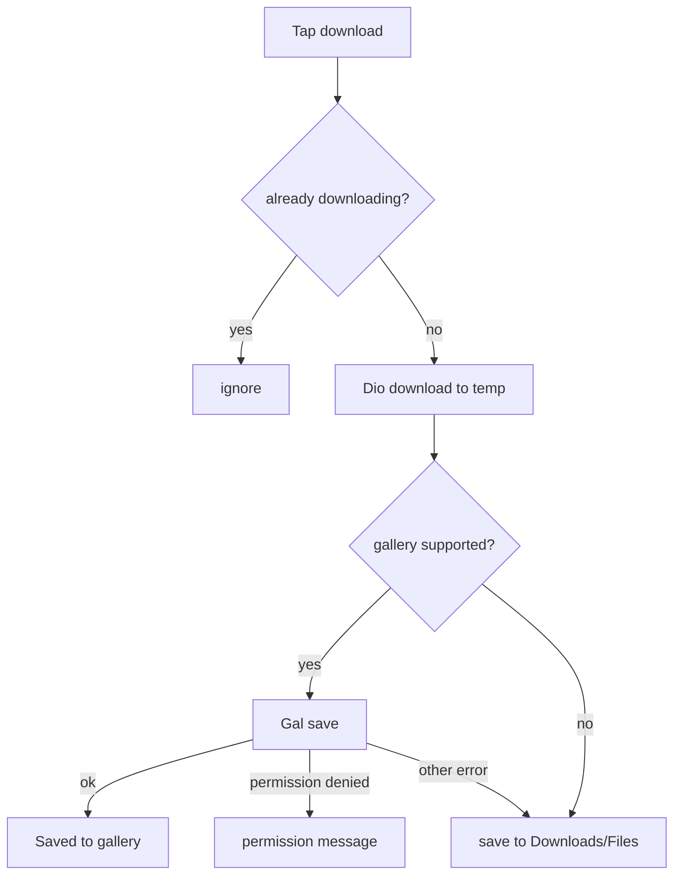

# User Status (lib/user/status/**)

## 1. Purpose
"Status" tab: a feed of admin-posted work status items (image or video with title and description) that the investor can view full screen, copy the link of, or download to gallery/files.

## 2. Files
| Path | Class | Role |
|---|---|---|
| status_screen.dart | `UserStatusScreen`, `_UserStatusView` | Tab UI, copy/download handlers. |
| cubit/status_cubit.dart, status_state.dart | `StatusCubit`, `StatusState` | |
| repository/status_repository.dart | `StatusRepository` | In-memory cache + API. |
| model/work_status_model.dart | `WorkStatusModel` | |
| model/work_status_response_model.dart | `WorkStatusResponseModel` | status, message, data list, code. |
| widgets/status_image_card.dart | `StatusImageCard` | Image card with actions. |
| widgets/status_video_card.dart | `StatusVideoCard` | Video card (uses `WorkUpdateInlineVideo`). |
| widgets/status_card_actions.dart | `StatusCardActions` | Download and View buttons (copy/share are commented out in UI). |
| utils/status_media_download.dart | `StatusMediaDownload`, `StatusMediaSaveResult`, `GalleryPermissionDeniedException` | Download + save. |

## 3. Screens and widgets
`UserStatusScreen` obtains `StatusCubit` from getIt; on create calls `loadStatuses(silent: hasCache, forceRefresh: true)` and `AccountStatusMonitor.refresh()`. `ListView` of cards; items with empty resolved URL render nothing. Video items -> `StatusVideoCard` (`isActive` pauses when tab not visible); others -> `StatusImageCard` with `onView` opening `openWorkUpdateFullscreenImage`. Retry button on failure; pull-to-refresh. Silent refresh every 5 s while tab active (force refresh). Download shows a progress snackbar with cancel.

## 4. Cubit / state
`StatusState`: `StatusInitial`, `StatusLoading`, `StatusSuccess(statuses)`, `StatusFailure(message)`. Initial state is `StatusSuccess` when the repository already has a cache.
`loadStatuses({silent, forceRefresh})`: ignored while `_isLoading`. Without forceRefresh: emits cache if present, or returns if already success. Otherwise emits Loading (unless silent) and calls `getWorkStatus(forceRefresh: forceRefresh || silent)`. Silent failures keep existing success; fallback message 'Failed to load work statuses'.

## 5. Repository
`StatusRepository.getWorkStatus({forceRefresh})`: GET `ApiEndpoints.getWorkStatus` = `/api/Project/GetWorkStatus`, no request fields. Response -> `WorkStatusResponseModel` -> `List<WorkStatusModel>`. Same success heuristic as other modules (throws only if unsuccessful and empty). Caches result in `_cachedStatuses` and precaches media through `WorkUpdateMediaCache.precache`. On error returns the cache if present, else rethrows.
(Admin-side endpoints `addWorkStatus`, `deleteWorkStatus` exist in `ApiEndpoints` but are not used by the user module.)

## 6. Models
`WorkStatusModel`: workStatusId, title, description, fileName, fileType, mimeType, googleDriveFileId, fileUrl (`resolvedFileUrl` via `resolveMediaUrl`), createdDate, createdBy, status (bool). `isVideo` = fileType 'video' or mime starts with `video/`; `isImage` = fileType 'image' or mime starts with `image/`.

## 7. Business rules
- Cards without a media URL are hidden.
- Download: not supported on web (throws). Extension resolved from URL / fileName / mimeType, default `mp4` for video and `jpg` for image. Downloads to a temp file via authenticated Dio (receive timeout 5 min), then saves to gallery (Android, iOS, macOS, Windows via `Gal`; requests access, throws `GalleryPermissionDeniedException` if denied) and falls back to Downloads/Files directory if gallery save fails. Temp file deleted afterwards. Result messages: 'Saved to gallery', 'Saved to Downloads', 'Saved to Files'; cancel -> 'Download cancelled'; permission -> 'Gallery permission is required to save media'; other -> 'Could not download media. Please try again.'
- Duplicate downloads of the same URL are ignored (`_downloadingUrls`).
- Copy link copies the media URL to the clipboard ('Link copied').
- Share handlers only show a "Share tapped" snackbar (placeholder).

## 8. Workflows
Open tab -> forced load (cache shown first if available) -> list. Download -> progress snackbar -> save -> result snackbar.

## 9. Navigation
In: tab 2 of `UserMainScreen`. Out: `WorkUpdateFullscreenImagePage` (images), fullscreen video routes from `WorkUpdateInlineVideo`.

## 10. Dependencies
user/updates (`WorkUpdateMediaCache`, `WorkUpdateInlineVideo`, fullscreen image), `AccountStatusMonitor`, `getIt<Dio>`, packages gal, cached_network_image, `AppSnackBar`.

## 11. Unclear items
- Unclear - needs human clarification: purpose of `WorkStatusModel.status` (bool) and `googleDriveFileId` for the user app (not used in UI inspected).
- Unclear - needs human clarification: Share action is a placeholder.
