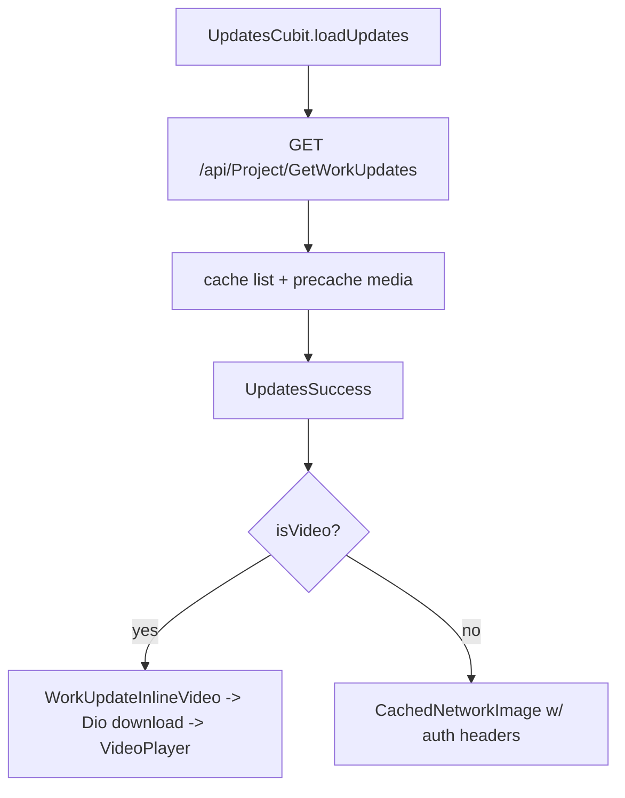

# User Updates (lib/user/updates/**)

## 1. Purpose
"Updates" tab: chronological feed of project work updates (image or video, title, description, relative upload time). Also provides shared media infrastructure (disk cache with auth headers, inline video player, fullscreen image) reused by the Status tab and Home.

## 2. Files
| Path | Class | Role |
|---|---|---|
| updates_screen.dart | `UserUpdatesScreen`, `_UserUpdatesView`, `_UpdateCard` | Tab UI. |
| cubit/updates_cubit.dart, updates_state.dart | `UpdatesCubit`, `UpdatesState` | |
| repository/updates_repository.dart | `UpdatesRepository` | Cache + API. |
| model/work_update_model.dart | `WorkUpdateModel` | |
| model/work_updates_response_model.dart | `WorkUpdatesResponseModel` | |
| utils/work_update_media_cache.dart | `WorkUpdateMediaCache`, `WorkUpdateVideoInitGate` | Cache manager, video download, precache. |
| widgets/work_update_inline_video.dart | `WorkUpdateInlineVideo` / `WorkUpdateInlineVideoState` | Inline player with controls, fullscreen. |
| widgets/work_update_fullscreen_image.dart | `WorkUpdateFullscreenImagePage`, `openWorkUpdateFullscreenImage` | Fullscreen image. |

## 3. Screens and widgets
`UserUpdatesScreen` gets `UpdatesCubit` from getIt and loads (forced/silent depending on cache). `ListView` of `_UpdateCard` (title, description, uploaded label, media). Images use `CachedNetworkImage` with `WorkUpdateMediaCache.manager`; videos use `WorkUpdateInlineVideo` (play/pause, replay, seek slider, mute, controls auto-hide after 3 s, fullscreen, retry; Windows has a dedicated fullscreen path). Retry on failure, pull-to-refresh, go-to-top button, silent refresh every 5 s while tab is active.

## 4. Cubit / state
`UpdatesState`: `UpdatesInitial`, `UpdatesLoading`, `UpdatesSuccess(updates)`, `UpdatesFailure(message)`. Initial state is success when repository cache exists.
`loadUpdates({silent, forceRefresh})`: identical logic to `StatusCubit.loadStatuses` (guard `_isLoading`; non-forced uses cache; silent failures keep data; fallback 'Failed to load work updates').

## 5. Repository
`UpdatesRepository.getWorkUpdates({forceRefresh})`: GET `ApiEndpoints.getWorkUpdates` = `/api/Project/GetWorkUpdates`, no request fields. Response -> `WorkUpdatesResponseModel` -> `List<WorkUpdateModel>`. Success heuristic as elsewhere. Caches list; precaches media (`WorkUpdateMediaCache.precache`). On Dio/other error returns cached list if present else rethrows. Also used by `HomeCubit` (always `forceRefresh:true`).
(Admin endpoints `workUpdate`, `deleteWorkUpdate` are not used here.)

## 6. Models
`WorkUpdateModel`: workUpdateId, title, description, fileName, fileType, mimeType, googleDriveFileId, fileUrl (`resolvedFileUrl`), createdDate, createdBy, status (bool).
- `isVideo`: mime `image/` -> false; mime `video/` -> true; else fileType contains image/video; else file extension in mp4, mov, webm, mkv, avi, m4v.
- `isImage`: mirror logic with extensions jpg, jpeg, png, gif, webp, bmp.
- `uploadedLabel`: relative text (minutes/hours ago, else formatted date with time; format DD-MMM style with 12-hour time).

## 7. Business rules
- Media requests carry `Authorization: Bearer <token>` (`WorkUpdateMediaCache.authHeaders`) because media URLs are protected.
- Cache: `CacheManager('workUpdateMediaCache')`, stale period 7 days, max 80 objects. Videos are downloaded with Dio to a file with a playable extension, validated by header sniffing (`_isLikelyValidVideoFile`), with in-flight dedupe per URL; one automatic retry that drops a bad cached file. `WorkUpdateVideoInitGate` serializes player initialisation.
- Receive timeout for video download 5 min, send 2 min.

## 8. Workflows
Open tab -> load -> cards; scroll -> images stream from cache, videos download then play; tap image -> fullscreen; tap fullscreen on video -> fullscreen player.

## 9. Navigation
In: tab 3 of `UserMainScreen`; `LatestProjectUpdates` on Home calls `goToTab(3)`. Out: fullscreen image and video pages.

## 10. Dependencies
`getIt<Dio>`, `LocalStorage` (token), `AccountStatusMonitor`, `GoToTopButton`, packages cached_network_image, flutter_cache_manager, video_player (and a Windows-specific player path); consumed by user/home and user/status.

## 11. Unclear items
- Unclear - needs human clarification: `WorkUpdateModel.status` meaning (published/active flag?) - not filtered client-side.
- Unclear - needs human clarification: the Windows fullscreen implementation details in `work_update_inline_video.dart` (1350 lines) were only skimmed.
